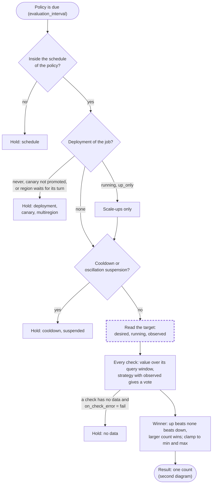
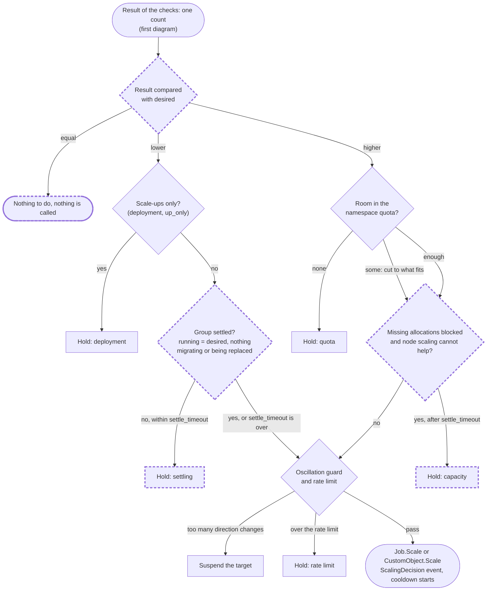
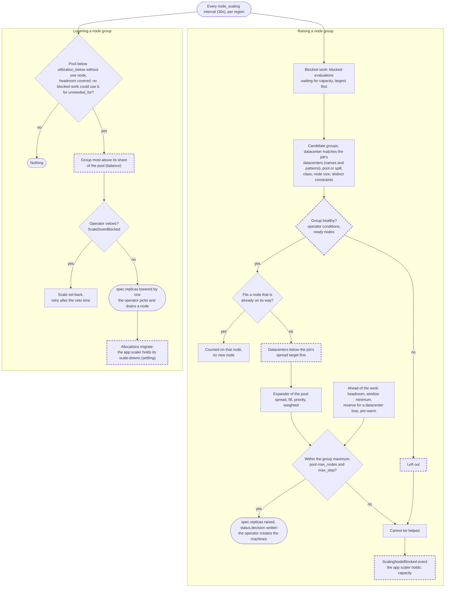

<!--
SPDX-FileCopyrightText: 2026 Norca contributors
SPDX-License-Identifier: MPL-2.0
-->

# Horizontal Autoscaling on Application Metrics

**Status:** decided design, 2026-11-12. The fixes of the built scalers are built on branches (the table in section 14 says what and where; not merged); one question is open (Q30). The application metrics are not built. It merges what is built
(the built-in autoscaler, the usage pipeline, the metrics store, custom object scaling) with what is
to build: first the fixes of the built scalers (sections 7.5 and 8), then the application metrics,
the operator-reported metrics and the backlog strategy. Section 12 is the build order, section 13
the decisions. The code findings behind the fixes are in
[application-scaling-review-report.md](application-scaling-review-report.md). A second review of
node scaling by datacenter and region (2026-11-12, section 8.6) added the problems P15–P22; their
fixes are decided too (D19–D26).

Scope: horizontal scaling of task groups and custom objects on the leader's built-in autoscaler.
Node scaling (`NodeGroup`) uses the same engine and is described in the cluster scaling plan; it
appears here only where it shares a part.

---

## 1. Summary

A task group (or a custom object) scales on **what the application is doing**, not only on its CPU
and memory: requests in flight, a queue's backlog, a consumer's lag, or a state that only the
application's operator knows. No external metrics system is needed: the values travel on the
usage report the clients already send, and the decision is made by the autoscaler that already runs
on the leader, with all of its safeguards.

Two ways bring an application's state into a scaling decision:

| Way | Who measures | What it is for | Status |
| --- | --- | --- | --- |
| **Task metrics** | the client, from each allocation (a loopback endpoint, later a file) | per-instance load: in-flight requests, sessions, local queue | to build |
| **Operator-reported metrics** | an operator (controller) through the API | state outside the allocations or across them: a shared queue, replication lag, a database's own view; also works at zero allocations | to build |

Whatever the source, a check names a metric, a strategy turns its value into a count, and the
existing pipeline applies min/max, cooldowns, the oscillation guard, the deployment gate, the quota
ceiling and the rate limit before it writes the count. **The decision is always the policy's**: an
operator reports, it does not decide the count (decided 2026-11-12, section 5).

Before these are built, the decision path of the built scaler is corrected (section 7.5): it has
defects that show whenever a group is not fully running (allocations starting, waiting for
capacity, migrating), and scaling on application metrics, from zero in particular, would meet them
on every step.

---

## 2. Where Each Part Comes From

| Area | Comes from (finished feature / design) | Code | Status |
| --- | --- | --- | --- |
| Policy engine on the leader: policy watch, workers, evaluation interval | Built-in autoscaler (`scheduling-autoscaling-and-disruption.md` §4) | `norca/norca/autoscaler/{autoscaler,policies,processor,evaluator}.go` | built |
| Policy syntax in the jobspec (`scaling { policy { check {...} } }`, `metric =` shorthand, `query_window`, `on_check_error`, `schedule`) | Built-in autoscaler | `autoscaler/parser.go`, `admission.go`, `schedule.go` | built |
| Strategies `target-value`, `threshold`, `fixed-value`, `pass-through` | Built-in autoscaler | `autoscaler/plugins/strategy/*` | built |
| Multi-check winner (up beats none beats down) | Built-in autoscaler | `evaluator.go` (`sdk.PreemptScalingAction`) | built |
| Cooldowns from the scaling events (survive a leader change; any count change counts, also one made by hand or by an operator) | Built-in autoscaler | `autoscaler/target.go` (`cooldownUntil`) | built |
| Oscillation guard (only the autoscaler's own direction changes count) | Built-in autoscaler | `target.go` (`recentDirections`), `executor.go` | built |
| Deployment gate `scale_during_deployment = "never" \| "up_only"` | Built-in autoscaler | `structs/scaling_check.go`, `evaluator.go` | built |
| Quota ceiling, event `ScalingQuotaCapped` | Built-in autoscaler + quotas (`admission-control-and-quotas.md`) | `autoscaler/coordination.go` (`capAtQuota`) | built |
| Rate limit of scaling actions, dry run | Built-in autoscaler | `executor.go`, `config.go` | built |
| Client usage collection per task group (1s samples, 10s windows) | Built-in autoscaler | `client/taskgroup_usage.go`, `client/allocrunner/taskgroup_usage.go` | built |
| Transport of the usage report: system bus `norca.telemetry.<region>.<node_id>`, RPC piggyback as fallback | Embedded system bus (`embedded-nats-system-bus.md`) + metrics store (`internal-metrics-storage-tstorage.md` §1.1) | `norca/norca/bus_telemetry.go`, `autoscaler_usage.go` | built |
| Report sender is the node that hosts the allocations (node identity checked) | Built-in autoscaler, system bus | `autoscaler_usage.go`, bus permissions | built |
| Leader ring buffer (30 buckets over `metrics_window`) | Built-in autoscaler | `autoscaler/metrics.go` | built |
| Long windows (`query_window` beyond `metrics_window`) and warmup after a leader change | Metrics store phases 4c–4f | `usage_apm.go` (`fromHistory`), `bus_telemetry.go` (`seedAutoscalerUsage`) | built |
| Stored history of every series on every server, retention 1h–30d | Metrics store (`internal-metrics-storage-tstorage.md`, `metric-storage-update.md`) | `norca/norca/metricsstore` | built |
| Source of task group usage (`nomad.cpu`, `nomad.memory`, ..., `taskgroup_<op>_<metric>`, `/<group>/<job>@<namespace>` suffix for another group) | Built-in autoscaler | `autoscaler/usage_apm.go` | built |
| Source `norca` of the cluster gauges (`cluster.cpu_allocated?dc=..&pool=..&op=max`) | Node scaling phase 0 | `autoscaler/cluster_apm.go` | built |
| Plugin-based scaling: `engine = "external"` policies for an external autoscaler process, external APM/strategy plugin binaries in `plugin_dir`, the Prometheus APM plugin | Built-in autoscaler | `autoscaler/policies.go` (`isBuiltinPolicy`), `plugins.go`, `plugins/external`, `plugins/apm/prometheus` | built; **kept and must keep working** (decided 2026-11-12); never used by a Norca feature itself |
| Custom object target: a policy writes the object's scale subresource; the controller derives the group count | Operator framework (`custom-objects-and-operator-framework.md` §2.4, §4.5) | `autoscaler/target_object.go`, `executor_object.go`, `CustomObject.Scale` | built |
| Operators keep the autoscaler's counts when they re-register child jobs | Operator framework | `controller/lifecycle.go` (`PreserveScaledCounts`) | built |
| `NodeGroup` target, `status.decision` | Cluster scaling plan | `autoscaler/nodegroup_policy.go`, `demand*.go` | built |
| Precedent for extending the usage report (node host part, CSI volume usage) | Metrics store phase 2, CSI completion | `structs/autoscaler_usage.go` (`Host`, `Volumes`) | built |
| Reading a file of the allocation without following links (`os.OpenRoot`) | Secret delivery | `client/allocrunner/taskrunner/secret_hook.go` | built (pattern to reuse) |
| Envoy sidecar of mTLS services | mTLS design | `client/mtlsproxy`, `taskrunner/mtls_envoy_hook.go` | built, **without an admin/stats endpoint** |
| Task metrics: `metrics` block, client scrape, `Custom` values in the report, ring buffer and store series | this document §4.3, `metric-storage-update.md` §8.1 (family 2) | — | **to build** |
| Operator-reported metrics | this document §5.1 | — | **to build** |
| `backlog` strategy | this document §7.2 | — | **to build** |
| Decision model (`desired` / `running` / `observed`, settle rule), no-change scaling, counts kept on register, evaluation status | this document §7.5, §8.4, §10; `application-scaling-review-report.md` | — | **to build, first** |
| Node scaling fixes: health filter, spread first, balance-aware scale-down, capacity link | this document §8.4 | — | **to build** |
| Sidecar (Envoy) and network metrics per allocation | this document §4.5 | — | out of the plan until asked; prerequisites missing |

---

## 3. Data Path

```
 ALLOCATION                    CLIENT NODE                         EVERY SERVER                LEADER
 ----------                    -----------                         ------------                ------
 cgroup stats ─────────────┐
 loopback /metrics (new) ──┼─► TaskGroupUsageAggregator ─► usage report ─► JetStream ─► metrics store
 metrics.json (new, later)─┘   (avg/max per group,          (bus; RPC        stream      (norca.group.*)
                               Custom values: new)           fallback)          │
                                                                                └────────► ring buffer ─┐
 OPERATOR (new)                                                                            (window)     │
 Metrics.Report ─► any server ─► published on the telemetry stream (same path as above) ───────────────┤
                                                                                                        ▼
                                          sources: group usage │ app values │ reported values │ cluster gauges
                                                                                                        │
                                          check ─► strategy ─► winner ─► deployment gate ─► min/max ─► quota cap
                                          ─► cooldown / oscillation ─► rate limit ─► Job.Scale | CustomObject.Scale
```

The new parts reuse the path: task metrics ride in the same report, operator-reported values are
published on the same stream by the server that receives them, so every server stores them and the
leader's ring buffer gets them like any other usage. Nothing about metrics is written to Raft; the
only Raft writes are the scaling actions and their events, as today.

---

## 4. Metric Sources

### 4.1 Task group resource usage (built)

| Check metric today | Store series | Value |
| --- | --- | --- |
| `nomad.cpu` | `norca.group.cpu` | CPU used, % of the allocated CPU |
| `nomad.memory` | `norca.group.memory` | memory used, % of the allocated memory |
| `nomad.cpu_mhz` | `norca.group.cpu_mhz` | CPU used, MHz |
| `nomad.memory_mb` | `norca.group.memory_mb` | memory used, MiB |

Also accepted: `taskgroup_<avg|max|sum>_<cpu-allocated|memory-allocated|memory>`; `sum` is the
average times the running allocations. A query can name another group with the suffix
`/<group>/<job>@<namespace>`.

All of these stay as they are (the plugin-based scaling uses them, section 13).

**New names, added next to them** (decided): a check can name every group series of the store
without the `norca.` prefix: `group.cpu`, `group.memory`, `group.cpu_mhz`, `group.memory_mb`, and
those no check could read so far, `group.cpu_throttled`, `group.memory_cache_mb`,
`group.oom_kills`, `group.allocs_running`, `group.allocs_queued`; the application values are
`group.app.<name>` and `group.reported.<name>`. For the policy's own group the short forms
`app.<name>` and `reported.<name>` are enough. The `/<group>/<job>@<namespace>` suffix works for
all of them.

### 4.2 Cluster gauges (built)

Source `norca`, query `cluster.<gauge>?dc=&pool=&class=&op=max`. Used by node scaling; a task
group policy can read them too (e.g. hold a scale-up when the pool is full).

### 4.3 Task metrics from a loopback endpoint (to build)

The group declares which values it exposes; the client reads only those.

```hcl
group "api" {
  network {
    mode = "bridge"
    port "http" { to = 8080 }
  }

  metrics {
    port     = "http"          # a port label of the group
    path     = "/metrics"      # default
    format   = "prometheus"    # or "json"
    interval = "10s"           # default: the report interval
    include  = ["http_requests_in_flight", "checkout_queue"]
  }
}
```

Rules:

- **Allowlist only.** At most 16 names per group; a name is `[a-z0-9_]{1,64}`. Lines of other
  names are skipped without being parsed further.
- **Types.** Gauges are taken as they are; a counter becomes its increase per second between two
  reads (a decrease is a restart: no value for that read). Histograms and summaries are ignored.
  Several series of one name (different labels) are summed.
- **Where the client connects.** The allocation's own address and the port's `to` value in bridge
  mode, the host address and the port in host mode; never another allocation's address.
- **Limits.** Timeout 2s, body at most 64 KiB, one read per allocation per interval, no redirects.
  A failed read gives no value for that allocation (not zero).
- **Aggregation.** Like the resource usage: average and maximum over the allocation samples of the
  window, weighted by samples. Each name has its own sample count, because an application may
  report fewer samples than the cgroup (it starts later, a read fails).
- **Check metric name:** `app.<name>` (4.1). Store series: `norca.group.app.<name>`
  (`.avg`/`.max`), labels `ns`, `job`, `group`; it counts toward `max_series` (2 per name).

JSON format: a flat object of numbers, `{"checkout_queue": 180, "http_requests_in_flight": 42}`.
Both formats are in the first step (decided).

### 4.4 Task metrics from a file (later)

For tasks without an HTTP server (batch workers, queue consumers): the task writes
`$NORCA_ALLOC_DIR/tmp/metrics.json` (flat JSON object of numbers, at most 4 KiB) and replaces it
atomically. The client reads it with `os.OpenRoot` on the allocation directory (no link is
followed), skips it when it has not changed for two intervals (stale), and applies the same
allowlist (`metrics { file = true  include = [...] }`). Same names, same series as 4.3.

### 4.5 Sidecar and network metrics (out of the plan until asked)

Decided 2026-11-12: not built until a user asks. What it would take, for the record:

- **Envoy sidecar** (`mode = "sidecar"`): requests per second, active requests and the p99 time are
  in Envoy's statistics, but the generated bootstrap has no admin endpoint today. Building it means:
  an admin listener on a Unix socket in the allocation directory (never TCP), the client reads the
  few counters it needs, the names `proxy.rps`, `proxy.inflight`, `proxy.p99_ms`.
- **Network per allocation:** bytes and connections are only measurable for bridge mode (the
  allocation's network namespace); host mode has no per-allocation counters. Noted as "not
  available at the source" in `metric-storage-update.md`.

**Dropped:** the health check header (`X-Norca-Load`) of the earlier draft. Only checks run by the
Norca client could carry it, not checks run by Consul, and the scrape covers the same need.

### 4.6 External sources (built, optional)

The Prometheus APM plugin, the external plugin binaries and the external engine stay and keep
working when they are configured (decided 2026-11-12, section 13). No Norca feature reads them; the
built-in sources always work without them. A built-in check may use an external strategy plugin
with any of the new metrics, since the source and the strategy are independent.

---

## 5. Operator-Driven Scaling on the Application's Internal State

An operator (a controller built with the controller SDK, running as a job with its workload
identity) often knows what the allocations cannot report alone: the length of a shared queue, the
lag of a consumer group, a database's replication delay, the number of tenants on a shard.

**Norca supports one way for an operator to bring this state into scaling: the operator reports it
as metrics, and a scaling policy decides (5.1)** (decided 2026-11-12). Every safeguard applies
(min/max, quota ceiling, deployment gate, cooldowns, oscillation guard, rate limit), it works at zero
allocations, and the decision is visible in one place (check values, store series, `ScalingDecision`
events).

Not supported as patterns (decided 2026-11-12):

- **The operator decides the count and scales directly** with `Job.Scale` or the object's scale
  subresource. Such a change skips the quota ceiling, the deployment gate, the oscillation guard and
  the rate limit, and splits the decision between the operator and the policies.
- **The operator reports the count it wants** and a `pass-through` check hands it on: the same split,
  in disguise.

An operator that has to do steps around a count change (a database replica that joins, a shard that
rebalances) gets the count from a policy on its custom object (5.2) and does the steps itself; the
count is still the policy's decision.

### 5.1 Reported metrics (to build)

**API.** `Metrics.Report` (RPC), `PUT /v1/metrics/report`, `api.Metrics().Report(...)`, and in the
controller SDK `ReportMetrics(ctx, target, values)`.

```json
{
  "Namespace": "prod",
  "Target": { "Job": "orders", "Group": "worker" },
  "Values": { "queue_depth": 1240, "consumer_lag_seconds": 14.2 }
}
```

A target is a task group (`Job` + `Group`) or a custom object (`Object`: `"<group>/<Kind>/<name>"`;
decided, built with the `backlog` step).

**Path.** The receiving server checks the token, the target and the limits, then publishes the
values on the telemetry stream (subject `norca.telemetry.<region>.reported`, written only by
servers). From there they take the same way as the client reports: every server stores them, the
leader puts them in the ring buffer. No forwarding to the leader is needed and a leader change loses
nothing.

**Meaning of a value.** A gauge: the state at the time of the report. In a bucket the values of the
same name are averaged (avg) and their maximum kept (max), like the other values. A value is valid
for its `ttl` (default 3 × the policy's evaluation interval, at most `metrics_window`); a check whose
metric has no valid value fails like any check without data, and `on_check_error` decides
(`fail`: no scaling; `ignore`: the other checks decide).

**Names.** `reported.<name>` in checks (4.1), store series
`norca.group.reported.<name>` (or `norca.object.reported.<name>` for an object target). Same name
rule and the same limit of 16 names per target as task metrics; separate from the `app.` names, so
the origin of a value is never in doubt.

**Access.** A new namespace capability `submit-metrics` (decided: a reporter must not be able to
scale, so `scale-job` is not reused), part of the `write` policy.
For an object target the token also needs `read` on the object's kind. The rate limit per token of
the receiving server (built in the edge checks) applies; in addition at most one report per target
per second is accepted (`429` with `Retry-After` above it).

**Checks.** No new check syntax:

```hcl
group "worker" {
  count = 0

  scaling {
    min = 0
    max = 50

    policy {
      cooldown             = "5m"
      cooldown_on_scale_up = "15s"

      check "backlog" {
        metric = "reported.queue_depth"
        strategy "backlog" {
          target = 100            # items one worker can carry
        }
      }
    }
  }
  ...
}
```

The operator reports `queue_depth` for `orders/worker` every 10s from the queue's own API; the
group scales from 0 to `ceil(1240 / 100) = 13`, and back to 0 when the queue is empty.

### 5.2 Policy on a custom object (built)

A policy of a task group can scale a custom object instead of the group:

```hcl
scaling {
  min = 1
  max = 7
  policy {
    target "custom-object" {
      kind = "db.example.com/PostgresCluster"
      name = "billing"
    }
    check "lag" {
      metric = "reported.replication_lag_seconds"
      strategy "target-value" { target = 5 }
    }
  }
}
```

The decision goes to the object's scale subresource; the operator derives the group count (and does
any join or rebalance steps) from it. Cooldown and oscillation come from the object's event log. Today
the checks of such a policy read the metrics of the policy's task group; with 5.1 they also read the
values reported for the object itself (decided).

### 5.3 Other writers of a count (built)

The scale APIs stay as they are, for people and for the plugin-based scaling (section 13):

- `Job.Scale` (`PUT /v1/job/<id>/scale`, capability `scale-job`): `norca job scale` by hand, and the
  external engine's autoscaler process. The count must be inside the group's scaling `min`/`max`.
  The change is a scaling event; the built-in autoscaler treats it as the last scaling (its cooldown
  starts), but not as its own direction change (no oscillation count).
- `CustomObject.Scale` (`PUT /v1/object/<group>/<kind>/<name>/scale`, object write): `norca object
  scale` by hand and the built-in autoscaler; it writes the kind's `scale.specPath`, adds a `Scaled`
  event, and bypasses `managed_by`.
- An operator that registers child jobs keeps the counts with `PreserveScaledCounts`, whoever set
  them.

A hand-made change on a target of an enabled built-in policy is undone by the next evaluation once
the cooldown ends. It is **allowed, not refused** (decided): refusing would break emergency use and
need a list of exceptions. The reply carries a warning and the policy's status shows it (section
10). The external engine is not concerned: it acts only on its own policies.

One change to `Job.Scale` itself (8.4): a call with an unchanged count succeeds without registering
the job again.

---

## 6. Data Structures

### 6.1 Usage report

```go
type TaskGroupUsage struct {
	// ... existing fields (Allocs, Samples, CPU*, Memory*, CPUThrottledPercent, OOMKills)

	// App holds the task metrics of the group (section 4.3, 4.4): at most
	// MaxAppMetricsPerGroup names, each with its own sample count.
	App map[string]AppUsageValue `json:",omitempty"`
}

type AppUsageValue struct {
	Avg     float64
	Max     float64
	Samples int
}

const (
	MaxAppMetricsPerGroup = 16
	MaxAppMetricNameLen   = 64
)
```

Reported values (5.1) travel in a separate message type on the server-only subject, with the
target, the name, the value, the report time and the `ttl`.

### 6.2 Ring buffer

Each tracked group keeps its four resource values in the existing `[30]usageBucket`; app and
reported values get a ring of their own per name (`[30]valueBucket{start, weight, sum, max}`),
created on the first value and dropped with the group. Bound: 16 app + 16 reported names per group,
on top of the existing `maxUsageGroups = 100_000`. Memory per name: 30 × 32 bytes.

### 6.3 Store

| Series | Labels | From |
| --- | --- | --- |
| `norca.group.app.<name>.avg` / `.max` | `ns`, `job`, `group` | task metrics |
| `norca.group.reported.<name>` | `ns`, `job`, `group` | operator reports |
| `norca.object.reported.<name>` | `ns`, `kind`, `name` | operator reports on an object |

All count toward `max_series`; a group or object that is gone is forgotten after the retention like
the other series. The long-window queries and the warmup seeding work for them as for the resource
values.

---

## 7. Scaling Math

### 7.1 Per-instance values: `target-value` (built)

For a value that adding instances spreads (in-flight requests, sessions, CPU):
`new = ceil(count × value / target)`, no change inside the `threshold` band (default 0.01),
`max_scale_up` / `max_scale_down` cap the step. At count 0 the new count is `ceil(value / target)`.

Example: 4 instances at 75 in-flight requests on average, target 50: `ceil(4 × 75 / 50) = 6`; with 6
instances the average falls to 50 and the count stays.

### 7.2 Shared backlog: `backlog` strategy (to build)

For a value that every instance sees whole (a shared queue's length, a consumer group's lag),
`target-value` overshoots: at count 2 and a queue of 1000 with target 100 it asks for 20, then at
count 20 and a queue of 900 for 180. The `backlog` strategy divides the backlog itself:

```
new = ceil(value / target)            (for any count, including 0)
direction: up   if new > desired
           down if new < desired and value / (desired × target) < 1 − threshold
```

`desired` is the group's `count` (7.5). Its own strategy, not an option of `target-value` (decided:
the formula and the direction rule differ). Options: `target` (required, > 0), `threshold`
(default 0.1), `max_scale_up`, `max_scale_down`.
With `min = 0` the group empties when the backlog is 0 and wakes up on the first item.

Where the value comes from: a reported value (5.1, the usual case: the operator asks the queue), or a
task metric that every worker reports the same way (then the average is the backlog), or another
group's metric through the `/<group>/<job>@<namespace>` suffix (a producer group that is always
running).

### 7.3 Several checks (built)

Every check votes; **up beats none, none beats down**, and among the same direction the larger
count wins. A scale-down therefore happens only when every check wants it. An app check and a CPU
safety check side by side are the normal pattern.

### 7.4 Order of the safeguards (built; changes of 7.5 marked)

1. Schedule (if the policy has `schedule`): outside its window the policy is not evaluated.
2. Target ready; deployment gate: during a deployment `never` skips the evaluation, `up_only`
   lets only scale-ups through, and nothing while a canary waits for promotion. (*Change:* the
   default becomes `up_only` for built-in engine policies, 8.4.)
3. Cooldown (from the last scaling event of the target, whoever made it) and oscillation suspension
   (3 direction changes in 10m suspend for 15m by default): the evaluation is skipped.
4. Checks and strategies; a check without data follows `on_check_error`.
5. Winner (7.3), clamped to `min`/`max`. (*Change:* compared with `desired`; the settle rule holds
   scale-downs, 7.5.)
6. Quota ceiling: a scale-up is cut to what the namespace quota still allows (`ScalingQuotaCapped`).
7. Rate limit (10 actions/s, burst 50, cluster-wide).
8. `Job.Scale` or `CustomObject.Scale` with the autoscaler's identity; `ScalingDecision` event.

Every step that stops an evaluation is recorded in the policy's evaluation status (section 10).

### 7.5 Decision model (to build, first)

Today the evaluator has one number for a target, the running allocations, and uses it as the
population the measured value belongs to, as what was already asked for, and as the base of the
direction. These are equal only when the group is at rest; the problems P2, P3, P11–P13 of section
8.3 are what happens when they are not. The target status gets three numbers:

| Number | Meaning | From |
| --- | --- | --- |
| `desired` | what was asked for | the group's `count`; for an object target the scale subresource's spec value |
| `running` | what runs now | the running, non-canary allocations (as today) |
| `observed` | the population the value was measured on | the average number of running allocations over the check's query window, from the task states of the group's allocations in the state store (when each started and finished; windows up to 15m); `running` for sources outside the usage pipeline, for instant queries and for longer windows |

Rules:

1. **The value is restated for the desired count, and the strategy runs with `desired`.** A value
   per instance that was measured on `observed` instances is what `desired` instances would show
   for the same load: `value × observed / desired`. With it `target-value` gives
   `ceil(observed × value / target)`, the average total load divided by the target, whatever
   happened to the population inside the window, and every strategy compares with what was asked
   for. The strategy interface is unchanged: built-in strategies and external strategy plugins get
   the same exact values.

   Values that are not per instance of the target are used as they are: a `sum` query, the usage
   of another task group, the cluster gauges read by a task group policy, a `pass-through` value,
   `fixed-value`. A value per instance with no running instance to lay it on votes for no change.
2. **A change is needed when the result differs from `desired`,** and the direction is the sign of
   that difference. Nothing is called when nothing changes.
3. **Settle rule: no scale-down while the group is not settled.** Not settled means
   `running < desired`, or allocations of the group are migrating or being replaced (a drain, a
   lost node). The hold lasts at most `settle_timeout` (default 10m); after it, the capacity link
   of 8.4 applies.
4. **Scale-up while not settled is allowed** when the result is above `desired`: the formula already
   counts on the allocations that are on their way, so a larger result means the load needs more
   than what was asked.

Why a rule biased against scaling down: a late scale-down costs some capacity for minutes; a wrong
one during a recovery costs an outage. Why no hold on scale-ups: with `observed` the formula is
right while allocations are on their way, and waiting for nodes to join would turn a capacity
problem into a latency problem.

Example (a drain during steady load): 6 instances at 50 in-flight requests each, target 50. One
node is drained, 2 allocations stop, the other 4 carry 75 each. 30s later a check with a 1m window
sees a sample-weighted average value of 60 on an average of 5 running: `ceil(5 × 60 / 50) = 6`,
equal to `desired`: nothing to do, and the two replacements start in peace. Today the same check
multiplies the 60 with the 4 that run at that instant, gets 5, calls it "up" (5 > 4), and
`Job.Scale(5)` lowers the group's count from 6 to 5 in the middle of the drain.

### 7.6 The decision flow of a policy (diagrams)

One evaluation of a built-in policy, as it will be after the fixes of 7.5 and 8.4, in two parts.
Dashed boxes are new; the others are built. Every end of the flow, a hold, "nothing to do" or a
scaling action, is written into the policy's evaluation status (section 10), and a hold that lasts
longer than `hold_warn` writes a `ScalingHeld` event.

**Part 1: gates and measuring.** The three gates (schedule, deployment, cooldown) stop an
evaluation before anything is measured; then the checks turn the measured values into one result.



**Part 2: decision and action.** The two directions are treated differently on purpose: a lower
result waits until the group is settled, a higher result is only limited by what can be had
(quota, capacity).



---

## 8. Datacenters, Regions and Node Scaling

This section describes the datacenter and region side of scaling as it is built, how the task group
scaler (called the *app scaler* below) and the node scaler depend on each other, the problems found
in the code on 2026-11-12 (8.3) and the fixes decided for them (8.4).

### 8.1 How it works today (built)

**Region.** Every region has its own leader and its own autoscaler. Policies, scaling events, the
usage window, the metrics store, namespace quotas and the `NodeGroup` / `NodeProvider` objects are
all per region; nothing is replicated across regions. A check cannot read a value of another region.

**Multiregion jobs.** A job with a `multiregion` block is registered in every region it lists; the
submitting region interpolates the region's `count`, `datacenters`, `node_pool` and `meta`
(`structs.MultiregionRegion`) and registers the result there. The deployment watchers coordinate the
rollout across regions. After that each region's autoscaler scales its own copy of the job on its
own; there is no common count or common maximum.

**Datacenter.** A task group has **one count for all of its `datacenters`**. Where an allocation goes
is the scheduler's choice: `datacenters` and the node pool are hard limits, `spread` on
`${node.datacenter}` and affinities are scores, `distinct_property` on the datacenter is a hard cap.
The usage of a group is aggregated over every node that runs it; the datacenter of the reporting
node is not kept (store labels `ns`, `job`, `group` only).

**What the app scaler counts.** The current count of a target is the number of **running,
non-canary** allocations of the group (`readTarget`, same rule as `Job.ScaleStatus`), not the
group's `count`. Allocations that are placed but not running yet, blocked by missing capacity, or
being migrated are not counted.

**Node scaling** (cluster scaling plan, built in phases 0–4):

- A `NodeGroup` is pool × datacenter [× class]; its `spec.replicas` is written by the same
  autoscaler, the `norca-nodescaler` operator creates and removes the machines.
- **Blocked work trigger** (`demand.go`): the blocked evaluations of the leader are packed into
  virtual nodes of the groups that could take the work (the job's datacenters and pool, the class
  constraint, `distinct_hosts`, static ports, `distinct_property` on dc/pool, `spill`); which group
  of a pool grows is the pool's **expander**: `spread` (default: fewest projected nodes), `fill`,
  `priority`, `weighted`. Nodes on their way are counted, so the same work is not asked for twice.
  Pool limits `max_nodes`, `max_step`. Not held by the group's cooldown.
- **Ahead-of-time checks** (allocated share, headroom) on the cluster gauges, held by the cooldown.
- **Scale down** (`scaledown.go`): only by the group's `scale_down` block, one node per pool at a
  time, the largest group first (keeps the datacenters even), when no blocked work could use the
  group, its allocated share without one node is below `utilization_below`, the headroom is still
  covered, `delay_after_add` has passed, and the operator does not veto (`ScaleDownBlocked`).
  The operator drains the node it picks.
- Schedule windows on a group's `min`/`max`; rolling replacement and node age also drain nodes.

### 8.2 How the two scalers depend on each other

```
 load rises
   │
   ▼
 app check (every evaluation_interval, 10s) ── count from RUNNING allocs ──► Job.Scale(count ↑)
   │
   ▼
 scheduler: places what fits ──► the rest is a blocked evaluation (per dc/pool)
   │
   ▼
 node demand loop (node_scaling interval) ──► expander ──► NodeGroup spec.replicas ↑
   │
   ▼
 operator creates machines ──► join (cloud: minutes; slow_after 5m, deadline 15m)
   │
   ▼
 blocked allocations placed ──► running ↑ ──► per-instance load ↓ ──► app check settles

 load falls
   │
   ▼
 app check ──► Job.Scale(count ↓) ──► allocations stop ──► allocated share ↓
   │
   ▼
 after unneeded_for: scale_down lowers one group by one ──► operator DRAINS a node
   │
   ▼
 the node's allocations migrate (stop, then start elsewhere) ──► running dips meanwhile
```

The app scaler reacts in seconds, the node scaler in minutes. Every problem below comes from one
side acting on a state the other side has not finished changing.

### 8.3 Problems

Found by reading the code on 2026-11-12; the code detail of each is in
[application-scaling-review-report.md](application-scaling-review-report.md) (findings F1–F14). None
is reproduced by a test yet: the first step of every fix is a test that fails on `main`.

| # | Problem | Cause in the code | Effect | Fix (decided, 8.4) | Weight |
| --- | --- | --- | --- | --- | --- |
| P1 | **A new job version resets the scaled count.** | `Job.Register` keeps the counts only with `PreserveCounts`; `norca job run -preserve-counts` is off by default; multiregion peers and other API callers do not set it. | Every deploy sets the group back to the jobspec count; the deployment then holds the autoscaler. Every engine is affected. | Counts kept on register | high |
| P2 | **The app scaler does not see allocations that are on their way.** | The count is the running allocations; starting and blocked ones are invisible. A computed count below the group's `count` is written as it is, even for an "up" decision. | Work that node scaling is already buying machines for is cancelled; repeated requests while nodes join. | Decision model | high |
| P3 | **Migrations and lost nodes give wrong-direction decisions.** | The value is an average over the query window (1m by default), the count is the running allocations at its end. | When the running count drops inside the window, the product is too small: a scale-down during a drain or a datacenter loss. | Decision model | high |
| P4 | **One count and one average for all datacenters.** | No datacenter in the usage; the count is per group. | A hot datacenter is averaged away. | Pattern documented now; `dc` label later | medium |
| P5 | **The node scaler ignores the job's spread and affinities.** | The demand items carry datacenters, pool, class and `distinct_*` only. | New nodes can all go to one datacenter of a job that asked for an even spread. | Spread first | medium |
| P6 | **The limits of the two scalers do not know each other.** | The app scaler knows the namespace quota only. | A count that can never run. | Capacity link | medium |
| P7 | **A datacenter loss and its return are handled wrongly.** | App side: P3. Node side: no health filter on the blocked-work candidates (the `spread` expander can pick the dead datacenter's group); the scale-down lowers the group whose own share is low, which is the returned, empty datacenter. | Replacement capacity asked in the wrong place; the cluster stays unbalanced after the return. | Decision model; health filter; balance | high |
| P8 | **Regions are independent; multiregion rollouts hold scaling.** | Region-local design. A region waiting for its turn has a `pending` deployment, during which the reconciler places nothing new, so the hold cannot be lifted. One scaling `min`/`max` for all regions. A backlog shared by regions is scaled in full in each. | Long holds nobody sees; no per-region bounds; over-provisioning on shared backlogs. | Visible hold; per-region bounds; SDK shares | medium |
| P9 | **Schedules are not linked.** | A policy `schedule` and a `NodeGroup` window are independent. | A scheduled scale-up waits for machines. | Pre-warm, later | low |
| P10 | **Deployments and canaries hold the app scaler, unseen.** | `never` is the default of `scale_during_deployment`; holds are debug log lines. | Long, invisible holds. | `up_only` default for the built-in engine; visible hold | medium |
| P11 | **The evaluator compares the result with the running allocations, not with the group's `count`.** | `scalingNeeded(action, currentCount)` with `currentCount` = running. | "A change is needed" although the count already is what the check wants, whenever the group is not fully running. | Decision model | high |
| P12 | **`Job.Scale` with an unchanged count does everything.** | No shortcut: job registration (Raft), an evaluation and a scaling event. | With P11: writes for nothing on every cooldown. | No-change scaling | high |
| P13 | **A no-change event starts the long cooldown.** | `cooldownUntil` takes the newest event; one that does not raise the count gets `cooldown`, not `cooldown_on_scale_up`. | With P11 and P12: after a scale-up that is still starting, the group is locked for the long cooldown (5m by default) while the load rises. | No-change scaling | high |
| P14 | **Why a policy does nothing cannot be seen.** | Skipped evaluations are debug log lines and counters. | Every "the autoscaler does nothing" needs a log session. | Evaluation status | medium |
| P15 | **A job with wildcard datacenters cannot grow an empty datacenter.** | The datacenters of blocked work are those that had a ready node when the evaluation ran, plus the job's explicit names; a pattern (`*`, the default of `datacenters`, or `dc-*`) adds nothing (`blockedDatacenters`). | A node group of a datacenter without nodes (min 0, or all its nodes gone) is never a candidate for such jobs: no scale from zero per datacenter. | 8.6 | high |
| P16 | **A node group has no capacity numbers of its own.** | The gauges are by datacenter, pool and class (`sampleCapacity`); nothing forbids two groups with the same three, and class "" is every node of the datacenter and pool. Nodes the operator did not create count too. | Allocated share, headroom and scale-down of a group are computed on foreign nodes: double headroom for two groups of one datacenter, a class-less group that sees the GPU group's nodes, static nodes that hide a group's low use. | 8.6 | medium |
| P17 | **The pool maximum counts the dead datacenter's nodes.** | `max_nodes` is checked against the sum of `spec.replicas`, whatever runs (`apply`). | After a datacenter loss the other datacenters can grow only by what was left under the maximum, not into the lost capacity. | 8.6 | medium |
| P18 | **No reserve for a datacenter loss.** | The headroom is per group, against its own datacenter. | Replacement capacity is bought after the loss: the lost work waits for machines (minutes). | 8.6 (opt-in) | medium |
| P19 | **Windows are in UTC only.** | `NodeGroup` schedule windows and policy schedules are cron expressions in UTC. | In a region with daylight saving the business hours move by an hour twice a year. | 8.6 | low |
| P20 | **Node scaling itself can sit in the lost datacenter.** | The operator pack asks for `distinct_hosts`, not for different datacenters; where a provider runs is free. | Both operator instances, or the provider every group depends on, can be lost with the datacenter: no node is created until they are placed again, exactly when nodes are needed. | 8.6 | medium |
| P21 | **Rolling replacement is per group.** | `rolling.max_unavailable` holds within a group; nothing coordinates the groups of a pool. | A template change replaces nodes in every datacenter at the same time: migrations everywhere at once (the surge keeps the capacity, disruption budgets protect the jobs). | 8.6 (later) | low |
| P22 | **A node that is down while its instance runs is never repaired.** | The operator counts it neither as ready nor as joining and does nothing; the autoscaler does not lower a group whose `spec.replicas` differs from its ready nodes. | The node holds a place under the group's maximum for good, and the group is never scaled down. | 8.6 | medium |

**The common cause of P2, P3, P11, P12 and P13:** the app scaler has one number, the running
allocations, and uses it as the population the value belongs to, as what was already asked for, and
as the base of the direction. These are equal only when the group is at rest.

### 8.4 Fixes (decided 2026-11-12)

**Decision model** (P2, P3, P7 app side, P11): section 7.5. One rule replaces the earlier proposals
of a capacity wait, an "up never lowers" guard and a recovery gate.

**No-change scaling** (P12, P13):

- `Job.Scale` with `count == previous` succeeds without registering the job or creating an
  evaluation. A scaling event is still written when the caller sent a message or an error (events
  are used as a log by the external engine), marked as unchanged.
- `cooldownUntil` and `lastScaleUp` skip events whose count did not change (also for events already
  stored).

**Counts kept on register** (P1): `Job.Register` keeps the current count of every group that has
an **enabled** scaling policy, of any engine, unless the request sets `ResetCounts`
(`norca job run -reset-counts`). `-preserve-counts` keeps its meaning for groups without a policy.
Multiregion peers do the same per region. A group whose policy is disabled or removed takes the
jobspec count.

**Evaluation status and visible holds** (P14, P10, P8): section 10. Waiting regions and unpromoted
canaries keep their hold (the reconciler places nothing there), and the hold is shown.

**`scale_during_deployment` is `up_only` by default for the built-in engine** (D7, decided as
Q30 option B and built in two steps):

1. *Scaling is not a new version of the job.* Found while building: `Job.Scale` registered the job
   again, so a scale-up during a running deployment got a new version (`upsertJobImpl`), and the
   reconciler cancelled the running deployment as that of an older job
   (`cancelUnneededDeployments`) and started another. Outside a deployment every scaling started a
   deployment of its own; one whose allocations could not be placed ran until its progress
   deadline and held the policy with the reason `deployment`. Now `Job.Scale` sends its register
   request with `ScaleGroup`, and the FSM applies it with `state.ScaleJob`: the count of the one
   group is set on the stored job (whatever version is stored when the request is applied), and
   the version and `JobModifyIndex` are kept. The scheduler starts no deployment for allocations
   added to a version that already runs and does not cancel a deployment of the same version. Side effects, all wanted: the scaled version stays
   the stable one and keeps its submission (job file), and scaling no longer pushes the real
   versions out of the tracked ones. `norca job history` shows no version for a scaling; the
   scaling events are its record. Registering a job with another count is still a new version.
2. *The default.* `autoscaler.ScaleDuringDeployment` is the one place: what the policy sets
   applies to every caller; a policy that sets nothing is `up_only` for the built-in autoscaler's
   own scaling of a policy of its engine and `never` for the external engine and a scale by hand.
   The evaluation and the deployment check of `Job.Scale` both use it.

3. *What scaling adds is not the work of the group's deployment* (the user allowed the change of
   the deployment handling, 2026-11-12). Keeping the version makes the deployment of that version
   stay the deployment of the group, and two things were wrong with the allocations a scale-up
   then adds. First, as part of the deployment, one that could never be placed kept it running
   until its progress deadline failed it (and `auto_revert` took back a good rollout). Second,
   found by reading `computeReplacements`: for a group whose deployment **failed**, the scheduler
   makes no placements except replacements, so such a group could not be scaled up at all until a
   new version was registered (before step 1 a scaling made a new version and a new deployment,
   which hid this and resumed the failed rollout). Now `state.ScaleJob` records what scaling added
   on the deployment (`DeploymentState.ScaleAdded`, while the deployment is running, paused,
   pending or failed; a scale-down takes away what was added first), and the reconciler marks
   that many placements of new allocations, those with the highest indexes of the group, as
   outside the deployment (`scheduler/reconcile_scale.go`): placed without the deployment ID, not
   waited for by the deployment (it is complete when its own allocations are), and not held by a
   failed deployment. A paused deployment and one waiting for its turn in a multiregion rollout
   hold them like every placement. Replacements keep the place of what they replace. Without a
   scaling nothing changes. A first form of the rule (indexes at or above the desired total) broke
   an existing reconciler test whose deployment has a desired total below the count without any
   scaling; hence the explicit record.

With step 3 the capacity hold needs no special case for deployments (a rule of step 2 that did not
wait for `settle_timeout` during a deployment was taken out again).

**Node scaling** (P5, P7):

- *Health filter.* A group gets no blocked work while its operator reports `JoinFailing`,
  `ProviderAvailable=false` or `NoBootstrap`: no machine can be made for it. A group of whose
  expected nodes (its scale less those joining) fewer than half have been ready for 2 minutes gets
  work only when no healthy group can take it (as built: a node that died in the only group there
  is must still be replaced, so that case is not left without nodes). Both are told once with a
  `ScalingNodeBlocked` event.
- *Spread first.* The demand item carries the job's datacenter spread targets and datacenter
  affinities. Among the healthy candidates the datacenters below the job's target are taken first;
  the pool's expander decides among equals.
- *Balance in the scale-down.* When a group of a pool is unneeded (the rule that was there: its
  own nodes little used for `unneeded_for`), the node that goes is one of the group furthest above
  its share of the pool's ready nodes (`weight`), if that group may be lowered and is at least a
  node above its share; otherwise the unneeded group itself. On by default; `balance = false` per
  pool keeps the old rule. One node per pool per `unneeded_for`, disruption budgets apply as for
  every drain.

  As built, differing from the first text: the trigger is not "the pool as a whole is below
  `utilization_below`". After a loss the pool holds about twice what it needs and is still above
  that threshold (8 of 13 nodes used is 61%), so nothing would ever be removed. The trigger stayed
  what it was; only which group gives the node changed. If blocked work raises the lowered group
  again within 30 minutes, its work could not move (jobs bound to that datacenter): the balance of
  the pool is switched off for 6 hours and a `ScalingNodeBlocked` event says so.

**Capacity link** (P6): when `settle_timeout` ends and the group's missing allocations are blocked
work that node scaling reports as not helpable (no group, group or pool maximum, too large,
unverifiable), the app scaler stops raising the count (`ScalingHeld`, reason `capacity`) and may
lower it again. It never lowers the count to "what runs" by itself: that stays with the checks.

**Regions** (P8):

- Regions stay independent; no check reads another region.
- The `multiregion` block may set the scaling bounds per region, for every scaled group of the job,
  like `count`: `region "eu" { count = 3  scaling { min = 2  max = 20 } }`.
- A backlog shared by several regions: the SDK's `ReportMetrics` takes the regions and their
  weights (default: the `count` ratio of the `multiregion` block) and reports each region its
  share. No takeover of a silent region's share (it would need cross-region reads).
- No scaling in a region that waits for its turn in a multiregion rollout: it would need the
  scheduler to place work during a `pending` deployment.

**Later, by need:**

| Item | State | Why |
| --- | --- | --- |
| Pre-warm (P9): scheduled `fixed-value` policies give their coming allocations to node scaling `prewarm` before the window (`node_scaling { prewarm }`, off by default); pre-warmed nodes are not lowered before the window starts | decided, built last | No defect; the node group windows cover it by hand. |
| `dc` label on the group usage, `?dc=` selector, an operation over datacenters (P4) | later | More series and a report change; "one group per datacenter, each with its own policy" works today and is documented. |
| File sink `metrics.json` (4.4) | later | The loopback endpoint covers most tasks. |
| Envoy and network values (4.5) | not until asked | No admin endpoint in the sidecar today. |
| A per-datacenter count inside one group; reading another region's metrics | no | Scheduler and jobspec change; against the region-local design. |

### 8.5 External engine and plugins

The plugin-based scaling stays as it is (section 13). The built-in autoscaler shares the cooldown
with any other writer: a real count change made by the external engine or by hand starts the
built-in policy's cooldown, but only the built-in engine's own changes count for the oscillation
guard. What each fix means for the plugin path:

| Fix | External engine, plugins, hand-made scaling |
| --- | --- |
| Decision model, capacity link, evaluation status | Not affected: built-in engine only. External strategy plugins used by built-in checks keep their interface; they run with the desired count and the restated value (7.5). |
| No-change scaling | `Job.Scale` with an unchanged count still succeeds; it no longer registers the job. An event is written as before when a message or error was sent. |
| Counts kept on register | Applies to enabled policies of the external engine too: its counts are not reset by a deploy either. |
| `up_only` default | Built-in engine only; the external engine and `norca job scale` keep `never`. |
| Node scaling fixes | Independent of the engine of the job's policy. |

Regression tests of the plugin path (an external-engine policy, an external APM and strategy
plugin, `nomad-apm` queries) are part of every step.

### 8.6 Node scaling by datacenter and region: second review (decided 2026-11-12)

The first review looked from the app scaler; this one from node scaling. The fixes below were
accepted as proposed (D19–D26).

**How node scaling sees a datacenter and a region (built):**

- A group belongs to one datacenter and one pool (immutable), optionally one class. Groups of a pool
  in several datacenters are tied together only by the pool's expander, `max_nodes` and `max_step`
  and by the scale-down's "one group of a pool at a time".
- What a group has and uses is read from the cluster gauges of its datacenter, pool and class
  (average of the last 2 minutes), or its ready nodes from the operator's `status.replicas`.
- Where blocked work may go is the list of datacenters that had ready nodes for the job plus the
  job's explicit `datacenters`.
- A region is the whole world of node scaling: its settings are in the servers' configuration of
  that region, its groups, providers and operator are the region's own. The state of the loop
  (how long a group has been unneeded, what was told) is in the leader's memory and starts again
  after a leader change, in the safe direction (a scale-down waits `unneeded_for` again).
- Allocations of a lost node that the job keeps as `unknown` (`disconnect` block) are not blocked
  work: node scaling does not react until the job gives them up. With the settle rule (7.5) the app
  scaler holds its scale-downs for that time.

**Fixes:**

- **P15, wildcard datacenters.** The demand item keeps the job's datacenter patterns; a group is a
  candidate when its datacenter matches a pattern, whether it has nodes or not. With the health
  filter (8.4) a dead datacenter is still left out.
- **P16, capacity per node group.** The servers sample the capacity gauges also by node group
  (label `node_group`, from the node meta `norca.node_group` the operator already sets); the
  allocated share, the headroom and the scale-down of a group use its own series. The series by
  datacenter, pool and class stay for the UI and for groups whose nodes carry no mark. Nodes the
  operator did not create no longer count into a group.
- **P17, pool maximum during a loss.** The nodes of an unhealthy group that are not ready do not
  count against `max_nodes` while the group is unhealthy. When they return and the pool is above
  its maximum, it is lowered a node at a time (the balance-aware scale-down picks the group).
  Cost: for the time of the overlap the pool can hold up to the lost group's size more than its
  maximum; a per-pool setting `max_nodes_counts = "spec"` keeps today's strict count.
- **P18, reserve for a datacenter loss (opt-in).** `pool "x" { reserve_datacenter_loss = true }`:
  the headroom of each group is raised so that the pool without its largest datacenter still holds
  the allocated work. For n even datacenters that is 1/(n−1) more capacity; off by default.

  As built (`reserve.go`): every group keeps free the share it would get of the work of the other
  datacenter that carries the most, split by the `weight` of the groups; with node sizes known the
  work is counted in CPU and memory, so groups of different nodes stand in for each other. The
  reserve and the headroom are one "free capacity ahead of the work" (the larger applies), in the
  raise and in `unneeded` of the scale-down, so the scale-down does not take the reserve. Added
  while building: **no reserve is kept while a group of the pool is not healthy** (the reserve is
  what the lost work is placed on; otherwise the two datacenters left would buy a second reserve,
  100% more), nor when a group's gauges can't be read or the pool is in one datacenter. The
  decision's check stays `headroom`; the reason names the reserve and the datacenter.
- **P19, time zones.** An optional `time_zone` (IANA name) on a `NodeGroup` schedule window and on
  a policy `schedule`; UTC when it is not set.
- **P20, placement of node scaling.** The operator pack spreads its instances over datacenters
  (a `spread` on `${node.datacenter}` next to `distinct_hosts`).

  The provider is different. Checked on 2026-11-12 (`norca-platform/provider/registrar`,
  `nodescaler/operator/providers.go`, the `norca-provider` pack): **two provider instances under
  one name are possible but are not a standby, and are not supported.** A `NodeProvider` object
  has one `spec.endpoint`; `Apply` has no lock, so the instance that registered last owns the
  endpoint, while every instance keeps the heartbeat fresh. If the instance behind the endpoint
  dies without a clean exit, the heartbeat still looks alive and the operator's calls fail
  (`ProviderAvailable` stays true): the failure is hidden. Only a clean exit hands over (it deletes
  the object, the other instance registers again within its heartbeat interval). The pack therefore
  runs one instance on purpose (`count = 1`; some platforms keep state in the process).

  What makes a provider survive a datacenter loss is being placed again: the provider job must be
  allowed in at least two datacenters (the pack's `datacenters`), outside the scaled pools. The
  new instance registers its own endpoint; until then the groups of the provider are left out by
  the health filter (nothing could be created anyway). The pack refuses a single datacenter unless
  `allow_single_datacenter = true`, and the provider documentation says why. A real standby (a
  lease in the object's status, taken over when it expires) is a later item, by need: the creates
  are already idempotent by `request_id`, so nothing else stands in its way.
- **P21, rolling by pool (later).** A pool-level limit so that the groups of a pool replace nodes
  one datacenter at a time; documented as a known behaviour until then.
- **P22, repair.** An instance whose node has been down for `repair.after` (default 15m) is
  deleted; the group is then one short of its scale and asks for a new one (as built: no surge is
  needed, the node carries nothing). Not while half or more of the group's nodes are down, at least
  two: that is a datacenter problem, not a node problem, and replacing would only fail; the
  condition `RepairHeld` says so. One node down is never too many, so the only node of a group is
  repaired. `spec.repair { enabled, after }`.

**How they meet the decided fixes:** P15 and P16 belong to step 4 of the build order (the health
filter and the balance need a group's own numbers and the full candidate list to be right); P17
makes the capacity link (8.4) tell the truth after a loss; P22 removes the case where a group can
never be lowered, which the balance-aware scale-down would otherwise stumble on.

### 8.7 The decision flow of node scaling (diagram)

One look of node scaling at a region, after the fixes of 8.4 and 8.6. Dashed boxes are new. The two
links to the app scaler are at the ends: work that cannot be helped becomes the app scaler's
`capacity` hold, and a node that is drained makes the groups on it unsettled, which holds their
scale-downs (7.5).



---

## 9. Configuration

Keys marked *new* do not exist yet.

### 9.1 Server

```hcl
server {
  autoscaler {
    enabled                 = true
    default_engine          = "builtin"
    client_metrics_interval = "10s"   # client report interval and window
    metrics_window          = "5m"    # leader ring buffer (30 buckets)
    oscillation_window      = "10m"
    oscillation_threshold   = 3
    oscillation_suspend     = "15m"

    settle_timeout   = "10m"          # new: longest hold of scale-downs while a group settles (7.5)
    hold_warn        = "10m"          # new: a hold longer than this writes ScalingHeld (10)
    reported_ttl_max = "5m"           # new: upper bound of a reported value's ttl (5.1)

    node_scaling {
      pool "workers" {
        balance                 = true      # new: balance-aware scale-down (8.4), default true
        max_nodes_counts        = "ready"   # new: "ready" (default) leaves the not-ready nodes of an
                                            #      unhealthy group out of max_nodes; "spec" is strict (8.6)
        reserve_datacenter_loss = false     # new, after step 4: reserve for the loss of a datacenter (8.6)
      }
      prewarm = "0s"                  # new, later: pre-warm for scheduled fixed-value policies
    }
  }

  metrics_store {
    retention = "30d"                 # long windows and warmup read from here
  }
}
```

### 9.2 Client

```hcl
client {
  usage {
    enabled = true

    app_metrics        = true         # new: read the `metrics` blocks (4.3)
    app_scrape_timeout = "2s"         # new
  }
}
```

### 9.3 Jobspec and CLI

New: the group's `metrics` block (4.3), the `backlog` strategy (7.2), the check metric names
`group.*`, `app.<name>` and `reported.<name>` (4.1), `scaling { min max }` in a `multiregion`
region block (8.4), `norca job run -reset-counts` (8.4). `scale_during_deployment` defaults to
`up_only` for built-in engine policies. Everything else in the examples is built.

### 9.4 Node groups and packs (8.6)

New: `spec.repair { after = "15m" }` of a `NodeGroup` (repair of a node that is down while its
instance runs; not while half or more of the group is down); `time_zone` on a `NodeGroup` schedule
window and on a policy `schedule` (later); the capacity gauges with the label `node_group`; a
datacenter `spread` in the `nodescaler-operator` pack; `allow_single_datacenter` in the
`norca-provider` pack.

---

## 10. Visibility

**Evaluation status (new).** The leader keeps the last evaluation of every built-in policy in
memory: its time, each check's value and vote, the three numbers of the target (7.5), the result,
and why nothing was done. It is served at `GET /v1/scaling/policy/<id>/status`
(`Scaling.GetPolicyStatus`, `api.Scaling().GetPolicyStatus`), always by the leader and with the
permissions of the policy, and shown by `norca scaling policy info` (the UI policy page is not done
yet). As built it is a sub-resource, not a part of the policy: the stored policy carries nothing
that lives only in memory. After a leader change it is empty until the first evaluation.

| Hold reason | Meaning |
| --- | --- |
| `schedule` | outside the policy's window |
| `deployment`, `canary`, `multiregion` | a deployment runs; canaries wait for promotion; the region waits for its turn |
| `cooldown`, `suspended` | cooldown after a count change; oscillation suspension |
| `settling` | scale-down held: allocations starting, blocked, migrating or being replaced |
| `no data` | a check has no valid value (`on_check_error` decides) |
| `quota`, `capacity` | capped by the namespace quota; node scaling cannot help the work |
| `rate limit` | dropped by the cluster-wide limit, retried at the next interval |

**Events.** `ScalingDecision` and `ScalingQuotaCapped` (built). New: `ScalingHeld` with the reason,
once when a hold has lasted `hold_warn`, and once when it ends; `ScalingCheckNoData` once per check
and transition into "no data" (a stopped operator is noticed).

**Series.** The app and reported values are stored like the other group series and drawn on the
task group page and the policy page; read with `GET /v1/metrics/history` and `/v1/metrics/series`.

**Hand-made changes.** A `Job.Scale` or `CustomObject.Scale` by another caller on the target of an
enabled built-in policy is allowed; the reply carries a warning, and the status shows "changed by
hand, the policy resumes after the cooldown".

**Agent metrics.** Reads failed per client, reports refused per server, holds by reason.

---

## 11. Security

- The client connects only to the allocation's own address and declared port; no redirects; size
  and time limits; the allowlist bounds what is parsed.
- The file sink (later) is read through `os.OpenRoot` on the allocation directory: no link leaves
  it.
- A client report is accepted only from the node that runs the allocations (built check), so a node
  cannot feed values for groups it does not run.
- Reported values need the `submit-metrics` capability on the target's namespace (it does not allow
  scaling); the subject they travel on is writable by servers only.
- Every scaling action is made with the autoscaler's own identity and recorded as a scaling event.

---

## 12. Build Order

The fixes of the built scalers come first: the application metrics multiply how often the scaler
acts (scale from zero, backlog steps), and would multiply the effect of the defects. Each step
starts with tests that fail on `main`, keeps the plugin path's regression tests green, and ends
with docs in norca-doc and the clean room record.

| Step | Content | Proof |
| --- | --- | --- |
| 1 | No-change scaling (P12, P13) | Unit: a scale-up followed by an evaluation while allocations start writes nothing and leaves `cooldown_on_scale_up` in force. |
| 2 | Decision model (7.5; P2, P3, P11) | A simulation test in the autoscaler package: fake clock, a load model, allocations that start late, drains, a lost node. Asserts: no scale-down while unsettled, convergence to `ceil(load / target)`, no call without a change. |
| 3 | Counts kept on register (P1); evaluation status, `ScalingHeld`, `up_only` default bound to the engine (P14, P10, P8) | Unit and API tests; an external-engine policy behaves as before. |
| now | Packs: datacenter spread of the operator, the provider allowed in two datacenters (P20) | Pack render tests; a registry change only. |
| 4 | Node scaling: datacenter patterns of the job (P15), capacity per node group (P16), health filter, spread first, balance (P5, P7), pool maximum during a loss (P17); operator: repair of down nodes (P22) | `demand` and `scaledown` test cases, operator tests; lab: the `nodescaler` case with a datacenter switched off and back on, a group of an empty datacenter grown by a job with `datacenters = ["*"]`, a node stopped under a running instance. |
| 4b | Reserve for a datacenter loss, opt-in (P18) | Unit; lab: with the reserve, the work of a switched-off datacenter is placed without new nodes. |
| 5 | Capacity link (P6) | Unit; lab: an app `max` above the pool's `max_nodes`. |
| 6 | Lab case for the whole: an app policy on node groups, a load step, a deploy under load, a node scale-down under load | A passed run. |
| 7 | Task metrics: `App` values in the report, ring per name, store series, the `metrics` block with Prometheus text and flat JSON, `group.*` and `app.*` names, UI series | Unit; lab: an API scaled on in-flight requests. |
| 8 | Operator-reported metrics: API, SDK, subject, `ttl`, `submit-metrics`, `ScalingCheckNoData` | Unit; lab with a small operator. |
| 9 | `backlog` strategy; reports on custom objects; per-region bounds and SDK shares | Lab: a queue worker scaled 0 → N → 0 by an operator's reports. |
| later | Pre-warm, `dc` label, file sink (8.4); `time_zone` (P19), rolling by pool (P21), a provider standby by lease (8.6) | — |

---

## 13. Decisions

**From other designs, applied here:**

- Norca never relies on an external metrics system; external outputs are additions only
  (OpenTelemetry plan, 2026-11-10).
- The usage report travels on the system bus, RPC piggyback is the fallback; every server stores
  everything (metrics store, 2026-10-30).
- Application metrics in the store (family 2) are built from this design, not separately
  (metric storage update §8.1, 2026-11-07).
- No released versions: no compatibility work, except for the plugin-based scaling below.

**Decided 2026-11-12:**

| # | Decision | Was |
| --- | --- | --- |
| D1 | **Operator-driven scaling: one way.** The operator reports metrics and a policy decides (5.1). Not supported as patterns: the operator scaling directly, and the operator reporting a desired count for a `pass-through` check. The scale APIs and the `pass-through` strategy themselves stay (5.3). | — |
| D2 | **The plugin-based scaling stays and must keep working when it is configured:** policies with `engine = "external"` (an external autoscaler process reads them through the scaling policy API and scales with `Job.Scale`); the external APM and strategy plugin binaries of `plugin_dir`, configured with `apm` / `strategy` blocks; the `nomad-apm` source with its `taskgroup_<op>_<metric>` queries and the `/<group>/<job>@<namespace>` suffix; the Prometheus APM plugin. Every change is an addition next to them: no key, source name, query form, API field or engine behaviour they use is removed or changed, and their tests stay (8.5). | — |
| D3 | **The fixes of the built scalers come before the application metrics** (section 12). | Q17 |
| D4 | **Decision model:** a target has `desired`, `running` and `observed`; the strategy multiplies with `observed`, a change is measured against `desired`, and no scale-down happens while the group is not settled, for at most `settle_timeout` (7.5). | Q12, Q13 |
| D5 | **No-change scaling is free** and does not start a cooldown (8.4). | — |
| D6 | **A new job version keeps the scaled counts** of groups with an enabled policy; `-reset-counts` overrides (8.4). | Q11 |
| D7 | **Evaluation status and `ScalingHeld`;** `up_only` is the default of `scale_during_deployment` for built-in engine policies only; canary and waiting-region holds stay and are shown (10). Built after Q30 (option B, 2026-11-12): first scaling keeps the job version and the running deployment, then the default. | Q21, Q19a, Q30 |
| D8 | **Hand-made changes on a policy's target are allowed, not refused:** a warning in the reply and a mark in the status (10). | Q7 |
| D9 | **Node scaling:** health filter (operator conditions and the ready-node signal), the job's datacenter spread and affinities before the pool's expander, balance-aware scale-down on by default with a per-pool switch (8.4). | Q15, Q18 |
| D10 | **Capacity link:** the app scaler holds when node scaling cannot help the work (`ScalingHeld`, reason `capacity`) (8.4). | Q16 |
| D11 | **Regions:** independent; per-region scaling bounds in the `multiregion` block; SDK shares for shared backlogs, no takeover; no scaling in waiting regions (8.4). | Q19 |
| D12 | **Names:** `group.*` names are added for the built-in values next to the existing ones (nothing removed); `app.<name>` and `reported.<name>` are the short forms for the policy's own group (4.1). | Q1, Q2 |
| D13 | **Task metrics:** Prometheus text and flat JSON in the first step (4.3); the health check header is dropped; the file sink is later; Envoy and network values are out of the plan until asked (4.4, 4.5). | Q3, Q4, Q10 |
| D14 | **Reports:** a new capability `submit-metrics`; reports on custom objects are built with the `backlog` step (5.1, 5.2). | Q5, Q6 |
| D15 | **`backlog` is its own strategy** (7.2). | Q8 |
| D16 | **Limits:** 16 app and 16 reported names per target, a name is `[a-z0-9_]{1,64}`, one report per target per second, default `ttl` 3 × the evaluation interval (4.3, 5.1). | Q9 |
| D17 | **Datacenters:** the pattern "one group per datacenter, each with its own policy" is documented now; the `dc` label is later (8.4). | Q14 |
| D18 | **Pre-warm:** automatic for scheduled `fixed-value` policies, off by default, built last (8.4). | Q20 |
| D19 | **Datacenter patterns:** a job's `datacenters` patterns are matched against the datacenters of the node groups, so a datacenter without nodes can grow; in step 4 (8.6, P15). | Q22 |
| D20 | **Capacity per node group:** gauges with the label `node_group` (from the node meta `norca.node_group`), used for a group's share, headroom and scale-down; the series by datacenter, pool and class stay; in step 4 (P16). | Q23 |
| D21 | **Pool maximum during a loss:** the not-ready nodes of an unhealthy group do not count against `max_nodes`; `max_nodes_counts = "spec"` per pool keeps the strict count; a pool above its maximum after the return is lowered a node at a time (P17). | Q24 |
| D22 | **Reserve for a datacenter loss:** opt-in per pool (`reserve_datacenter_loss`), after step 4 (P18). | Q25 |
| D23 | **Time zones:** optional `time_zone` on node group windows and policy schedules, with the later items (P19). | Q26 |
| D24 | **Placement of node scaling:** datacenter spread in the operator pack now; the provider stays one instance, allowed in at least two datacenters so it is placed again; two instances under one name are not supported (checked: one endpoint, no lock, a shared heartbeat hides a dead endpoint); a standby by lease is a later item (P20). | Q27 |
| D25 | **Rolling by pool:** later; the per-group behaviour is documented now (P21). | Q28 |
| D26 | **Repair:** an instance whose node has been down for `repair_after` (15m) is replaced, not while half or more of the group is down; operator side, with step 4 (P22). | Q29 |

---

## 14. Open Points

No question is open.

- **Q30 – `up_only` as the default (D7): decided 2026-11-12, option B, built.** A scale-up during
  a running deployment gave the job a new version, and the reconciler cancelled the running
  deployment and started another. The options were: (A) make `up_only` the default anyway;
  (B) first make a count-only change keep the running deployment, then make it the default;
  (C) leave `never`. B: section 8.4, "Evaluation status and visible holds".

**Build state (2026-11-12, branches in the worktree `E:\orchestrate\wt\app-scaling`, not merged, not
pushed):**

| Step | State | Commit |
| --- | --- | --- |
| 1 No-change scaling | built | norca 348fe69bc |
| 2 Decision model | built | norca de06422de |
| 3 Counts kept on register; evaluation status, `ScalingHeld`, warning for hand-made changes | built (the `up_only` default: row Q30) | norca 90057ca88, a44dddc15 (+ 4cb065abe, a Windows-only test fix) |
| now Packs | built | norca-registry 1c48d5b |
| 4 Node scaling: P15, health filter, spread first, balance, P17, P16; repair (P22) | built | norca bef3ce08f, 9ed16264c, ba4d87f5f, 909e39fc8, 55f75632a, 988062c37; norca-platform b842eb5 |
| 4b Reserve for a datacenter loss (P18) | built (unit tests; no lab case yet: it needs real nodes, the nodescaler case) | norca 1c77e0eee (branch `feat/datacenter-loss-reserve`) |
| 5 Capacity link | built | norca 13053d930 |
| Q30 Scaling keeps the job version and the running deployment; `up_only` default for the built-in engine; what scaling adds is outside the group's deployment | built; lab case `appscaling` passed with the first two (44 checks), run again with the third | norca d515a4ce0, 64e564b40, 4ae96b924 (branch `feat/scale-keeps-version`) |
| 6 Lab case for the whole | lab case `appscaling` written (norca-lab `labctl/appscaling.go`, `cases/appscaling`): status, no-change, scale by hand, counts kept and `-reset-counts`, the holds `settling` and `capacity`, a node group in an empty datacenter. Not in it: load steps on a real metric, a drain under a running instance, datacenter off/on with the balance, repair (they need real nodes: the nodescaler case). The existing cases `nodegroups`, `nodescaler` are run with the new binaries | see the hand-over |
| 7–9 Application metrics | not built | — |

Before and during the build:

- **Confirm by test.** P11–P13 and P3 were read from the code, not reproduced. If a test shows a
  smaller effect than read (for example because a deployment usually follows a scale-up and blocks
  the repeated call), the fix stays the same; the order of steps 1 and 2 may change.
- **`observed` for external sources.** The value of a check on the Prometheus plugin is laid on
  what runs now (its query decides what period it covers), so P3 stays for such checks, softened
  by the settle rule.
- **As built (step 2, norca de06422de), differing from the first text of 7.5:** the average
  population is taken from the allocations' task states, not from the allocation-seconds of the
  usage reports: a lost report would have lowered the population and with it the result. The
  population reaches the strategy through the restated value, not through a new strategy
  interface, so plugins lose no precision.
- **Counts kept on register change what `norca job run` does** for scaled groups: lab cases and
  packs that rely on the reset need `-reset-counts`.
- **The pool maximum can be exceeded for a while** after a lost datacenter returns (D21): up to the
  returned group's size, until the scale-down brings the pool back. Pools with a hard cost cap set
  `max_nodes_counts = "spec"`.
- **More series:** the capacity gauges once more per node group (D20).
- **A provider is one instance:** node creation pauses while it is placed again after its node is
  lost (D24).
- **Nothing is built until the build is ordered.**
