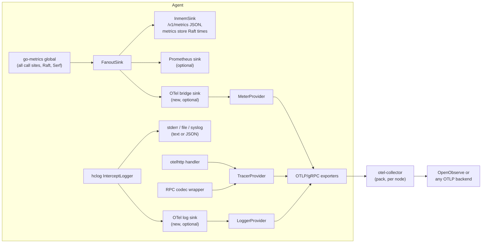

<!--
SPDX-FileCopyrightText: 2026 Norca contributors
SPDX-License-Identifier: MPL-2.0
-->

# OpenTelemetry in the agent – plan

**Status:** Draft · 2026-11-10 · nothing built; all open questions decided on 2026-11-10 (the table below lists the
decisions; [decisions of 2026-11-10](#decisions-of-2026-11-10) lists them in one place). Related:
[metric-storage-update.md](metric-storage-update.md) and
[internal-metrics-storage-tstorage.md](internal-metrics-storage-tstorage.md) (the metrics store,
which this plan leaves alone), the otel-collector and openobserve packs of `norca-registry`.

The agent has go-metrics telemetry (an in-memory sink plus statsite, statsd, Prometheus, DogStatsD and
Circonus sinks) and hclog logs, but no traces and no OpenTelemetry export. This plan adds an **OTLP/gRPC
exporter for metrics, traces and (optionally) logs**, makes the agent's own telemetry independent of
Prometheus, and turns the existing logs into consistently structured, trace-correlated logs. The
built-in metrics store, the metrics history API, the web UI charts and the built-in autoscaler do not
change.

## Table of contents

- [Summary and decisions](#summary-and-decisions)
- [Goals and non-goals](#goals-and-non-goals)
- [Starting point](#starting-point)
- [Architecture](#architecture)
- [Configuration](#configuration)
- [1. Prometheus optional](#1-prometheus-optional)
- [2. Structured logging](#2-structured-logging)
- [3. Metrics over OTLP](#3-metrics-over-otlp)
- [4. Traces over OTLP](#4-traces-over-otlp)
- [5. OTLP/gRPC transport](#5-otlpgrpc-transport)
- [Resource attributes](#resource-attributes)
- [Cardinality](#cardinality)
- [Performance and overhead](#performance-and-overhead)
- [Startup, failure, shutdown and reload](#startup-failure-shutdown-and-reload)
- [Security](#security)
- [Testing](#testing)
- [The packs and the lab](#the-packs-and-the-lab)
- [Licensing and dependencies](#licensing-and-dependencies)
- [Documentation to update](#documentation-to-update)
- [Phases and acceptance](#phases-and-acceptance)
- [Risks](#risks)
- [Decisions of 2026-11-10](#decisions-of-2026-11-10)

## Summary and decisions

Rows marked *Decided* were decided by the user; the others are the design these decisions build on. Every open question is decided ([decisions of 2026-11-10](#decisions-of-2026-11-10)).

| | Proposal |
| --- | --- |
| Prometheus | *Decided 2026-11-10 (user):* runtime-optional, **off by default** (already off outside `-dev`). The setting moves into a `prometheus { enabled, expiration }` block of `telemetry`; the Prometheus output stays the go-metrics sink (not the OTel Prometheus exporter). No build tag: `prometheus/client_golang` stays a dependency (the autoscaler's `prometheus` source and many libraries use it). |
| Other metric outputs | *Decided 2026-11-10 (user):* the **statsd, statsite, DogStatsD (Datadog) and Circonus sinks are removed**, with their `telemetry` keys (`statsite_address`, `statsd_address`, `datadog_address`, `datadog_tags`, `circonus_*`) and the `circonus-gometrics` dependencies. The outputs left: the in-memory sink, the optional Prometheus sink and OTLP. A backend that needs one of the removed protocols gets it through an OpenTelemetry collector. |
| Collector | *Decided 2026-11-10 (user):* **every agent, server or client, sends to the collector of its own node (`127.0.0.1`) by default**; any agent can instead be pointed at a direct address, so everything can go to one central place: TLS (CA, server name, mTLS client certificate), authentication (headers, `headers_file`, mTLS), compression, timeout, retry and per-signal target overrides are options; plaintext only to loopback unless `insecure = true` is explicit. The deployer can write the block. Code in `helper/telemetry`; the go-metrics setup stays in `command/agent`. |
| Export protocol | **OTLP over gRPC only** for the agent (`otlptracegrpc`, `otlpmetricgrpc`, `otlploggrpc`). No OTLP/HTTP exporter in the binary for now. |
| Metrics | A **go-metrics sink that bridges to the OpenTelemetry metric SDK**, added to the existing fanout. No rewrite of the ~615 call sites to the OTel API (they only get the new names); Raft, Serf and memberlist metrics (which also go through go-metrics) come along. *Decided 2026-11-10 (user):* **the metrics are renamed to `norca.*`** in this plan (`nomad.nomad.rpc.request` → `norca.server.rpc.request` or as the naming table decides, `nomad.client.allocs.*` → `norca.client.allocs.*`, ...): the service prefix, the call sites (~615), the Raft/Serf/memberlist prefix of the bridge, the internal readers (metrics store, cluster gauges, the autoscaler sources and the web UI charts), the metrics reference, the packs and dashboards; one naming table decides each prefix, and the rename comes before the OTLP export so that no `nomad.*` name is ever exported. |
| Traces | New. HTTP API spans (otelhttp), one **central server span per RPC** from a wrapper of the msgpack RPC server codec, trace context carried **inside the RPC arguments** (a W3C `traceparent` field in `InternalRpcInfo`), spans for forwarding, Raft apply, eval processing, plan apply, the client allocation lifecycle and driver plugin calls. |
| Sampling | *Decided 2026-11-10 (user):* parent-based; **the important operations are always sampled** — job register/update/deregister/plan/dispatch/scale, the operator endpoints (raft, snapshot, autopilot, scheduler config, keyring, backup), scaling decisions and actions (task groups, node groups, objects), client registration/drain/eligibility and the allocation lifecycle on clients, and the further ones found when the RPC and HTTP endpoints are reviewed in phase 3 (an explicit list in `helper/telemetry`) — and **the rest at a root ratio of `0.1`**; blocking queries, heartbeats and streams are excluded. Incoming `traceparent` from HTTP API clients is **not trusted as parent by default** (a span link); a switch (`trust_http_parent`) turns it on. No trace context is stored in allocations (scheduling and client traces are joined by `norca.eval.id` / `norca.alloc.id`). The OTel global providers are not set. With an `otlp` block, trace IDs are created (and logged) even when no trace export is enabled; without it, none. |
| Logs | *Decided 2026-11-10 (user):* **hclog stays**; the log keys are unified across the whole code base (mechanical commits per package group); OTLP log export is in scope (last phase, off by default). A key convention, a level guide, `trace_id`/`span_id` on log lines that run under a span, and a vet-style check. Optional OTLP log export through an hclog `SinkAdapter`, off by default, in the last phase. |
| Metrics store, `/v1/metrics`, autoscaler | *Decided 2026-11-10 (user):* the built-in metrics stay and run **in parallel** with the external outputs, so Norca never relies on an external metrics system (goal 7). Unchanged by this plan; they never depended on the Prometheus sink (see [starting point](#starting-point)). The autoscaler's `prometheus` source stays an optional way to read a user's own Prometheus, not something a built-in feature needs. |
| Resource | `service.name = "norca"`, `service.version`, `service.instance.id`, `host.name`, plus `norca.region`, `norca.datacenter`, `norca.node.id`, `norca.node.name`, `norca.node_pool`, `norca.server.id`, `norca.agent.roles`; user `resource_attributes` on top. |
| Env variables | *Decided 2026-11-10 (user):* the agent configuration is the only source; `OTEL_*` environment variables are not honoured by the agent. |
| Dependencies | OpenTelemetry Go is Apache-2.0 (checked below). Several OTel modules are already linked into the binary today (indirect, through the GCS client of go-getter and go-cni). |

## Goals and non-goals

**Goals**

1. Prometheus is one optional output among others, not a requirement for observing an agent.
2. Logs follow one key convention, with levels used consistently, and can be joined with traces.
3. Every metric the agent emits today can be pushed over OTLP.
4. Requests can be followed as traces: from the HTTP API through RPC forwarding and Raft to the
   scheduler, and on the client through the allocation lifecycle and the driver calls.
5. All export uses OTLP over gRPC, with TLS, headers, compression and timeouts configurable.
6. With OTLP off, the agent behaves and performs as today.
7. **Norca does not depend on an external metrics system** (*decided 2026-11-10, user*). The
   built-in metrics always run, in parallel with Prometheus and OTLP and whatever they are set to:
   the in-memory sink, the metrics store (`norca/metricsstore`) with its history API, `/v1/metrics`
   (JSON), the web UI charts and the cluster gauges that the built-in autoscaler (source `norca`)
   and node scaling decide on. Prometheus and OTLP are outputs added next to them, never a source
   that a Norca feature reads, and an exporter that is down or misconfigured does not change them.

**Non-goals**

- Changing the metrics store (`norca/metricsstore`), the metrics history API (`/v1/metrics/history`,
  `/series`, `/summary`), the web UI charts or the built-in autoscaler sources.
- Collecting the metrics, traces or logs of the **workloads**. Applications keep sending to the
  collector of their node (the otel-collector pack); the agent does not proxy telemetry.
- Replacing hclog by `log/slog` across the code base (about 1 900 `logger.<Level>(` call sites
  outside tests; hclog is also the logger API of go-plugin, Raft and the plugin SDKs).
- Instrumenting the inside of driver plugin processes, the embedded NATS server, or the `controller`
  module and the operators built on it (they use `log/slog`; a follow-up can give them the same
  exporter).
- An OTLP/HTTP exporter, and tail sampling in the agent (tail sampling belongs in the collector).

## Starting point

What exists, read from the code on `test/lab-2026-11-10` (7b0adac8a).

| Part | State |
| --- | --- |
| `telemetry` block | `command/agent/config.go`, `type Telemetry` (line ~1108): `statsite_address`, `statsd_address`, `datadog_address`/`datadog_tags`, `prometheus_metrics`, `disable_hostname`, `use_node_name`, `collection_interval`, `publish_allocation_metrics`, `publish_node_metrics`, `prefix_filter`, `filter_default`, `disable_dispatched_job_summary_metrics`, `disable_rpc_rate_metrics_labels` and 13 `circonus_*` keys. `DefaultConfig()` leaves Prometheus off; `DevConfig()` turns it on with allocation and node metrics. Merge in `(*Telemetry).Merge` (line ~2510). |
| Sinks | `command/agent/command.go` `setupTelemetry` (line ~1064): always an `InmemSink` (10 s intervals, 1 min, dumped on SIGUSR1); a `FanoutSink` of the configured statsite, statsd, Prometheus (`go-metrics/prometheus`, default options: 60 s expiry, summaries for timers), DogStatsD and Circonus sinks plus the inmem sink. `metrics.DefaultConfig("nomad")`: service name `nomad` is prefixed to every key, hostname label on, runtime metrics on, timers in milliseconds. |
| go-metrics module | `github.com/hashicorp/go-metrics v0.7.0`; `github.com/armon/go-metrics` is replaced by the compatibility version `v0.0.0-20230509193637-d9ca9af9f1f9` (`norca/go.mod` line 21), so libraries that import armon (Raft fork `bacanoo-io/raft v1.8.0-norca.1`, Serf, memberlist) emit into the same global sink. |
| Call sites | In the `norca` module outside tests: `MeasureSince` 416, `MeasureSinceWithLabels` 4, `IncrCounter` 65, `IncrCounterWithLabels` 31, `SetGauge` 41, `SetGaugeWithLabels` 58, `AddSample` 0. |
| `/v1/metrics` | `command/agent/metrics_endpoint.go`: JSON from the `InmemSink` (`DisplayMetrics`), or `?format=prometheus` through `promhttp` on the default registry; **415 "Prometheus is not enabled"** when `prometheus_metrics` is off. Routes in `command/agent/http.go` line ~527 (`/v1/metrics`, `/history`, `/series`, `/summary`). CLI `norca operator metrics` (`command/metrics.go`), API `api/operator_metrics.go`. |
| Metrics store | `norca/metricsstore` (tstorage). Fed by the servers' own sampling of the state (`norca/metrics_store_sample.go` and siblings), by the clients' usage reports on the system bus (`norca/bus_telemetry.go` → `RecordNodeHost`), and for the two Raft times by reading the **InmemSink** (`norca/metrics_store_server.go`, `telemetryReader.raftTimings`, via `norca/config.go` `TelemetrySink`). It does **not** read the Prometheus sink. |
| Autoscaler sources | `norca/autoscaler/plugins/plugins.go`: `nomad-apm` (live state and allocation stats, `plugins/apm/nomadapm`), `norca` (the cluster gauges of the metrics store, `cluster_apm.go`) and the usage source (`usage_apm.go`), and `prometheus` (`plugins/apm/prometheus`, a **query client** of an external Prometheus server via `client_golang/api`). None reads the agent's Prometheus sink. The autoscaler emits `nomad.autoscaler.usage.*` through go-metrics (`norca/autoscaler/metrics.go`). |
| Logging | `command/agent/command.go`: `SetupLoggers` (gated writer, level filter, syslog, rotating log file) and `hclog.NewInterceptLogger` with `log_level`, `log_json`, `log_include_location`; the standard `log` package is redirected into hclog; with `log_json` the CLI UI writes through hclog (`helper/logging/logging.go`). Only `log_level` is reloaded on SIGHUP. `/v1/agent/monitor` streams logs through an interceptor sink (`command/agent/agent_endpoint.go`, `log_json`, `log_include_location` query options). `helper/grpc-middleware/logging` exists for gRPC logging. The `controller` module uses `log/slog`. |
| Log keys | Counted in `norca/`, `client/`, `command/`, `drivers/`: `"error"` 945 (no `"err"`); `"alloc_id"` 70 vs `"alloc"` 58; `"job"` 164 vs `"job_id"` 5; `"eval"` 36 vs `"eval_id"` 11; `"node_id"` 55 vs `"node"` 46; `"group"` 38, `"task_group"` 3. 35 log calls format the message with `fmt.Sprintf`. |
| Correlation | None: no request ID, no trace ID. The HTTP wrapper logs `request complete` / `request failed` with `method`, `path`, `duration`, `code` (`command/agent/http.go` `wrap`). |
| RPC | `net/rpc` with a msgpack codec over yamux (`norca/rpc.go`). `handleNomadConn` loops `server.ServeRequest` (synchronous: the endpoint runs before `ServeRequest` returns) with a codec wrapper, `errorNotingCodec` — a precedent for wrapping the codec. In-process RPC: `(*Server).RPC` (`norca/server.go` ~2067); client agent RPC server: `client/rpc.go`. Forwarding: `forward`, `forwardLeader`, `forwardServer`, `forwardRegion` (`norca/rpc.go` ~594–730), `forwardClientRPC` (`norca/client_rpc.go`). Arguments embed `QueryOptions` or `WriteRequest`, both embedding `InternalRpcInfo{Forwarded bool}` (`norca/structs/structs.go` ~317, 384, 504). The msgpack codec is generated (`structs.generated.go`, checked in CI). Endpoints have no `context.Context`. |
| Raft | `raftApply` / `raftApplyFuture` (`norca/rpc.go` ~807–828). The request structs (with their `WriteRequest`) are what is encoded into the log. `raft.Log` has an `Extensions []byte` field. |
| Scheduler | `Worker.invokeScheduler`, `Worker.SubmitPlan` (`norca/worker.go` ~611, 651), `planner.planApply` (`norca/plan_apply.go` ~97). |
| gRPC | Only towards plugins over go-plugin: drivers (`plugins/drivers`), devices, CSI, base, logmon, executor, docklog, external autoscaler plugins. No gRPC between agents. |
| OpenTelemetry today | Indirect only (`norca/go.mod` lines ~369–377): `otel`, `otel/metric`, `otel/sdk`, `otel/sdk/metric`, `otel/trace` v1.44.0, `otelgrpc` v0.67.0, `otelhttp` v0.69.0, `auto/sdk` v1.2.1, GCP detectors. `go mod why`: `otel` comes from `client/allocrunner` → `containerd/go-cni`; `otelgrpc` from the getter → `go-getter` → `cloud.google.com/go/storage`. They are listed in `THIRD_PARTY_NOTICES.md` (Apache-2.0 AND BSD-3-Clause). No Norca code imports OpenTelemetry. |
| Packs | `otel-collector` (contrib v0.162.0, system job): scrapes the agent at `/v1/metrics?format=prometheus` and **requires `prometheus_metrics = true`**; OTLP receiver on gRPC 4317 / HTTP 4318 on the node address (`host_network`), without TLS or authentication; adds `host.name` and `norca.node.id`; exports OTLP/HTTP to OpenObserve. `openobserve`: router with HTTP 5080 and gRPC 5081. |
| Lab | `norca-lab/cases`: bench, clients, consul, loadbalancer, multidc, multiregion, noconsul, nodegroups, nodescaler, operator, single, traefik. No observability case. |

## Architecture



All OpenTelemetry setup lives in one new package, `helper/telemetry` (name to confirm), which owns the
providers, the resource, the exporters, the bridge sink, the hclog sink, the propagation helpers and
the shutdown. `setupTelemetry` in `command/agent/command.go` calls it; the server and client get a
small `Telemetry` handle (tracer, propagation helpers) through their configs, as `TelemetrySink` is
passed today.

The providers are **not** installed as the OpenTelemetry globals: library instrumentation (go-cni,
the GCS client) keeps the no-op default, so the set of spans stays what Norca chooses. Only the
global **propagator** is set (W3C Trace Context and Baggage), which libraries read for outgoing
requests. This is reversible (decision 12).

## Configuration

The `telemetry` block gains a `prometheus` and an `otlp` block. Keys may change freely (no released
version), so `prometheus_metrics` is replaced, not aliased.

```hcl
telemetry {
  collection_interval        = "10s"
  publish_allocation_metrics = true
  publish_node_metrics       = true
  prefix_filter              = ["-nomad.raft.replication.appendEntries"]

  # Was: prometheus_metrics = true
  prometheus {
    enabled    = false
    expiration = "60s"     # go-metrics PrometheusOpts.Expiration
  }

  otlp {
    # Default: the collector of the own node. Any host:port (or dns:/// target) sends everything
    # to one central receiver instead, for example "otlp.example.com:4317".
    endpoint    = "127.0.0.1:4317"
    insecure    = false                # plaintext gRPC; implied for a loopback endpoint, see Rules
    compression = "gzip"               # "gzip" or "none"
    timeout     = "10s"                # per export call

    retry {                            # retry of a failed export (the exporters' RetryConfig)
      enabled          = true
      initial_interval = "5s"
      max_interval     = "30s"
      max_elapsed      = "1m"          # then the batch is dropped and counted
    }

    # Authentication: gRPC metadata (Basic, Bearer, API keys of hosted backends), a file for the
    # secret values, and/or a client certificate in the tls block (mTLS).
    headers = {
      "authorization" = "Basic ..."    # sent as gRPC metadata
    }
    headers_file = "/etc/norca.d/otlp-headers"   # optional, key=value per line, re-read on SIGHUP

    tls {
      ca_file              = "/etc/norca.d/tls/otlp-ca.pem"
      cert_file            = ""        # client certificate for mTLS, optional
      key_file             = ""
      server_name          = "otel-collector.service.observability.norca"
      insecure_skip_verify = false
    }

    resource_attributes = {
      "deployment.environment.name" = "production"
    }

    # Each signal can override endpoint, insecure, headers, headers_file and tls (same keys as
    # above); what it does not set comes from the otlp block. Example: traces to another backend.
    #   traces { endpoint = "tempo.example.com:4317"  tls { ca_file = "..." } }

    metrics {
      enabled     = true
      interval    = "30s"              # export interval of the periodic reader
      temporality = "cumulative"       # or "delta"
      histograms  = "explicit"         # or "exponential"
    }

    traces {
      enabled            = true
      sample_ratio       = 0.1         # ratio of new root traces
      trust_http_parent  = false       # see Sampling and Security
      exclude_rpc        = ["Node.GetClientAllocs", "Node.UpdateStatus"]   # appended to the built-in list
      max_queue_size     = 2048
      max_export_batch   = 512
    }

    logs {
      enabled = false
      level   = "info"                 # minimum level exported; independent of log_level
    }
  }
}
```

Rules:

- **Targets (decision 8):** servers and clients alike default to the collector of their own node,
  `endpoint = "127.0.0.1:4317"`. A direct address sends to any OTLP/gRPC receiver instead, so all
  agents of a cluster (or several clusters) can go to one central place without a local collector.
  Each signal block defaults to `enabled = true` once `otlp` is present, except `logs` (`false`).
- **Per-signal overrides:** `metrics`, `traces` and `logs` may each set `endpoint`, `insecure`,
  `headers`, `headers_file` and `tls`; unset keys come from the `otlp` block (field-wise merge, as
  `Telemetry.Merge` does). Without overrides every signal uses the one connection settings.
- **Transport security:** a loopback endpoint (`127.0.0.1`, `::1`, `localhost`) defaults to plaintext,
  because the local collector listens there without TLS. Any other endpoint uses TLS: with a `tls`
  block as given, without one the system roots. Plaintext to a non-loopback endpoint needs an
  explicit `insecure = true` and the agent logs a warning at startup. `insecure = true` with a `tls`
  block is an error.
- **Authentication:** `headers` and/or `headers_file` (gRPC metadata: `authorization` Basic/Bearer,
  the API-key headers of hosted backends), and/or a client certificate (`tls.cert_file`/`key_file`,
  mTLS). They combine. Headers over plaintext to a non-loopback endpoint are an error (credentials
  would travel unencrypted).
- `collection_interval` keeps its meaning (how often the agent samples node and allocation gauges);
  `otlp.metrics.interval` is how often the OTel reader exports.
- The `-dev` agent turns on Prometheus as today; it does not turn on OTLP.
- Validation and merge follow the existing pattern (`Telemetry.Merge`, `Telemetry.Copy`, config parse
  tests in `command/agent/config_parse_test.go` and the fixtures).
- The CLI gets no new flags (the block is too large for flags).

## 1. Prometheus optional

What "optional" means here: an operator can observe an agent completely with Prometheus off.

| Item | With Prometheus off |
| --- | --- |
| `/v1/metrics` (JSON) | Unchanged: the `InmemSink` is always present. |
| `/v1/metrics?format=prometheus` | 415, as today ("Prometheus is not enabled"). |
| `norca operator metrics -format prometheus` | Fails with that error, as today. |
| Metrics store, `/v1/metrics/history`, `/series`, `/summary`, web UI charts | Unchanged: fed by state sampling, the system bus and the `InmemSink`. |
| Autoscaler `norca`, usage, `nomad-apm` sources | Unchanged. |
| Autoscaler `prometheus` source | Unchanged: it queries an **external** Prometheus server the user runs; it has nothing to do with the agent's sink. |
| otel-collector pack | Gets a mode in which the agent pushes OTLP to it and the Prometheus scrape of the agent is off (see [the packs](#the-packs-and-the-lab)). |

Changes:

1. `prometheus_metrics` → `prometheus { enabled, expiration }`; `metrics_endpoint.go` reads the new
   field.
2. `setupTelemetry` builds the Prometheus sink with `NewPrometheusSinkFrom(opts)` instead of the
   defaults, so `expiration` takes effect.
3. No compile-time option. `client_golang` stays linked (autoscaler query client, Docker and
   containerd libraries). Removing it is not achievable and not needed for the goal.
4. The Prometheus output stays the go-metrics sink (decision 9), not the OpenTelemetry Prometheus
   exporter on the same MeterProvider, because it renames series (unit suffixes, `_total`) and turns summaries into
   histograms.

## 2. Structured logging

hclog already produces key/value logs (text or JSON). What is missing is consistency, level
discipline and correlation. The current logs stay; they are extended and normalized.

### Approach

- **hclog stays** as the logging API. No slog migration (non-goal). An `hclog → slog` adapter is not
  needed: the OTel export, if wanted, hooks into hclog directly (below).
- **Key convention** (table below), applied mechanically across the code base, package group by
  package group, in separate commits. No compatibility is needed, so keys are renamed, not aliased.
- **Messages are constants.** No values interpolated into the message: the 35 `fmt.Sprintf` log calls
  are converted to fields. Lower case, no trailing period (already the dominant style).
- **Context loggers.** Components that work on one object get a logger with its identity once
  (`logger.With("alloc_id", ..., "job_id", ..., "namespace", ...)`), as the alloc and task runners
  mostly do already; the convention makes this the rule for the eval worker, the plan applier, the
  deployment watcher, the drainer, the volume watchers and the autoscaler.
- **Trace correlation.** A helper `telemetry.LogWith(logger, ctx)` (or `...FromSpan`) adds `trace_id`
  and `span_id` when the context carries a valid span context. Used where a span exists: the HTTP
  wrapper's `request complete`/`request failed`, the RPC error paths, the worker, the plan applier,
  the alloc runner phases. A trace ID exists even for unsampled requests (the SDK creates span
  contexts for dropped spans), so log lines of one request correlate even when the trace was not
  exported. With `otlp.traces` off no TracerProvider is installed and no IDs are added (open
  question 13: always install one for correlation).
- **Check.** A small analyzer in `tools/` (run by `go vet -vettool` in CI or by a test) reports: a key
  outside the convention where a convention key exists (`alloc`, `err`, `job` with a string value
  ...), an odd number of key/value arguments, `fmt.Sprintf` as the message. It runs on changed
  packages first, then everywhere once the renames are done.
- The JSON layout of hclog (`@timestamp`, `@level`, `@module`, `@message`, `@caller`) stays.

### Key convention

| Key | Value | Replaces |
| --- | --- | --- |
| `error` | the `error` | (already universal) |
| `namespace` | namespace name | `ns` |
| `job_id` | job ID | `job` when the value is an ID |
| `job_version` | job version | `version` (job context) |
| `task_group` | task group name | `group`, `tg` |
| `task` | task name | `task_name` |
| `alloc_id` | full allocation ID | `alloc` (ID) |
| `eval_id` | evaluation ID | `eval` (ID) |
| `deployment_id` | deployment ID | `deployment` (ID) |
| `node_id` | client node ID | `node` (ID) |
| `node_name` | client node name | `node` (name) |
| `server_id` / `server` | server ID / name | `peer` where it is a server |
| `region`, `datacenter`, `node_pool` | | `dc` |
| `rpc_method` | `Service.Method` | `method` (RPC) |
| `http_method`, `http_path`, `http_status` | HTTP request | `method`, `path`, `code` |
| `duration` | `time.Duration` | `took`, `elapsed`, `time` |
| `index` | Raft or state index | `raft_index`, `modify_index` where generic |
| `trace_id`, `span_id` | hex IDs | new |
| `driver`, `plugin` | plugin name | |
| `object_kind`, `object_name` | custom objects | |

An object itself (a whole `*structs.Allocation`) is never logged as a value; its ID is. The exact
list is finalized in phase 2 by grepping every key in use (`grep -rhoE '"[a-z_]+", '` over the log
calls) and deciding each one.

### Levels

| Level | Use |
| --- | --- |
| `error` | Something failed and needs an operator, or data/work was lost. |
| `warn` | Degraded or retried; recovers by itself; worth noticing if repeated. |
| `info` | Lifecycle and state changes of the agent and of long-lived objects (leadership, join, alloc started/stopped). Not per request. |
| `debug` | Per request and per decision. |
| `trace` | Per iteration, payloads. |

The level guide is applied while renaming keys; wrong levels found on the way are fixed then (for
example `request failed` for 4xx stays `debug`, as now).

### OTLP log export (optional, last phase)

- An hclog `SinkAdapter` (`Accept(name, level, msg, args...)`) registered on the agent's
  `InterceptLogger` with its own level (`otlp.logs.level`). Every named sub-logger of the agent is an
  intercept logger, so the sink sees all agent logs; the standard `log` output (redirected into hclog)
  comes along.
- It converts each call to an OTel `log.Record`: timestamp, severity (TRACE 1, DEBUG 5, INFO 9, WARN 13,
  ERROR 17) and severity text, body = message, attributes = the key/values (typed: string, int, bool,
  float, duration as milliseconds, errors as `exception.message`), the logger name as
  `norca.logger`, and `trace_id`/`span_id` attributes moved into the record's trace context fields.
- Exported by `sdk/log` with a batch processor and `otlploggrpc`.
- **Loop guard:** errors of the exporters are reported through the OTel error handler, which logs to
  hclog with a marker field; the log sink drops records with that marker and is rate limited, so a
  failing log exporter cannot feed itself.
- **Status of the API:** the OTel Go Logs API and SDK are still `v0.x` (`otel/log`, `otel/sdk/log`
  v0.14.0 in the module cache; the version matching otel v1.44.0 was not checked). This is why the
  phase is last and the signal off by default.
- In scope: **yes, as the last phase, off by default** (decision 6): the otel-collector pack does not
  read the agents' log files (no `filelog` receiver in its component list), so OTLP is the only way
  the agent logs reach OpenObserve with the cluster stack. A `filelog` receiver in the pack was the
  alternative, not chosen.

## 3. Metrics over OTLP

### Bridge, not rewrite

A rewrite to the OTel metric API would touch ~615 call sites and would still miss Raft, Serf and
memberlist, which emit through go-metrics. A bridge sink covers everything, keeps the (renamed) names, and keeps
Prometheus/inmem consistent with OTLP. New metrics may use the OTel API directly later where a
context (exemplars) matters; the bridge is the default.

`telemetry.NewOTelSink(meterProvider, opts)` implements `metrics.MetricSink` (and
`PrometheusSink`-style `Shutdown`) and is appended to the fanout in `setupTelemetry`.

| go-metrics | OTel instrument | Notes |
| --- | --- | --- |
| `SetGauge[WithLabels]` | `Float64ObservableGauge`, one per name | The sink keeps the last value per (name, label set) with a timestamp; the callback reports values younger than the expiry (default 60 s, as the Prometheus sink), so series of gone allocations disappear. |
| `IncrCounter[WithLabels]` | `Float64ObservableCounter`, one per name | The sink accumulates per (name, label set) and reports the running sum; entries expire like gauges. Synchronous counters are not used because the SDK keeps cumulative attribute sets forever (alloc-labelled counters would grow without bound). |
| `MeasureSince`, `AddSample[WithLabels]` | `Float64Histogram`, unit `ms` | go-metrics timers are milliseconds (`TimerGranularity`). Explicit buckets by default (the SDK defaults 0…10 000, which suit milliseconds; a Norca list may replace them after the lab), exponential optional. Replaces the Prometheus sink's summaries (quantiles are computed in the backend). |
| `EmitKey` | ignored | No call sites. |

- **Names:** the go-metrics key with the service prefix, joined with dots:
  `norca.*` after the rename (for example `norca.client.allocs.memory.usage`, `norca.raft.apply`). Identical to the
  names in the metrics reference. The backend may convert dots (OpenObserve, Prometheus
  translation in the collector); that is the backend's naming.
- **Labels:** become attributes unchanged. The `host` label that go-metrics adds
  (`EnableHostnameLabel`) is dropped by the bridge, because `host.name` is a resource attribute.
- **Filters:** `prefix_filter`/`filter_default` are applied by go-metrics before any sink, so they
  hold for OTLP too.
- **Instrument creation** is lazy and cached in a `sync.Map` by name; the OTel SDK deduplicates
  anyway. Names that are invalid OTel instrument names (if any) are logged once and dropped
  (to verify at implementation; go-metrics keys are mostly `[a-z_.]`).
- **Temporality:** cumulative by default (what Prometheus-style backends and OpenObserve expect;
  OpenObserve's handling of delta and exponential histograms was **not verified**). Delta optional.
- **Runtime metrics:** go-metrics already emits `nomad.runtime.*`; the OTel runtime instrumentation
  is not added.
- **No exemplars:** the go-metrics API has no context, so histograms carry no trace exemplars.
  Acceptable; a later native instrument for RPC latency could add them.

## 4. Traces over OTLP

### Spans

| Area | Span | Where | Notes |
| --- | --- | --- | --- |
| HTTP API | `GET /v1/job/{id}` style, kind server | `otelhttp.NewHandler` around the agent mux (`command/agent/http.go`) | Route = the registered mux pattern (prefix patterns: `/v1/job/`), never the raw path (cardinality). Excluded by default: `/v1/agent/health`, `/v1/metrics*`, `/v1/event/stream`, `/v1/agent/monitor`, log/exec/fs streams, and blocking queries (`index` > 0). The `wrap` logs get `trace_id`. |
| RPC server | `Job.Register`, kind server, `rpc.system = norca`, `rpc.service`, `rpc.method` | A codec wrapper next to `errorNotingCodec` in `handleNomadConn`, and in `(*Server).RPC` and `client/rpc.go` | Starts the span after `ReadRequestBody` (args decoded, parent extracted from them), ends it in `WriteResponse` (status from `resp.Error`). `ServeRequest` is synchronous, so one span per call without touching endpoints. Excluded by default: blocking queries (`MinQueryIndex` > 0), `Status.Ping`, `Node.UpdateStatus`, `Node.GetClientAllocs`, `Node.UpdateAlloc` batches, `Eval.Dequeue` long polls, streaming RPCs; configurable (`exclude_rpc`). |
| Forwarding | `forward Job.Register`, kind client, `norca.forward = leader\|server\|region` | `forward*` in `norca/rpc.go`, `forwardClientRPC` | The args already carry the current span (see propagation), so the receiving server's span is a child. |
| Raft | `raft.apply <MessageType>` | `raftApply`/`raftApplyFuture` | Parent taken from the message when it carries `InternalRpcInfo` (most requests are the RPC args themselves), so no signature change. Attributes: message type, index, size. |
| FSM | `fsm.apply <MessageType>` (leader only at first) | `nomadFSM.Apply` | Parent from the decoded request (the `traceparent` field is in the log entry). Followers: off by default (one span per server per write is noise). |
| Eval | `eval.process` | `Worker` around dequeue → `invokeScheduler` → ack | Parent: the span that created the eval (job register, node update ...), from the eval broker (below). Attributes: `norca.eval.id`, `norca.job.id`, `norca.namespace`, `norca.eval.triggered_by`, scheduler type, status. |
| Scheduler | `scheduler.<type>` with child `scheduler.compute`, `scheduler.select` per task group | `invokeScheduler`, `scheduler/` | Placement counts, failed placements as attributes; no span per node considered. |
| Plan | `plan.submit` (worker, client side of `Plan.Submit`), `plan.evaluate`, `plan.apply` | `Worker.SubmitPlan`, `plan_apply.go` | The plan queue wait is visible as the gap between submit and evaluate. |
| Client alloc | `alloc.start`, `alloc.stop`, `alloc.restart`, `alloc.gc`; children per hook (`alloc.hook.<name>`, `task.hook.<name>`), `task.start`, `artifact.download`, `image.pull` | `client/allocrunner`, `taskrunner` | **No span for the whole life** of an allocation (days). Each phase is a short trace; they share `norca.alloc.id`, `norca.eval.id`, `norca.job.id`, `norca.task_group`, `norca.task`. |
| Driver calls | `norca.plugins.drivers.Driver/StartTask` style, kind client | `otelgrpc.NewClientHandler` as a gRPC dial option of the go-plugin clients (drivers, devices, CSI) | Long streams (`WaitTask`, `TaskEvents`, `TaskStats`, `ExecTaskStreaming`) are filtered out. The plugin process side is not instrumented (non-goal). |
| Client → server | kind client spans from the client's RPC calls made inside a client span (alloc phases) | `client/rpc.go` `RPC` | Only when the caller passes a context (see below). |

### Context propagation

- **HTTP:** W3C `traceparent`/`tracestate` from the request headers via the propagator — used as the
  **parent only when `trust_http_parent = true`**; otherwise the agent starts a new root and adds the
  incoming context as a **span link**. Responses carry the trace ID in a header
  (`Norca-Trace-Id`, decision 13), so a CLI user can quote it.
- **msgpack RPC has no headers**, so the context travels **in the arguments**. `InternalRpcInfo`
  gets one field, `TraceParent string` (W3C format, ~55 bytes; empty when there is no span), with
  `GetTraceParent`/`SetTraceParent` on the `RPCInfo` interface. Since `QueryOptions` and
  `WriteRequest` embed `InternalRpcInfo`, almost every RPC argument has it.
  - The HTTP layer sets it in `parseWriteRequest`/`parseQueryOptions` from the request's span.
  - The **server codec wrapper** reads it as parent, starts the server span, and **writes the server
    span's context back into the args**. From then on, code that only has the args (forwarding,
    `raftApply`, the FSM) derives its parent from them; no endpoint signature changes.
  - Forwarded RPCs send the args as they are, so the next server's span is a child of this one.
  - Raft: the request struct is what is encoded into the log, so the FSM sees the same
    `TraceParent`. (To verify: every `raftApply` call site passes a struct with `InternalRpcInfo`;
    the ones that do not simply get no parent.) `raft.Log.Extensions` is not needed.
  - `tracestate` and baggage are **not** carried over RPC (not needed internally).
  - The generated msgpack codec (`structs.generated.go`) is regenerated; CI checks it.
- **Evaluations:** the eval broker keeps an in-memory map eval ID → span context, filled when the FSM
  enqueues an eval created by a traced request (the FSM has the request's `TraceParent`), and returns
  it in the `Eval.Dequeue` reply (a new `TraceParent` field in the reply, not in `Evaluation`). The
  map is not replicated: after a leader change, evals re-enqueued by the new leader have no parent
  and start a root with a link-free `norca.eval.id` attribute. **Nothing trace-related is persisted
  in the state store.**
- **Scheduler → client:** no propagation into the allocation (that would persist a trace context in
  every `Allocation`). Client phase traces are joined to the scheduling trace by `norca.eval.id` /
  `norca.alloc.id` attributes. Decision 5.
- **Client internals:** the alloc and task runners pass a `context.Context` with the phase span to
  hooks and driver calls (most hooks already take a `ctx`; to verify per hook). Where the code has no
  context, the phase span is the only span.
- **System bus (NATS):** messages have headers; the publishers that matter (events, usage reports)
  are not request-scoped, so no propagation is proposed now. Possible later with
  `traceparent` in `nats.Header`.

### Sampling

- Sampler: `ParentBased(root = important-operation list ? AlwaysSample : TraceIDRatioBased(sample_ratio))`, with remote parents honoured
  (internal RPC parents are always "remote" to the receiving server, and must be honoured to keep
  traces whole).
- **Important operations are always sampled** (decision 3): the root sampler checks the method or
  route against the explicit list in `helper/telemetry` (jobs, operator endpoints, scaling, client
  registration/drain/eligibility, the allocation lifecycle, plus what the phase-3 endpoint review
  adds) and samples it always; every other new root is sampled at the ratio, `0.1` by default.
  Excluded methods/routes never create spans, sampled or
  not, so heartbeats and long polls do not consume the ratio.
- Because untrusted HTTP parents are links, an API client cannot force sampling unless
  `trust_http_parent = true`.
- Errors are not force-sampled in the agent (head sampling cannot know); tail sampling on errors is
  documented as a collector option (`tail_sampling` processor).

## 5. OTLP/gRPC transport

- Exporters: `otlptracegrpc`, `otlpmetricgrpc`, `otlploggrpc`, all built from the one `otlp` block:
  `WithEndpoint`, `WithInsecure` or `WithTLSCredentials` (a `tls.Config` built with Norca's TLS
  helpers from `ca_file`/`cert_file`/`key_file`/`server_name`), `WithHeaders`, `WithCompressor("gzip")`,
  `WithTimeout`, and the exporters' retry (enabled, max elapsed time = 1 minute).
- One gRPC connection per signal (the exporters' default). Sharing one `grpc.ClientConn` across the
  three (`WithGRPCConn`) is possible and saves sockets; decide at implementation.
- The exporters fall back to `OTEL_EXPORTER_OTLP_*` environment variables for options not set in
  code; the setup sets every option explicitly so the environment has no effect (decision in the
  table above; decision 7).
- `headers_file` lets the credentials stay out of the main config file; it is re-read on SIGHUP and
  applied through a per-RPC credentials hook (to verify that the gRPC exporters accept
  `grpc.WithPerRPCCredentials` via `WithDialOption`; the option exists in the versions in the cache).
- gRPC is already linked (`google.golang.org/grpc v1.84.0`); the exporters add
  `go.opentelemetry.io/proto/otlp` and `grpc-gateway/v2` (types only) as transitive dependencies.

## Resource attributes

| Attribute | Value | Source |
| --- | --- | --- |
| `service.name` | `norca` | constant |
| `service.version` | agent version | `version.GetVersion()` |
| `service.instance.id` | client node ID, or the server's node ID on a server-only agent | client/server state |
| `host.name` | hostname, or `node_name` with `use_node_name` | config |
| `norca.region`, `norca.datacenter` | | config |
| `norca.node.id` | client node ID (same key the otel-collector pack adds) | client |
| `norca.node.name`, `norca.node_pool` | | client config |
| `norca.server.id` | Raft server ID | server |
| `norca.agent.roles` | `["server"]`, `["client"]` or both | config |
| `os.type`, `process.pid` | | SDK detectors (`resource.WithOS`, `WithProcessPID`) |
| user | `resource_attributes` | config, may not override the `norca.*` keys |

The client node ID is known only after the client has loaded or created it; the providers are created
after the agent has its IDs (the order in `Command.Run`: telemetry is set up before the agent today,
so OTel setup moves after `setupAgent`, while the go-metrics part stays where it is and the bridge is
attached to the fanout later — to design in phase 0).

## Cardinality

- Metrics: the series are those of today's Prometheus sink. The large families are the allocation
  metrics (`publish_allocation_metrics`: `alloc_id`, `job`, `task_group`, `task`, `namespace`) and
  the per-requester RPC rate labels (switchable with `disable_rpc_rate_metrics_labels`). The bridge's
  expiry bounds them to live allocations. In addition the SDK's per-instrument **cardinality limit**
  is set (default 2 000 attribute sets; overflow goes to the `otel.metric.overflow` series). Whether
  the limit is a stable option in otel v1.44.0 or still behind `OTEL_GO_X_CARDINALITY_LIMIT` was
  **not verified**.
- Spans: names are routes and RPC method names (bounded); IDs are attributes, never names.
- Logs: unchanged volume; the export has its own level.

## Performance and overhead

- **Metrics:** the bridge's hot path is a map lookup and an atomic/locked update per call, comparable
  to the Prometheus sink (`sync.Map` + hash per call). With OTLP off the bridge is not in the fanout:
  zero cost. A Go benchmark of the bridge vs the Prometheus sink is part of phase 1.
- **Traces:** with traces off no TracerProvider is created; the codec wrapper and the HTTP handler
  are only installed when on. With traces on, an unsampled span costs the span-context creation and
  the `traceparent` parse/format per RPC (~hundreds of ns, to measure). Excluded methods skip all
  work. The `TraceParent` field adds ~55 bytes to traced RPCs and Raft entries.
- **Export:** batch span processor (queue 2 048, drop when full, never block the caller), periodic
  metric reader, batch log processor; gzip.
- **Budget:** with OTLP on and the default ratio, the 5-minute bench soak (lab `bench` case) shows no
  more than ~2 % CPU and ~2 % p99 RPC latency over the baseline, and no memory growth. Measured, not
  assumed.

## Startup, failure, shutdown and reload

- **Startup:** exporter creation does not dial synchronously (gRPC connects lazily), so an absent
  collector never blocks or fails agent startup. Invalid configuration (bad endpoint syntax, missing
  CA file) fails startup, like other config errors.
- **Failures:** export errors go through `otel.SetErrorHandler` to hclog at `warn`, rate limited
  (one line per signal per minute with a count), and to go-metrics counters
  (`norca.agent.otlp.export_errors` with `signal`), so they show in `/v1/metrics` even when OTLP is
  down. Dropped spans/records are counted too.
- **Shutdown:** in `Command.Run`'s deferred shutdown, after `agent.Shutdown()` and the HTTP servers:
  `TracerProvider.Shutdown`, then `MeterProvider.Shutdown` (final collection and export), then
  `LoggerProvider.Shutdown` last (so the shutdown logs go out), sharing one 5 s deadline. A failing
  flush is logged to stderr only.
- **Reload (SIGHUP):** `sample_ratio`, `otlp.logs.level`, `headers_file` (also per signal) take
  effect without restart; endpoint, TLS and enabling or disabling a signal require a restart (the agent logs that). The rest
  of `telemetry` is not reloadable today either.

## Security

- **Credentials** in `headers`/`headers_file` are secrets: the agent never logs them, and
  `/v1/agent/self` redacts `otlp.headers` (as other secrets of the config are redacted; to check how
  `agent/self` redaction is done).
- **TLS** for every non-loopback endpoint unless `insecure = true` is set explicitly (warned at
  startup); credentials never go over plaintext to another host. The pack's OTLP receiver has no TLS
  and no authentication today, so its agent-facing listener is `127.0.0.1` only (pack change below);
  a central receiver is reached over TLS, with headers and/or mTLS.
- **Incoming trace context** from API clients is untrusted by default (link, not parent), so a client
  cannot force sampling or graft spans onto internal traces. Internal RPC (server/client traffic over
  mTLS) is trusted.
- **Span and log content:** no request bodies, no job specs, no variables, no tokens, no
  environment; attributes are IDs, names, counts, statuses. The HTTP spans record the route, not the
  query string. Error messages are recorded as span status descriptions only for RPC errors, which
  already go to logs.
- **Data residency:** nothing is exported unless `otlp` is configured.

## Testing

- **Unit (metrics):** the bridge against `sdk/metric` with a `ManualReader`: each go-metrics call
  kind, labels, the dropped `host` label, prefix filter, expiry, cardinality overflow.
- **Unit (traces):** `sdk/trace/tracetest.InMemoryExporter` (+ `SpanRecorder`): HTTP → RPC → forward →
  Raft apply parent/child chain on a test cluster (`norca.TestServer` with three servers, request sent
  to a follower); eval → plan chain; exclusion lists; `trust_http_parent` on and off; codec round-trip
  of `TraceParent`.
- **Unit (logs):** the hclog sink against an in-memory `sdk/log` exporter (severity mapping,
  attribute types, trace fields, loop guard); the key analyzer's own tests.
- **Integration (OTLP/gRPC):** a minimal in-process gRPC server implementing the three OTLP collector
  services from `go.opentelemetry.io/proto/otlp` (already a transitive dependency of the exporters),
  started by the test; checks TLS, mTLS, headers, gzip, timeout and retry against it. Go TLS tests run
  in a Linux container (local TLS interception on Windows breaks them).
- **Config:** parse, merge, validation and `-dev` tests next to the existing telemetry tests.
- **Lab:** a new case `observability` in `norca-lab/cases`: three servers and two clients, the
  otel-collector pack with its OTLP receiver on `127.0.0.1`, a collector `file` or `debug` exporter
  (no OpenObserve needed), Prometheus off on every agent; steps: run a job through a follower,
  check that the collector received the RPC metrics, a trace containing `Job.Register` on two servers
  and `eval.process`, the alloc start trace on a client, and (phase 5) log records with `trace_id`.
  A second step with OpenObserve via the packs, for a manual look.
- **Performance:** the bridge benchmark, and the 5-minute bench soak with OTLP off/on.

## The packs and the lab

The pack changes live in `norca-registry` and follow the code:

- **otel-collector:** listen on `127.0.0.1:4317` as well as the node address (so agents can use
  `insecure = true` locally without exposing anything); a variable `nomad_otlp_enabled`
  that turns off the Prometheus scrape of the agent (`nomad_metrics_enabled = false`) and documents
  the agent's `otlp` block; README prerequisites stop requiring `prometheus_metrics`. Service
  discovery (`nomad_sd_configs`) does not need the agent's Prometheus output and stays.
- **Servers without a client** (decision 8): every agent, servers too, sends to `127.0.0.1` by
  default. The collector pack is a system job and runs only on client nodes, so a server-only node
  needs a collector installed on the host, or points its `otlp` block (or every agent's) at a central
  receiver by direct address, with TLS, headers and/or mTLS. The pack README documents both; the
  deployer can write the `otlp` block.
- **openobserve:** no change (its OTLP/HTTP ingest is used by the collector, not by agents).

## Licensing and dependencies

Checked on 2026-11-10 from the `LICENSE` files in `C:\Users\rawen\go\pkg\mod`:

| Module | Version checked | License | State |
| --- | --- | --- | --- |
| `go.opentelemetry.io/otel`, `/metric`, `/trace`, `/sdk`, `/sdk/metric` | v1.44.0 | Apache-2.0 | already linked (indirect), become direct |
| `go.opentelemetry.io/otel/exporters/otlp/otlptrace/otlptracegrpc` | v1.38.0 (v1.44.0 not in the cache) | Apache-2.0 | new |
| `go.opentelemetry.io/otel/exporters/otlp/otlpmetric/otlpmetricgrpc` | v1.38.0 (v1.44.0 not in the cache) | Apache-2.0 | new |
| `go.opentelemetry.io/otel/exporters/otlp/otlplog/otlploggrpc` | v0.14.0 | Apache-2.0 | new, phase 5 |
| `go.opentelemetry.io/otel/log`, `/sdk/log` | v0.14.0 | Apache-2.0 | new, phase 5 |
| `go.opentelemetry.io/contrib/instrumentation/net/http/otelhttp` | v0.69.0 | Apache-2.0 | already linked, becomes direct |
| `go.opentelemetry.io/contrib/instrumentation/google.golang.org/grpc/otelgrpc` | v0.67.0 | Apache-2.0 | already linked, becomes direct |
| `go.opentelemetry.io/proto/otlp` | v1.8.0 | Apache-2.0 | new (transitive) |
| `go.opentelemetry.io/auto/sdk` | v1.2.1 | Apache-2.0 | already linked |
| `github.com/grpc-ecosystem/grpc-gateway/v2` | v2.27.2 | BSD-3-Clause | new (transitive of the exporters) |
| `github.com/cenkalti/backoff/v5` | v5.0.3 | MIT | new (transitive of the exporters) |

- All on the allowed list (MPL-2.0, Apache-2.0, MIT, BSD-2/3-Clause, ISC). `THIRD_PARTY_NOTICES.md`
  lists the current OTel modules as "Apache-2.0 AND BSD-3-Clause" (a BSD-licensed file inside the
  repositories); the regenerated notices (`make notices`) will show the same for the new ones, and
  include their NOTICE files if any.
- **To check at implementation:** the exact exporter versions that match otel v1.44.0 (all OTel
  modules move in lockstep, and the GCS client and go-cni already pull v1.44.0), and their licenses
  at that version; `go-licenses` in CI checks them anyway.
- No code is copied from other projects; the bridge sink and the hclog sink are Norca's own. The
  design follows the OpenTelemetry specification and semantic conventions (Apache-2.0
  documentation), not any HashiCorp product.

## Documentation to update

In `norca-doc/content/docs` (public; no links to this internal file):

| Page | Change |
| --- | --- |
| `configuration/telemetry.md` | The `prometheus` block replaces `prometheus_metrics`; a new `otlp` section with all keys and examples; the note that `/v1/metrics` JSON and the metrics store work without any sink. |
| `configuration/_index.md` | Logging section: the key convention and level guide (short, or a link to the new logging page); `log_json` output example with `trace_id`. |
| `operations/monitoring.md` | "Agent telemetry": OTLP as the recommended path; "A metrics, traces and logs stack from the registry": agents push OTLP to the local collector, Prometheus off; "Prometheus without the packs" stays. |
| `operations/metrics-reference.md` | A note on OTLP naming (same names, dots), timers as histograms in ms, the new `norca.agent.otlp.*` metrics. |
| new `operations/tracing.md` | The span list, attributes, sampling, exclusions, propagation (`traceparent`, `trust_http_parent`, `Norca-Trace-Id`), the collector tail-sampling recipe. |
| new `operations/logging.md` (or a section) | Key convention, levels, correlation, OTLP log export. |
| `differences/metrics.md` | The "Agent telemetry" row: OTLP export added, Prometheus optional; a row for traces and for structured logs. |
| `differences/_index.md` | One line for tracing if the index lists features. |
| `getting-started/examples/04-multi-region.md`, `features/packages/registry.md`, `upgrade/upgrade-specific.md` | `prometheus_metrics` → `prometheus { enabled = true }`. |
| `api/agent.md` | Redacted `otlp` headers in `/v1/agent/self`; `/v1/metrics` unchanged. |
| `introduction/license.md` | Nothing unless a dependency outside the list appears. |

Elsewhere: the otel-collector pack README and variables (`norca-registry`), the deployer design
(it mentions `prometheus_metrics`, `norca-deployer/design/norca-deployer-design.md`), and the lab
case. The UI design review needs no change (no UI part).

## Phases and acceptance

| Phase | Content | Acceptance |
| --- | --- | --- |
| 0 | The removal of the statsd, statsite, DogStatsD and Circonus sinks with their keys and dependencies (its own commit, first). `helper/telemetry`: config structs, parse, merge, validation, `-dev` defaults; resource; gRPC exporter construction (TLS, headers, `headers_file`, gzip, timeout, retry); provider lifecycle and ordered shutdown; error handler with rate limit and `nomad.agent.otlp.*` counters; the in-process OTLP test server. `prometheus { enabled, expiration }` replaces `prometheus_metrics`. | Config tests pass for every key and error case; an agent with `otlp` pointing to a closed port starts in the same time as without and logs one rate-limited warning per signal per minute; shutdown completes within 5 s with the collector down; with the test server up, an empty export round-trips over TLS, mTLS and plaintext with headers and gzip. |
| 1 | Metrics: the rename to `norca.*` first (naming table, call sites, bridge prefix, internal readers: metrics store, cluster gauges, autoscaler sources, UI charts; metrics reference, packs, dashboards); then the go-metrics → OTel bridge sink in the fanout; histogram buckets; cardinality limit; the otel-collector pack's OTLP mode and `127.0.0.1` listener; docs for `telemetry` and metrics. | No `nomad.*` metric name is left in the code or the docs; with Prometheus off, the lab collector receives the `norca.*` RPC, Raft, allocation and runtime metrics with the resource attributes; series of a stopped allocation disappear after the expiry; `/v1/metrics` JSON, the metrics store and the autoscaler `norca` source behave as before (their tests unchanged); bridge benchmark within 1.5× the Prometheus sink per call. |
| 2 | Structured logs: final key list, the analyzer, renames package group by package group (server, client, agent, drivers, helpers), `fmt.Sprintf` messages converted, level fixes, context loggers in worker/plan applier/watchers. | The analyzer reports nothing on the `norca` module; `log_json` output of a lab run has only convention keys for IDs; no log line interpolates a value into the message; tests that assert log output updated. |
| 3 | Traces, core: TracerProvider and sampler; otelhttp with route names and exclusions; `TraceParent` in `InternalRpcInfo` (codec regenerated); the RPC codec wrapper on servers, in-process RPC and the client RPC server; forwarding and Raft apply spans; FSM apply on the leader; `trace_id` in HTTP/RPC logs; `Norca-Trace-Id` header; `trust_http_parent`. | A `norca job run` against a follower yields one trace: HTTP span → `Job.Register` on the follower → forward → `Job.Register` on the leader → `raft.apply` → `fsm.apply`; excluded methods create no spans; an incoming sampled `traceparent` is a link unless trusted; the request's log lines carry the same `trace_id`; bench soak within budget. |
| 4 | Traces, scheduling and clients: eval broker span-context map and `Eval.Dequeue` reply field; `eval.process`, scheduler, plan submit/evaluate/apply spans; client phase spans (start, stop, restart, GC, hooks, artifact, image pull); otelgrpc client handler on plugin clients with stream filtering; `trace_id` in the corresponding logs. | The job-run trace continues into `eval.process` → `plan.apply` on the leader; the client's `alloc.start` trace for that allocation has the same `norca.eval.id`; a driver `StartTask` span appears under `task.start`; after a leader change, re-enqueued evals produce root traces without errors; lab `observability` case passes. |
| 5 | Logs over OTLP: hclog sink, severity and attribute mapping, trace fields, loop guard, `otlp.logs.level` reload; docs for logging. | Log records arrive in the lab collector with severity, `norca.logger`, attributes and trace context matching the spans of phase 3/4; a failing log exporter does not increase the log volume beyond the rate-limited warning; agent with `logs.enabled = false` registers no sink. |

Phases 1 and 2 are independent and can run in parallel after phase 0; phase 5 needs phase 2 (the keys)
and phase 3 (trace fields).

## Risks

| Risk | Mitigation |
| --- | --- |
| OTel Logs API/SDK are `v0.x` and change between releases. | Last phase, off by default, isolated in one file behind the hclog sink. |
| All OTel modules must move together; the GCS client and go-cni already pin `v1.44.0`; a bump of either can force an OTel bump (and vice versa). | One `go get` of the whole OTel set per update; the technology-updates routine checks them together. |
| The `TraceParent` field changes every RPC argument struct and the Raft log encoding. | No compatibility needed (no releases); codec regenerated and checked in CI; mixed-version clusters are not supported anyway. |
| Long-running or noisy RPCs dominate traces. | Built-in exclusion list, `exclude_rpc`, blocking queries excluded by `MinQueryIndex`. |
| Cardinality from allocation metrics. | Bridge expiry, SDK cardinality limit, existing `publish_allocation_metrics` switch. |
| Export failure floods logs or loops through the log exporter. | Rate-limited error handler, marker field, loop guard. |
| Servers without a collector on the host. | Documented TLS endpoint; deployer option. |
| The rename of log keys is a large diff touching many files (merge conflicts with other branches). | Mechanical commits per package group, done when few branches are open; the analyzer prevents regressions. |
| The OTLP receiver of the pack has no authentication. | Local-only `127.0.0.1` listener for agents; node-address listener stays for apps as today. |
| Some `raftApply` call sites may pass messages without `InternalRpcInfo`. | They get no parent (a root or no span); listed in phase 3. |

## Decisions of 2026-11-10

All decided by the user on 2026-11-10 (the earlier open questions, in their order):

1. **Prometheus config:** a `prometheus { enabled, expiration }` block replaces `prometheus_metrics`.
2. **Metric names:** renamed to `norca.*` in this plan, before any OTLP export (see the decisions table:
   a naming table, the call sites, the bridge prefix of Raft/Serf/memberlist, the internal readers, the
   metrics reference, packs and dashboards).
3. **Sampling:** the important operations always (jobs, operator endpoints, scaling, clients and the
   allocation lifecycle, plus what the endpoint review of phase 3 finds), the rest at `0.1`.
4. **`traceparent` from HTTP clients:** not trusted by default; `trust_http_parent` turns it on.
5. **Trace context in allocations:** none; joined by `norca.eval.id` / `norca.alloc.id`.
6. **OTLP log export:** yes, in the last phase, off by default.
7. **`OTEL_*` environment variables:** not honoured.
8. **Where agents send:** servers and clients alike to the collector of their node (`127.0.0.1`) by
   default. Options: a direct address (any OTLP/gRPC receiver, so everything can go to one central
   place instead of the local collector), TLS (CA, server name, client certificate for mTLS),
   authentication (headers, `headers_file`, mTLS), compression, timeout, retry, and per-signal
   overrides of the target. Plaintext only to loopback unless `insecure = true` is explicit.
9. **OTel Prometheus exporter:** no; the Prometheus output stays the go-metrics sink.
10. **statsd, statsite, DogStatsD, Circonus:** removed (phase 0, first commit).
11. **Log keys:** unified across the whole code base, in mechanical commits per package group.
12. **OTel global providers:** not set.
13. **Trace IDs without trace export:** created when an `otlp` block exists, not otherwise.
14. **Package:** `helper/telemetry`; the go-metrics setup stays in `command/agent`.
15. **Built-in metrics:** always run, in parallel with the external outputs (goal 7).
