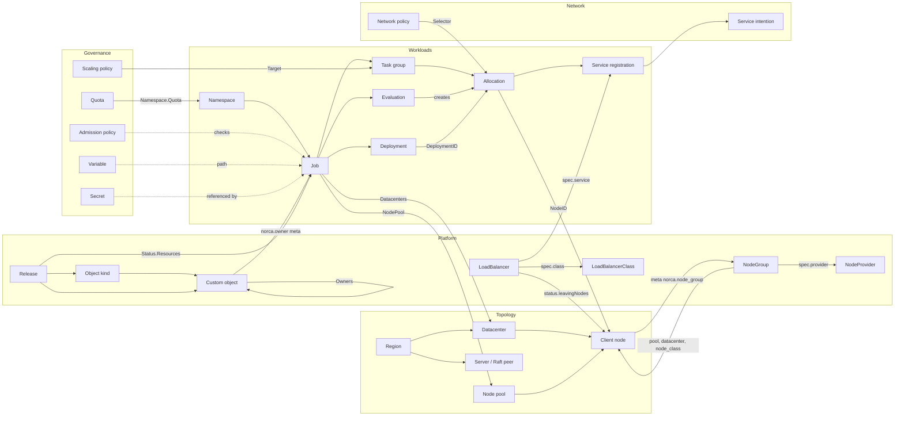
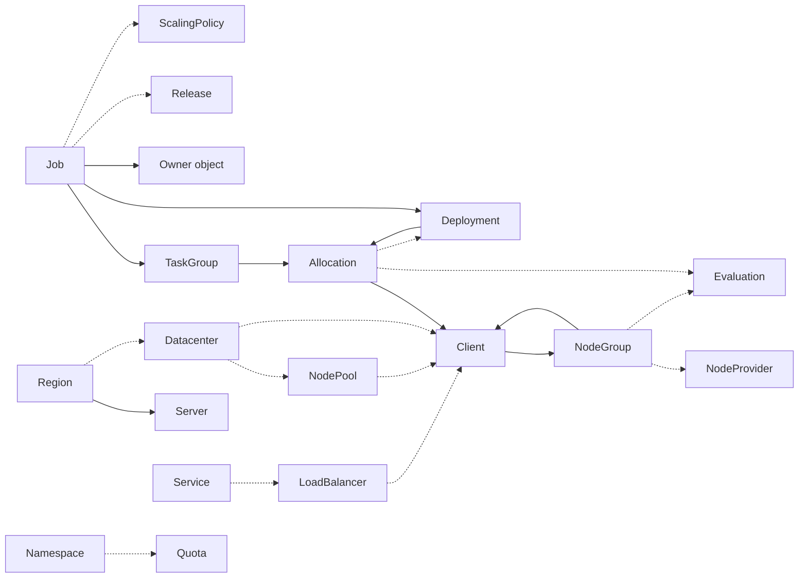

<!--
SPDX-FileCopyrightText: 2026 Norca contributors
SPDX-License-Identifier: MPL-2.0
-->

# Web UI: design and review

- **Date:** 2026-11-06, last revised 2026-11-16
- **Status:** Working document. The audit is of 2026-11-06; later features are added as they land (sections 8 and 10).
- **Scope:** the Norca web UI (`norca/ui`, Ember 6.12 Octane + Tabler). This document reviews what the UI shows today against the objects, relations and metrics the API offers, and proposes how to restructure the menu, the dashboard, the detail pages and a few large overview pages.
- **Companion:** [web-ui-architecture.md](web-ui-architecture.md) describes the technical architecture (frame, transports, build). This document is about information design.

**Conventions.** Paths are relative to the root of the norca repository unless they start with another repository name (`norca-doc/`, `norca-platform/`). `ui/app/...` means `norca/ui/app/...`, `structs/...` means `norca/norca/structs/...`. Every statement about the current state cites a file. Each proposal is marked **Proposal**; everything else describes what existed on 2026-11-06, unless a row carries a later date. The line numbers are those of that day and have moved since; the cited files still exist (checked 2026-11-16). Where something could not be confirmed, the text says **unsure**.

---

## 1. Information gathering: the objects and how they depend on each other

### 1.1 The objects

| Object | API (list / one) | Identity | Human name | UI page today |
| --- | --- | --- | --- | --- |
| Region | `/v1/regions`; `?region=` on every call | name | name | Region selector, dashboard federation strip, `servers` (`<Servers::Regions>`) |
| Datacenter | none; a string on nodes, servers, jobs | name | name | Filter only (clients, topology); group boxes in topology |
| Node pool | `/v1/node/pools`, `/v1/node/pool/:name` | `NodePool.Name` (`structs/node_pool.go`) | name | Filter only (clients, topology); no page |
| Client node | `/v1/nodes`, `/v1/node/:id` | `Node.ID` (UUID, `structs/structs.go:2167`) | `Node.Name` (`:2178`) | `clients`, `clients/:node_id`, `topology` |
| Server / Raft peer | `/v1/agent/members`, `/v1/operator/raft/configuration`, `/v1/status/leader` | member name; Raft ID | member name | `servers`, `servers/:agent_id` |
| Namespace | `/v1/namespaces`, `/v1/namespace/:name` | name | name | Topbar selector only; no page |
| Job | `/v1/jobs`, `/v1/job/:id` | (namespace, `Job.ID`) | `Job.Name` (`structs.go:4520`) | `jobs`, `jobs/:job_name/*` (13 tabs) |
| Task group / task | inside the job | (ns, job, group[, task]) | names | `jobs/:job/groups/:name`, allocation task pages |
| Allocation | `/v1/allocations`, `/v1/allocation/:id` | `Allocation.ID` | `Allocation.Name` = `job.group[index]` (`structs.go:10650`) | `allocations/:id/*`; no global list |
| Deployment | `/v1/deployments`, `/v1/deployment/:id` | `Deployment.ID` | none (job + version) | `deployments`, `deployments/:id`, job tab |
| Evaluation | `/v1/evaluations`, `/v1/evaluation/:id` | `Evaluation.ID` | none (trigger + job/node) | `evaluations` (list + side panel); no route of its own |
| Service registration | `/v1/services`, `/v1/service/:name`, `/v1/services/external` | registration ID | `ServiceName` | `services`, `services/:name`, `endpoints` |
| CSI volume / plugin | `/v1/volumes`, `/v1/plugins` | ID | name | `csi/volumes/*`, `csi/plugins/*` |
| Host volume | on the node (`Node.HostVolumes`, `structs.go:2267`) | name | name | Clients filter "Volume" |
| Variable | `/v1/vars`, `/v1/var/:path` | (ns, path) | path | `variables/*` |
| ACL policy / role / token / auth method | `/v1/acl/*` | name / role ID / accessor ID | name / `ACLRole.Name` / `ACLToken.Name` (`structs.go:13043`) | `access-control/*`, `settings/tokens` |
| Quota | `/v1/quotas`, `/v1/quota-usages` | `QuotaSpec.Name` | name | `quotas/*` |
| Scaling policy | `/v1/scaling/policies`, `/v1/scaling/policy/:id` | `ScalingPolicy.ID` (UUID, `structs.go:6173`) | its target (ns/job/group) | `scaling`, `scaling/:policy_id`, job Scaling tab |
| Object kind | `/v1/object-kinds`, `/v1/object-kind/:group/:kind` | (group, kind) | kind | `kinds`, `kinds/:group/:kind` |
| Custom object | `/v1/objects/:group/:kind`, `/v1/object/:group/:kind/:name[/events]` | `CustomObject.ID` (`structs/objects.go:329`) and (group, kind, ns, name) | name | `objects`, `objects/:group/:kind/:name` |
| NodeGroup, NodeProvider | custom objects of `norca.io` registered by the core (`norca/norca/nodescaling_kinds.go`) | name | name | Generic object page + `<Objects::NodeGroup>` panel; clients badges, card, filter |
| LoadBalancer, LoadBalancerClass | custom objects of `norca.io`, registered by the user (`norca-platform/loadbalancer/operator/*.kind.hcl`) | name | name | Generic object page only |
| CertificateIssuer, Certificate, CertificateOrder | custom objects of `norca.io` registered by the core; the issuing CAs of the region at `/v1/certificates/roots`, `/v1/certificates/crl` | name (the issuer is cluster scoped; the other two: namespace and name) | name | `certificates`; `<Objects::Certificate>` panel on the object page; generic object page for the other two |
| VolumeSnapshotSchedule | custom object of `norca.io` registered by the core, namespaced (`norca/norca/snapshot_kinds.go`) | name | name | Generic object page only |
| CSIVolumeRequest | custom object of `norca.io` registered by the core, namespaced; the name is the volume ID (`norca/norca/volume_request_kinds.go`) | name | name | Generic object page only |
| Tenant | custom object of `norca.io` registered by the core, cluster scoped (`norca/norca/tenant_kinds.go`) | name | name | Generic object page only |
| Release (pack) | `/v1/releases`, `/v1/release/:ns/:name/*`; also `CustomObject:packs.norca.io/Release` | (ns, name) | name | `packages`, `packages/:namespace/:name` |
| Pack registry / pack | `/v1/pack-registries`, `/v1/packs` | name | name | No longer in the UI (2026-11-23, 4.8b): CLI and API only; a pack release is still upgraded on its release page |
| Rigger registry / module | objects `rigger.norca.io/Registry`; `/v1/rigger/registry/:name/search`, `/module`, `/icon`, `/stack`, `/sync`; `/v1/rigger/install` | name; module `<namespace>/<name>` (global) or `<name>` | name | `packages` Catalog tab (`Packages::RiggerCatalog`: kind Modules/Stacks, registry picker, server search with category, keyword, paging; the selection of a `display = "selected"` registry, the whole index on request) and Registries tab (`Packages::RiggerRegistries`) |
| Rigger stack / operation | releases by `owner=stack/<ns>/<name>`; `/v1/rigger/stack/plan`, `/status`, `/apply`, `/destroy`; objects `rigger.norca.io/Operation` (namespaced); `/v1/rigger/operation/:name/log`, `/cancel` | stack `<ns>/<name>` (owner of its releases); operation name | name | `packages` Stacks tab (`Packages::RiggerStacks`: stacks from release owners and operations) and `packages/stack/:namespace/:name` (`Packages::RiggerStack`, 4.8d): releases with part, status, drift (Check status); operations with phase, outcomes, log followed while running (query `operation`), cancel; Apply again (`riggerStackBackend`, version the stack runs, namespace locked), Destroy (typed name) |
| Secret | `/v1/secrets`, `/v1/secret/:path` | (ns, path) | path | `secrets`, `secrets/s/*path` |
| Secret engine / lease | `/v1/secret-engines`, `/v1/secret-leases` | (ns, name) / lease ID | name / none | No page (only referenced in `ui/app/utils/backups.js`) |
| Seal | `/v1/operator/seal` | per server | — | `<Secrets::SealStatus>`, dashboard strip |
| Service intention | `/v1/service-intentions` | (ns, destination, source ns, source) | the pair | `network` |
| Network policy / admin network policy | `/v1/network-policies`, `/v1/admin-network-policies` | (ns, name) / name | name | `network/policies/:ns/:name`, `network/admin/:name` |
| Admission policy | `/v1/admission-policies` | name | name | `admission`, `admission/:name` |
| Backup / restore | `/v1/operator/backups`, `/v1/operator/backup/:id/*`, restores | `BackupRecord.ID`, `BackupRestore.ID` | labels / requester + time | `backups/*` |
| Event | `/v1/event/stream` | (index, topic, key) | — | Dashboard ticker, notifications; no page |
| Metric series | `/v1/metrics/{series,history,summary}` | (metric, labels) | — | Three chart components (section 2) |
| Bus (NATS) | `/v1/operator/bus` | — | — | No UI |
| CDC consumer | `/v1/cdc/consumer/:stream` (`events`, `admin`, `kv`) | (reader, stream) | — | No UI |

### 1.2 The relations, by the field that links them

Classic Nomad relations:

| From | Field | To | Source |
| --- | --- | --- | --- |
| Server | member tag `region`, `dc` | Region, datacenter | `/v1/agent/members` (`ui/app/utils/servers-data.js:41`) |
| Node | `Node.Datacenter` | Datacenter | `structs.go:2175` |
| Node | `Node.NodePool` | Node pool | `structs.go:2230` |
| Node | `Node.NodeClass`, `Node.Meta`, `Node.Attributes` | class; free-form | `structs.go:2227, 2223, 2194` |
| Node | `Node.HostVolumes`, `CSINodePlugins` | host volumes, CSI plugins | `structs.go:2267, 2264` |
| Namespace | `Namespace.Quota` | Quota | `structs.go:5509` |
| Namespace | `Namespace.NodePoolConfiguration` | default / allowed node pools | `structs.go:5516` |
| Job | `Job.Namespace`, `Job.Datacenters` (globs), `Job.NodePool` | Namespace, datacenters, node pool | `structs.go:4509, 4538, 4546` |
| Job | `Job.ParentID` | Parent job (periodic, dispatch) | `structs.go:4516` |
| Allocation | `NodeID`, `NodeName` | Node | `structs.go:10653, 10656` |
| Allocation | `JobID`, `TaskGroup`, `Namespace` | Job, task group | `structs.go:10661, 10665` |
| Allocation | `EvalID`, `FollowupEvalID` | Evaluation | `structs.go:10647, 10736` |
| Allocation | `DeploymentID`, `DeploymentStatus` | Deployment | `structs.go:10722, 10726` |
| Allocation | `PreviousAllocation`, `NextAllocation` | Allocation (reschedule chain) | `structs.go:10715, 10718` |
| Allocation | `PreemptedAllocations`, `PreemptedByAllocation` | Allocation | `structs.go:10740, 10744` |
| Deployment | `JobID`, `JobVersion`, `TaskGroups` | Job version, groups | `structs.go:10214, 10217, 10241` |
| Evaluation | `JobID`, `NodeID`, `DeploymentID`, `TriggeredBy` | Job, node, deployment | `structs.go:12037, 12044, 12051, 12033` |
| Evaluation | `PreviousEval`, `NextEval`, `BlockedEval`, `RelatedEvals` | Evaluation | `structs.go:12072-12086` |
| Evaluation | `QuotaLimitReached` | Quota | `structs.go:12099` |
| Service registration | `NodeID`, `Datacenter`, `JobID`, `AllocID` | Node, DC, job, allocation | `structs/service_registration.go:67-80` |
| CSI volume | plugin, read/write allocations | Plugin, allocations | `ui/app/models/volume.js:15-18` |
| ACL token | `Policies`, `Roles` | Policies, roles | `structs.go:13045, 13049` |
| Scaling policy | `Target` {Namespace, Job, Group} | Task group | `structs.go:6179` |
| Variable | path `nomad/jobs/<job>/<group>/<task>` | Job (implicit) | `ui/app/components/jobs/overview.hbs:49` |

Norca relations:

| From | Field | To | Source |
| --- | --- | --- | --- |
| Custom object | `Group`, `Kind` | Object kind | `structs/objects.go:333-334` |
| Custom object | `Owners[]` {Kind, Namespace, Name, ID} | Owner object or job | `structs/objects.go:351, 386-390` |
| Custom object | `ManagedBy`, `Labels`, `Finalizers` | managing identity; selectors; controllers that must finish | `structs/objects.go:339-356` |
| Job | meta `norca.owner`, `norca.owner.kind` | Owning custom object | `structs/objects_lifecycle.go:52-53` |
| Job | meta `norca.managed-by` | Managing identity | `structs/objects_lifecycle.go:59` |
| Object kind | `Webhooks`, release that installed it | Reconciler webhook; Release (`kindOwners`) | `structs/objects.go:161`; `ui/app/components/kinds/list.js` |
| Object event | `Reporter` | Controller identity that wrote it | `structs/objects_lifecycle.go:136-160` |
| NodeGroup | `spec.pool`, `spec.datacenter`, `spec.node_class` | Node pool, datacenter, class: the nodes of the group | `norca/norca/nodescaling_kinds.go:50-52` |
| NodeGroup | `spec.provider`, `spec.group` | NodeProvider name, provider group (`NodeProvider.spec.groups[].name`) | `nodescaling_kinds.go:98-99` |
| NodeGroup | `status.nodes[].node`, `.instance` | Node ID, provider instance | `nodescaling_kinds.go:154`; `ui/app/utils/node-scaling.js:64` |
| NodeGroup | `status.rollout.replacing[].node`, `.nodeName` | Node | `nodescaling_kinds.go:160-175` |
| NodeGroup | `status.rollout.outdated[]`, `warned[]` | Node **names** | `nodescaling_kinds.go:179-180` |
| NodeGroup | `status.strayNodes[].node`, `status.removal.node` | Node | `nodescaling_kinds.go:195-205` |
| NodeGroup | `status.decision.work[]` {namespace, job, group}, `.evaluations` | Task groups and blocked evaluations that drove the scale | norca-platform report; commit `08ee9f289` |
| Node | meta `norca.node_group`, `norca.instance`, `norca.created_by`, `norca.node_group_revision`, `norca.node_group_generation`, `norca.created_at`, `norca.cert_expires`, `norca.scale.replace`, `norca.scale.protect` | NodeGroup, instance; rollout state | `ui/app/utils/node-scaling.js:14-25` |
| Node | meta `norca.lb.leaving` | Edge node leaving its load balancers | `node-scaling.js:24` |
| Job service | `expose { load_balancer }` → service meta `norca_lb_class`, `norca_lb_port`, `norca_lb_internal` | LoadBalancer object (created by the operator) | commit `e8b455177` |
| LoadBalancer | `spec.service`, `spec.class`, `spec.datacenters` | Service, LoadBalancerClass, DCs | `norca-platform/loadbalancer/operator/loadbalancer.schema.json` |
| LoadBalancer | `status.targets`, `status.leavingNodes` | Instances, nodes | same |
| Certificate | `spec.issuer` | CertificateIssuer (cluster scoped, by name) | `ui/app/utils/certificates.js` |
| Certificate | `spec.secret_path`; back: the secret's label `norca.io/certificate` | Secret of the namespace (its expiry is `status.notAfter`) | same |
| Certificate | `status.order`; back: `CertificateOrder.spec.certificate` = `<ns>/<name>` | CertificateOrder | same |
| Certificate | `status.authority` | An issuing CA of `/v1/certificates/roots` | same |
| Namespace | metadata `norca.io/certificate-*` | What the namespace may ask for | same |
| VolumeSnapshotSchedule | `spec.volume` | CSI volume of the namespace (can't be changed) | `norca/norca/snapshot_operator.go` |
| VolumeSnapshotSchedule | `status.snapshots[]` {id, name, volume, plugin} | The CSI snapshots it took and keeps (the plugin's IDs) | same |
| CSIVolumeRequest | its name, `status.volumeCreateIndex` | The CSI volume of that ID in the namespace, the one it created or adopted | `norca/norca/volume_request_operator.go` |
| CSIVolumeRequest | `spec.plugin_id`, `spec.secret_path` | CSI plugin; secret of the namespace | same |
| Tenant | `spec.namespace.name` (default the tenant's name); `status.namespace` | Namespace (one tenant per namespace) | `norca/norca/tenant_kinds.go` |
| Tenant | `status.resources[]` {type, name, namespace, id} | The namespace, quota (`<tenant>`), ACL policies and ACL roles (`<tenant>-<role>`), network policy `tenant-isolation` it created | `norca/norca/tenant_operator.go` |
| Namespace | metadata `norca.io/certificate-*` written from `spec.certificate_*` of a Tenant | What the namespace may ask certificates for | same |
| Release | `Spec.Pack`; `Status.Resources[]` {Type, Namespace, Job, Object, ObjectKind, Quota, ACLPolicy, Variable, AdmissionPolicy, ExternalService, SecretKeys} | Pack; every object it created | `structs/release.go` |
| Secret lease | `Engine`, `Role`, `AllocID`, `JobID`, `TaskGroup`, `Task`, `NodeID` | Engine, allocation, job, node | `structs/secret_engine.go` |
| Secret | `SecretMeta.Owner`, `Labels`; referencing jobs (scan) | Owner; jobs | `structs/secrets.go:223`; `ui/app/components/secrets/detail.js` (`findReferencingJobs`) |
| Service intention | `Source`, `SourceNamespace`, `Destination` | Services | `structs/mtls.go` |
| Network policy | `Namespace`, `Selector`; admin: `Namespaces`, `Selector` | Workloads | `structs/network_policy.go` |
| Backup | `Region`, `LeaderID`, `Labels` | Region, server | `structs/backup.go:169` |
| Restore | `BackupID`, `RequestedBy`, `RequestedByName`, `PreRestoreBackupID` | Backup, token, backup | `structs/backup.go:831` |
| Scaling decision event | `JobID`, `Group`, `PolicyID`, `Quota` | Task group, policy, quota | `structs/scaling_decision.go:39` |
| Event | `Topic`, `Key`, `Payload` | Any object of the topic | `structs/event.go:29-42`; Norca topics: `Backup`, `Quota`, `Scaling`, `Secret`, `SecretAccess`, `ServiceIntention`, `NetworkPolicy`, `AdmissionPolicy`, `CustomObject` |

Operators and controllers have **no registry object** in the API (unsure whether one is planned). What identifies one today: the job that runs it (often with a release that installed it), the `Reporter` of the object events it writes, `ManagedBy` on the objects it manages, the owner meta on the jobs it creates, and the `Webhooks` of a kind. Their Prometheus metrics live on the operator's own `/metrics` port (section 2).

### 1.3 Dependency diagram

---

## 2. Available metrics

### 2.1 Sources

| Source | What | Labels (the object it belongs to) | Where | Read by the UI |
| --- | --- | --- | --- | --- |
| **Metrics store** (tstorage on every server, `norca/norca/metricsstore/`; retention 1h–30d, default 30d, reload by SIGHUP; default disk cap 4GiB, plus the hosts store `tsdb-hosts` for `norca.node/server/bus.*`: `host_retention` default 7d, cap 1GiB) | Task group series: `norca.group.cpu`, `cpu_mhz`, `cpu_throttled`, `memory`, `memory_mb`, `memory_cache_mb`, `memory_swap_mb` (only drivers that measure swap; not docker on cgroups v2), `oom_kills`, `restarts`, `allocs_running`, `allocs_queued`, `allocs_starting`, `allocs_failed`, `allocs_lost`, each stored as `.avg` and `.max` (`metricsstore/metrics.go`) | `ns`, `job`, `group` (task group) | `/v1/metrics/history`, `/v1/metrics/summary` | Yes, partly (not the phase 2 series) |
| Metrics store, node host stats (family 7, from the clients' usage reports) | `norca.node.{cpu_used,cpu_mhz,memory_used_mb,memory_total_mb,disk_used_mb,disk_total_mb,inodes_used_percent}` | `node`, `dc`, `pool`, `class` | `/v1/metrics/history`, `/v1/metrics/series` | No (the client page polls live stats) |
| Metrics store, nodes by state | `norca.nodes.{down,disconnected,draining,ineligible}` | `dc`, `pool` | same | No |
| Metrics store, control plane (family 5) | `norca.sched.{broker_ready,broker_unacked,broker_pending,broker_waiting,broker_delayed,plan_queue_depth,blocked_total,blocked_escaped,blocked_quota_limit,heartbeats_active}`, `norca.jobs.{pending,running,dead}` (`ns`), `norca.secrets.{leases_active,expiring,expired,rotation_due}`, `norca.backup.{last_success_age_seconds,size_bytes,duration_seconds}` (`destination`), `norca.security.{certificates_issued,admission_denied,webhook_calls,webhook_errors}` (`webhook`), `norca.autoscaler.{queue,policies,oscillation_suspended}`, `norca.store.{disk_bytes,series,dropped_reports}` | mostly none (region); jobs, backups, webhooks as noted | same | No |
| Metrics store, server internals (family 8, each server samples its own; read another server with `server_id`) | `norca.server.{raft_db_bytes,raft_last_contact_seconds,raft_commit_lag,raft_fsm_pending,raft_term}`, `norca.bus.{jetstream_bytes,jetstream_messages,routes}` | none (per server by the store it is in) | same, operator read | No (a servers page would show them) |
| Metrics store, objects (family 9) | `norca.nodegroup.{replicas,ready,joining,failed,rollout_replacing,rollout_outdated}` (`group`), `norca.nodegroup.{nodes_ready,cpu_allocated,memory_allocated}` (`group`: the ready, eligible nodes that name the group in the meta `norca.node_group`, and the share of their CPU and memory that is allocated; `318c841b6`), `norca.nodegroup.condition` (`group`, `type`), `norca.lb.{targets,ready}` (`ns`, `name`), `norca.objects.{count,degraded}` (`kind`) | as listed | same | No |
| Metrics store, certificates | `norca.certificate.{ready,expires_hours}` (`metricsstore/gauges.go`) | `ns`, `name` | same | No (the Certificates page computes the expiry from `status.notAfter`) |
| Metrics store, cluster gauges (`metricsstore/gauges.go`) | `norca.cluster.{cpu,memory}_{allocated,used}`, `disk_allocated`, `nodes_ready` | `dc`, `pool`, `class` (empty class = all) | `/v1/metrics/history`, `/v1/metrics/series` | Only the four cpu/memory series, class `""` |
| Metrics store, blocked demand (leader only, `norca/norca/metrics_store_blocked.go`) | `norca.cluster.blocked_{cpu_mhz,memory_mb,evals,allocs_exclusive,unverifiable}` | `dc`, `pool` | same | No |
| Metrics store, autopilot (leader only) | `norca.cluster.autopilot_healthy`, `autopilot_failure_tolerance` | none (region) | same | No |
| Metrics store, quotas | `norca.quota.{cpu_mhz,memory_mb}_{allocated,used}` | `quota` | same | No |
| Metrics store status | partitions, disk, series, dropped reports, forgotten series (no point within the retention), retention | per server | `/v1/operator/metrics-store` | No (CLI only) |
| **Client stats** (live) | Host CPU/memory/disk; alloc and task CPU ticks, RSS, usage | node; allocation; task | `/v1/client/stats`, `/v1/client/allocation/:id/stats` | Yes, polled every 2 s while the page is open (`ui/app/utils/classes/abstract-stats-tracker.js:82`) |
| **go-metrics telemetry** (prefix `norca.` since 2026-11-27, `telemetry.MetricsServiceName`; table in `norca/helper/telemetry/names.go`) | `norca.client.host.*`, `norca.client.allocs.*` (+ Norca `network_policy.dropped`), `norca.server.{broker,plan,worker,heartbeat,rpc,fsm,blocked_evals}.*`, `norca.raft.*`; Norca: `norca.server.{backup,secrets,admission,custom_object,mtls,autopilot}.*`, `norca.autoscaler.*` | node_id, datacenter, node_pool, alloc_id, job, task_group, task, namespace | `/v1/metrics` (JSON or Prometheus) | No |
| **Controller runtime** (`norca/controller/metrics.go:113-137`) | `norca_controller_reconcile_total{controller,result}`, `_reconcile_seconds`, `_queue_depth`, `_resync_total`, `_events_total`, `_leader`; own series via `SetGauge`/`AddCounter` (`metrics.go:101-111`) | controller | The operator's own `/metrics` port | No (not reachable through the agent API) |
| Node scaling operator (`norca-platform/nodescaler/operator/orphans.go:91-93`) | `norca_nodescaler_orphaned_instances{provider}`, `norca_nodescaler_orphans_deleted_total{provider}` | provider | operator `/metrics` (`-metrics-addr`, off by default) | No |
| Scaling events | Count changes per group (last 20), decisions | task group, policy | `/v1/job/:id/scale`, topic `Scaling` | Yes |
| Object status snapshots | NodeGroup `status.*`, LoadBalancer `status.*`, Release status | the object | `/v1/object/...`, `/v1/release/...` | Partly (section 8) |

Notes: the metric names in [internal-metrics-storage-tstorage.md](internal-metrics-storage-tstorage.md) differ from the code (for example `cluster.cpu.allocated_ratio` there, `norca.cluster.cpu_allocated` in code; no `region` label); the code is authoritative, as that document's section 1.1 says. Task group series have no `alloc_id`, `node_id` or `task` label, so the store cannot answer per-node or per-allocation questions. The ACL of a series follows its object: task group series need `read-job`, `norca.cluster.*` node read, autopilot operator read, `norca.quota.*` quota read (`norca/norca/metrics_store_endpoint.go:76-89`).

### 2.2 Where metrics appear in the UI today

| Component | Mounted at | Endpoint | Object | Shown |
| --- | --- | --- | --- | --- |
| `<Metrics::ClusterHistory>` (`ui/app/components/metrics/cluster-history.js:19-24`) | Dashboard (`components/dashboard.hbs:228`) | `/v1/metrics/series`, `/v1/metrics/history` ×4 | dc/pool | cpu and memory allocated vs used, 1h–30d; class series dropped by the filter at `cluster-history.js:85` |
| `<Metrics::TaskGroupHistory>` (`components/metrics/task-group-history.js`) | Task group page (`templates/jobs/job/task-group.hbs:67`) | `/v1/metrics/history` ×5, `/v1/metrics/summary` | task group | `cpu_mhz` avg/max, `cpu_throttled`, `memory_mb`, `memory_cache_mb`, OOM marks, right-sizing table |
| `<Metrics::ScalingHistory>` (`components/metrics/scaling-history.js:59-67`) | Scaling policy page (`components/scaling/policy.hbs:52`) | `/v1/metrics/history` | task group | `norca.group.cpu` %, `memory` %, `allocs_running` |
| Scaling step chart, decisions | `components/scaling/policy.hbs:38-46`, `components/jobs/scaling.hbs:54` | `/v1/job/:id/scale`, topic `Scaling` | task group | count over time |
| `<PrimaryMetric::*>` (`components/primary-metric/`) | client page (`templates/clients/client/index.hbs:123-126`), allocation, task, topology | client stats | node, alloc, task | live CPU and memory since the page opened |
| `allocations/usage` meters | allocation rows, task rows, plugin rows | client stats | alloc, task | latest CPU/memory vs reserved |
| `topology/utilization.hbs` | topology | Ember store | dc, node | reserved vs capacity (not usage) |
| Dashboard stats, quota bars | `components/dashboard.hbs:114-155`; `quotas/*` | summaries, `/v1/quota-usages` | cluster, quota | current counts only |
| Added 2026-11-07 (norca `8a2834f3d`), on `<Metrics::GaugeHistory>` and the retention-aware ranges (`utils/metrics-component.js`, service `metrics-retention`) | servers list, server page, client page, task group page, NodeGroup and LoadBalancer object pages, dashboard | `/v1/metrics/history` (with `server_id` per server), `/v1/metrics/series`, `/v1/operator/metrics-store` | server, node, task group, NodeGroup, LB, region | store status per server (differing retention/disk cap flagged); Raft and bus history; host history; allocations, restarts, swap; scale history and condition band; LB health history; control plane card. Ranges offer only what the store holds (`Retention` in the responses) |

### 2.3 Gaps

Metrics that exist and no page shows:

1. Cluster gauges `nodes_ready`, `disk_allocated`, the per-class series, all five `blocked_*` gauges and the autopilot gauges. The blocked-demand gauges are what drives node scaling (commits `9e87a5b66`, `0f973092f`), yet neither the dashboard nor the NodeGroup page shows them.
2. `norca.group.allocs_queued`; the percent metrics `norca.group.cpu`/`memory` on the task group page (they appear only on the scaling policy page).
3. All `norca.quota.*` histories; quota pages show the current usage only.
4. Metrics store status (`/v1/operator/metrics-store`): disk, series against `max_series`, dropped groups. A dropped task group silently has no chart.
5. All of `/v1/metrics`: broker/plan queues, raft, heartbeats, autoscaler, backup age and failures, secrets expiring/rotation due, admission denials, `custom_object.throttled`, mTLS issuance, network policy drops. Since metrics store phases 1–2 most of these (not raft, `custom_object.throttled`, network policy drops) also have a stored history (families 5, 6, 7, 9 in section 2.1), and since 2026-11-07 (section 2.2, last row) the UI shows node host history, alloc failures/restarts/swap, NodeGroup and LB series, server Raft/bus series and a control plane card; still not shown: secrets, backup, security and autoscaler series, quotas history, per-peer Raft times and RPC counters.
6. Controller and operator metrics: not reachable through the agent at all.
7. NodeGroup status fields that are effectively metrics: `status.decision`, `lastRequest`, `join.failures`, `scaleDown.vetoes`, `rollout.took`, `rollout.warned`, `capacity`/`allocatable` (only visible as raw JSON).

Objects with no stored history: allocations (live polling only, no `alloc_id` series in the store by design), jobs as a whole (only per task group; job counts per namespace), servers (autopilot gauges and, since phase 3, per-server Raft and bus series are stored but not shown), NodeProviders, custom objects other than counts per kind, controllers, CSI, services and network policies, deployments and evaluations. Nodes (host stats), NodeGroups, LoadBalancers, backups and secrets (counts) have stored history since phases 1–2.

---

## 3. Visualization options per object

### 3.1 Lists, detail pages, editors, filters

| Object | List (filters) | Detail page | Editor | API filter parameters not used by the UI |
| --- | --- | --- | --- | --- |
| Job | `jobs` (namespace, type, status, datacenter, node pool, prefix; `controllers/jobs/index.js`) | 13 tabs (`components/jobs/tabs.js`) | HCL/JSON editor, run, dispatch, scale | `filter` expression (e.g. by meta `norca.owner`) |
| Allocation | none global; per job, per node, per deployment | `allocations/:id` + task tabs (overview, logs, files) | — (stop/restart actions) | `/v1/allocations?filter=` |
| Client node | `clients` (state, node pool, node group, class, datacenter, version, volume; `templates/clients/index.hbs:43-91`) | overview + monitor (`components/clients/tabs.js`) | drain, eligibility, meta | `filter` on meta (`/v1/nodes?filter=`) |
| Node pool | — (filter options only) | — | — | `/v1/node/pool/:name/{nodes,jobs}` |
| Namespace | — (topbar selector) | — | — | `/v1/namespaces` |
| Server | `servers` (Raft voter, leader badge; `components/servers/list-row.hbs:16-35`) | details + tags + monitor (`templates/servers/server/index.hbs`) | — | `/v1/operator/autopilot/health` (not called; grep finds no use in `ui/app`) |
| Deployment | `deployments` ("show finished" switch, `components/deployments/list.hbs:56`) | `deployments/:id` | promote/fail | — |
| Evaluation | `evaluations` (status, triggered by, type, job, namespace) | side panel `<EvaluationSidebar::Detail>` | — | — |
| Custom object | `objects` (kind select, `components/objects/list.hbs:9`) | `objects/:group/:kind/:name` (spec, status, conditions, events, labels, finalizers, owners, owns) | schema-validated editor with dry run | `Labels` selector of `CustomObjectListRequest` (`structs/objects.go:623`) |
| Object kind | `kinds` | `kinds/:group/:kind` | kind editor | — |
| Certificate | `certificates` (certificates by expiry with their state, issuers, open orders, issuing CAs) | object page with the Certificate panel (`components/objects/certificate.*`) | generic object editor; Revoke with a confirmation | — |
| Release | `packages` (sections: releases, Rigger stacks, Rigger catalog, Rigger registries) | `packages/:ns/:name` | install form of a Rigger module (the pack form with a backend, `utils/rigger.js` `riggerBackend`: ValuesJSON, adopt, no atomic or description, secret-store variables listed); release page of a Rigger release (4.8c): module, source, registry (`Pack.Registry`, set by server installs), owner stack and part (links to the stack page), Upgrade from the registry when no stack owns it, no "Edit values"; pack upgrade, rollback | — |
| Service | `services` | `services/:name` | — | — |
| External service / domain | `endpoints` | — | parse/format editor | — |
| Intentions, network policies | `network` | `network/policies/:ns/:name`, `network/admin/:name` | unified editor | — |
| Quota | `quotas` | `quotas/:name` | `quotas/new`, `/edit` | — |
| Scaling policy | `scaling` (engine filter) | `scaling/:policy_id` | job scaling editor | — |
| Variable, secret, admission, backup, ACL | own lists | own pages | own editors | Secret engines and leases have no page at all |

### 3.2 Raw IDs shown to a human, and the name that could be shown instead

The UI already resolves some IDs well: the client header and page title use `or name shortId` (`components/clients/header.hbs:11`, `templates/clients/client/index.hbs:7`), the allocation title uses `Allocation.Name` (`templates/allocations/allocation/index.hbs:7`), the dashboard event ticker uses the node name (`ui/app/utils/event-summary.js:90`), the endpoints page has a `nodeName(id)` resolver (`components/endpoints/page.js:151`), backup contents fall back from `NodeName` to the short ID (`components/backups/contents.js:89`), the rollout table uses `nodeName` (`components/objects/node-group.hbs:54`), and the restore request shows `RequestedByName` (`components/backups/request.js:86`).

The established pattern elsewhere is the opposite: the **short ID is the link text** and the name is at best a tooltip; `components/ui/tooltip.hbs:9-11` documents exactly that as its usage example. Short IDs come from `shortUUIDProperty` (`ui/app/utils/properties/short-uuid.js`, the part before the first `-`) on the `node`, `allocation`, `deployment`, `evaluation` and `reschedule-event` models, and from ad-hoc `split('-')[0]` / `slice(0, 8)` in about 15 components (for example `components/objects/node-group.js:93`, `utils/event-summary.js:17`, `utils/secrets.js:175-176`).

**When is the name already loaded?** `allocation.node`, `evaluation.node` and `service.node` are lazy relationships: reading `node.name` fetches that client once (`GET /v1/node/:id`). Where a tooltip already reads `@allocation.node.name`, that fetch happens today, so showing the name in the cell costs nothing extra. All clients are loaded up front on the client pages (`routes/clients.js:24`) and the topology page (`routes/topology.js:25`); on job pages only for system/sysbatch jobs (`routes/jobs/job.js:53-55`).

**Client node ID** (node name `Node.Name`, `structs.go:2178`; the allocation API also carries `NodeName`, `structs.go:10656` and `AllocListStub.NodeName` `:11469`, but the Ember allocation model does not map it: `ui/app/models/allocation.js` has no `nodeName` attribute):

| Where | Shown | Name available |
| --- | --- | --- |
| `components/clients/list-row.hbs:16-18` | short ID column is the link; the Name column is plain text | `node.name` loaded. Make the name the link, the ID an optional column |
| `components/jobs/client-status-row.hbs:8-11` | same pattern | `row.node.name` loaded |
| `components/allocations/row.hbs:51-54` (shared allocations table: job, task group, volume, preemptions) | `allocation.nodeShortId`; the table also sorts the Client column by `node.shortId` (`components/allocations/table.js:22`) | `node.name` (already fetched for the tooltip), or `NodeName` from the payload via a new `@attr nodeName` |
| `components/allocations/service-panel.hbs:48-51` | `nodeShortId` | same |
| `templates/allocations/allocation/index.hbs:72-74`, `:212` (preempted by) | `nodeShortId`, `preempter.node.shortId` | `node.name` |
| `templates/evaluations/index.hbs:82-88` | `evaluation.shortNodeId` | `evaluation.node.name` (`models/evaluation.js:33`), not loaded here: one fetch per distinct client, or a node index |
| `templates/topology.hbs:86`, `:136-140` | `node.shortId` (name in a separate row) | `node.name` loaded |
| `components/reschedule-event-row.hbs:29-34` | `allocation.node.shortId`, no name anywhere | `node.name` (lazy) |
| `components/storage/plugin-allocation-row.hbs:46-50` | `allocation.node.shortId` | `node.name` (tooltip) |
| `templates/jobs/job/services/service.hbs:27-32` | `node.shortId` | `node.name` (tooltip) |
| `components/clients/header.js:14` | breadcrumb label `client.shortId` (title and copyable full ID are fine) | `client.name` |
| `controllers/jobs/job/allocations.js:206-220`, `controllers/jobs/job/task-group.js:198-212` | Client **filter options** keyed and labelled by `node.shortId` (the code comment says "client names") | `node.name` |
| `components/objects/node-group.hbs:24` | `i.shortNode` (instance table, `node-group.js:93`) | `status.nodes[]` has no node name: look it up in the store / `/v1/nodes`, or have the operator write `nodeName` as it already does in `rollout.replacing` |
| `components/objects/node-group.hbs:39` | full node UUID in the scale-down alert | `status.removal.name` is the instance; node name via lookup |
| `utils/secrets.js:176` → secret detail "By" column (`components/secrets/detail.hbs:160`) and `components/secrets/list.js:103` | `client <8 chars>` | the access record has only `NodeID` (`structs/secrets.go:563-582`): lookup |

**Allocation ID** (name `Allocation.Name` = `job.group[index]`, `structs.go:10650`, always loaded on the model; it is not unique over time, since a replacement keeps the name, so show the name with a muted short-ID suffix):

| Where | Note |
| --- | --- |
| `components/allocations/row.hbs:23-25` | the shared allocations table (`components/allocations/table.js:58-61`) has **no Name column** at all |
| `components/allocations/header.js:45-50`, `components/fs/breadcrumbs.js:73`, `templates/allocations/allocation/fs.hbs:6` | breadcrumbs and the file browser page title use `shortId` (the overview title uses the name) |
| `templates/topology.hbs:122-126`, `components/reschedule-event-row.hbs:20-27`, `components/allocations/service-panel.hbs:36-39`, `templates/jobs/job/services/service.hbs:22-25`, `components/job-status/deployment-history.hbs:35`, `components/job-status/individual-allocation.hbs:14,19` (tooltip, aria-label), `components/topo-viz/node.hbs:100` (aria-label), `components/storage/plugin-allocation-row.hbs:20` | `.name` loaded or lazily available |
| `components/services/detail.hbs:33-37`, `components/network/policy.hbs:81` | the payloads (service registration, network policy status `api/network_policies.go:78-86`) carry no allocation name: lookup or a backend field |
| `utils/event-summary.js:56` (dashboard ticker, notifications, job events) | "Allocation <short> <status>"; `Name` is in the event payload |
| `components/backups/compare.hbs:54` | full allocation and deployment UUIDs in a column labelled "Name" (the server sends only the ID, `norca/norca/backup_browse.go:717-741`) |

Already fine: `templates/allocations/allocation/index.hbs:206-208` (name and link), `components/deployments/detail.hbs:86-87` and `components/backups/job-history.hbs:94` (Name column next to the ID). Deliberate: the exec CLI hint and URL parameter (`controllers/exec.js:122-124`, `utils/generate-exec-url.js`).

**Evaluation ID** (no name in the model or the API; a readable title is "`TriggeredBy` of job `<name>`" or "`TriggeredBy` on node `<name>`", fields at `structs.go:12033-12044`): `templates/evaluations/index.hbs:74`, `templates/jobs/job/evaluations.hbs:19`, `components/evaluation-sidebar/detail.hbs:17`, `components/evaluation-sidebar/evaluation-actor.hbs:17,21`, `utils/event-summary.js:73`. The Resource column and the side panel show the job ID (`plainJobId`), not the job name.

**Deployment ID** (no name; "`<job>` v`<JobVersion>`", `structs.go:10214-10217`, as the deployment page already titles itself, `components/deployments/detail.hbs:6`): `components/jobs/deployment.hbs:9`, `components/jobs/multiregion-timeline.hbs:37`, `components/job-status/panel/deploying.hbs:12` (badge "Deploying <id>"; "Deploying version N" is clearer), `components/backups/job-history.hbs:79`, `components/backups/contents.js:67`. The browser tab title of the deployment page is the bare word "Deployment" (`templates/deployments/deployment.hbs:5`).

**Job ID instead of job name.** The two differ only when the spec sets `name`, but several payloads carry only `JobID`: `components/dashboard.hbs:209,214`, `components/deployments/list.hbs:61,69`, `components/quotas/detail.hbs:63`, `components/quotas/list.hbs:74`, `components/scaling/list.hbs:67`, `components/scaling/policy.hbs:6`, `components/services/detail.hbs:35`, `components/network/policy.hbs:82`, `components/frame/command-palette.js:290`, `utils/event-summary.js:48,57,74,100` (at `:100` the payload has `Name`). The name is reachable with `store.peekRecord('job', JSON.stringify([id, ns]))` when the job is loaded.

**Other IDs**:

| ID | Where | Better |
| --- | --- | --- |
| Token accessor (secret access audit, restore requests) | `utils/secrets.js:175` ("token <8>"), `utils/backups.js:167-172` (`identityLabel`); restore approvals list no names (`components/backups/request.js:95`) | `ACLToken.Name` (lookup needs management); the restore requester already has `RequestedByName` (`request.js:84-87`) |
| Token accessor on token pages | `components/token-editor.hbs:15-26`, `templates/settings/tokens.hbs:133-136` | deliberate, labelled fields: fine |
| Restore ID | `components/backups/detail.hbs:148` (short ID link), `components/backups/restore-wizard.hbs:230` (full ID) | requester name + time + mode (`structs/backup.go:831`); `components/backups/list.hbs:77` already uses "Full/Selective restore" |
| Backup ID | time-based `UTC-time-raftIndex` (`norca/backup/manifest.go:56`), shown in lists, titles, toasts | readable as is; labels could be shown next to it |
| Scaling policy ID | full UUID in the subtitle (`components/scaling/policy.hbs:7`); title is "Job / Group" | fine |
| Leader | resolved to the member name, falls back to the address (`utils/dashboard-data.js:105-116`) | fine |
| NodeGroup instance names | provider machine IDs (`components/objects/node-group.hbs:21`) | nothing better exists |
| Object event `Reporter` | `components/objects/detail.js:266` ("by <reporter>") | an identity string; mapping it to a controller/job needs a lookup (**unsure** of the format) |
| Custom object UID, release, quota, variable, policy, role IDs | not shown as text (names are used) | fine |

Small bugs found during the audit, fixed in `8233f3f29` (2026-11-08): `ui/app/models/reschedule-event.js` defined `previousNodeShortId` from itself (instead of `previousNodeId`); `ui/app/routes/allocations/allocation.js` built the not-found message from the params object ("[object Object]"); `accessorLabel` in `ui/app/utils/secrets.js` ignored `Accessor.System`, so system accesses read "anonymous".

**Proposal (ID display rule).** One component, `<Ui::ObjectLink @type @id @name>`, renders the human name as link text, the short ID in muted monospace after it (or in the tooltip), and the full ID on copy. Resolution order: name in the payload (`NodeName`, `Name`, `RequestedByName`) → name from the Ember store → a cached per-region index (`/v1/nodes` stub list, already fetched by several pages) → short ID. An `IdentityService` holds the node index per region and is refreshed by `Node` events.

---

## 4. The sidebar: current and proposed

### 4.1 Current

The menu is `NAVIGATION` in `ui/app/utils/navigation.js:12-197`, rendered by `components/frame/sidebar.hbs:31-50` with `ability` gates (`sidebar.js:23-27`):

| Group | Items |
| --- | --- |
| Overview | Dashboard |
| Workloads | Jobs, Packages, Objects, Deployments |
| Services and networking | Services, Intentions and rules, Endpoints and domains |
| Capacity | Clients, Topology, Storage, Quotas, Scaling |
| Configuration | Variables, Secrets, Certificates, Admission policies, Type definitions |
| Operations | Servers and regions, Evaluations, Backups |
| Access | Tokens, policies, roles |

Findings:

- The comment at the top (`navigation.js:6-11`) says packages, objects, deployments, services, quotas, scaling, admission, type definitions and backups are "planned"; they all exist. Node pools and events are still missing.
- "Objects" is one item for every kind: NodeGroups, NodeProviders, LoadBalancers and Releases are reachable only through a kind dropdown, although node scaling is a cluster-topology concern and load balancers a networking one.
- Evaluations (scheduling of workloads) sit under Operations, away from jobs and deployments; Servers and regions (the topology) sit under Operations, away from Clients.
- Evaluations and Type definitions share the icon `list-details` (`navigation.js:152, 170`).
- No item for node pools, namespaces, secret engines/leases, metrics, or the event stream.

### 4.2 Proposal: group by relationship

| Group | Items | Why |
| --- | --- | --- |
| **Overview** | Dashboard, Region map *(new, section 7)*, Activity *(new: event stream page)* | Where to start; what is happening now |
| **Cluster** | Regions and servers, Datacenters and node pools *(new)*, Clients, Node groups *(new: NodeGroup + NodeProvider)*, Topology, Storage | Everything that answers "where does work run": region → DC → pool → node, and what creates nodes |
| **Workloads** | Jobs, Deployments, Allocations *(new global list)*, Evaluations, Packages | The job and everything it spawns; evaluations explain placement |
| **Networking** | Services, Endpoints and domains, Load balancers *(new, shown when the kind exists)*, Intentions and rules | Traffic into and between workloads |
| **Governance** | Namespaces *(new)*, Quotas, Scaling policies, Admission policies | What limits or changes workloads |
| **Security** | Access control, Secrets (+ engines and leases), Variables, Certificates (exists since 2026-11-15 for the certificates the servers issue and for the issuing CAs, section 8; *new:* the mTLS roots and the distrusted CAs, which need an API) | Identities, secrets and trust |
| **Platform** | Objects, Type definitions, Operators *(new, inferred: see 1.2)* | The operator framework itself |
| **Operations** | Backups, Metrics *(new: store status and explorer)* | Running the control plane |

Rules for the menu: (a) a kind gets a menu item when the core registers it (NodeGroup, NodeProvider) or when it is present in the cluster (LoadBalancer); (b) every item answers one question; (c) items hidden by ACL stay hidden (`ability`), and a group with no visible items disappears.

---

## 5. The dashboard

### 5.1 Current

`ui/app/components/dashboard.{js,hbs}`, data from `ui/app/utils/dashboard-data.js:142-193` (leader, nodes, jobs, deployments, blocked evaluations, backups, quotas, quota usages, releases, seal), refreshed per region on `Job`, `Deployment`, `Evaluation`, `Allocation`, `Node` events (`dashboard.js:22`), polling every 30 s otherwise.

| Block | Content | Notes |
| --- | --- | --- |
| Federation strip (`dashboard.hbs:28-112`) | per region: leader (member name), servers alive, clients ready/down, seal, last backup, allocation bar | No capacity or Raft health |
| Four stats (`:114-155`) | deployments in progress, blocked evaluations, failed/lost allocations, clients ready | "Deployments in progress" links to `jobs`, not `deployments` (`:122`); "failed" links to `jobs` |
| Warnings (`:159-189`, `buildWarnings` `dashboard-data.js:335`) | unreachable region, no leader, servers down, secret store recovery, clients down/disconnected, blocked evals, quota nearly full, release problems, overdue backup, failed deployment | No NodeGroup or LoadBalancer conditions |
| Deployments in progress (`:191-226`) | job ID, region, version, healthy bar | Shows `JobID`, not `Job.Name` |
| Cluster history (`:228`) | `<Metrics::ClusterHistory>` | one dc/pool at a time |
| Allocations by status (`:232-242`) | doughnut | |
| Latest events (`:244-255`) | 8 events | Allocation and evaluation titles use short IDs |

### 5.2 Proposal

Keep the federation strip (it works for multi-region). Replace the static counts with capacity and pressure from the metrics store, and add an "in progress" view.

| Block | Data | API |
| --- | --- | --- |
| **Capacity per datacenter / pool** (replaces the single-scope chart): a small-multiples grid, one cell per dc/pool, each with allocated vs used CPU and memory sparklines (24 h), ready nodes, and a red mark when blocked demand is non-zero | `norca.cluster.{cpu,memory}_{allocated,used}`, `nodes_ready`, `blocked_cpu_mhz`, `blocked_memory_mb`, `blocked_evals` | `/v1/metrics/series` once, then `/v1/metrics/history` per series (**Proposal**: a batch endpoint, `history?metric=a&metric=b`, to avoid N×M requests) |
| **Control plane health**: autopilot healthy, failure tolerance (sparkline), Raft voters | `norca.cluster.autopilot_*`, `/v1/operator/raft/configuration` | metrics store; operator read |
| **Operations in progress** (replaces "Deployments in progress"): deployments, node drains, NodeGroup scale-ups/downs and rolling replacements, release upgrades, restores awaiting approval | deployments; nodes with `DrainStrategy`; NodeGroup `status.nodes` (creating), `status.removal`, `status.rollout.replacing`; releases with phase `pending`; restores | existing endpoints; NodeGroups via the node-scaling service |
| **Warnings**, extended | + NodeGroup conditions with negative polarity True (`RollBlocked`, `RollBehind`, `JoinFailing`, `ForeignNode`, `ScaleDownBlocked`, `DeletionBlocked`, `ProviderAvailable=False`, `Provisioned=False`), LoadBalancer `Ready=False`, stray nodes, metrics store dropping groups, CA expiry | objects API, `/v1/operator/metrics-store`, `/v1/mtls/roots` |
| **Quota pressure**: top 5 quotas by used/limit with 7-day trend | `norca.quota.*` + `/v1/quota-usages` | metrics store |
| **Latest events** with names (section 3.2) and a link to the Activity page | event stream | — |

Stat tiles link to the filtered list they count (deployments → `deployments`, failed allocations → the proposed global allocation list with `status=failed`).

---

## 6. Detail windows: related data, navigation, filters

### 6.1 Current

| Window | Related data shown | Navigates to | Filters / missing links |
| --- | --- | --- | --- |
| **Job** (`components/jobs/overview.hbs`, 13 tabs) | parent job (`:21`), path variable (`:49`), owner object via `norca.owner` (`:72`, `utils/job-owner.js`), placement failures, children, status panel, task groups, recent allocations | task group, allocation, owner object, variables, deployments, evaluations, clients | No link to the release that installed it, the scaling policy page, the quota of its namespace, the LoadBalancer of its services, or the node pool |
| **Task group** (`templates/jobs/job/task-group.hbs`) | allocations, metrics history, right-sizing | allocation, scaling | — |
| **Allocation** (`templates/allocations/allocation/index.hbs`) | job, task group, client (short ID, `:73`), namespace (text), version, utilization, tasks, reschedule events, preempted-by | job, task group, client, preempter | No links to its evaluation, deployment, previous/next allocation (fields exist: `models/allocation.js:132-141`), services, secret leases |
| **Client** (`templates/clients/client/index.hbs`) | status, address, datacenter (text, `:87`), node pool (text, `:88`), class, version, drivers, node group card (`components/clients/node-group-card.hbs`), drain, live utilization, allocations, attributes, meta | allocations, NodeGroup object, monitor | Datacenter and pool are not links; no services on the node, no CSI plugins, no eval history, no LoadBalancer leaving state beyond the badge |
| **Server** (`templates/servers/server/index.hbs`) | status, address, datacenter, region, version, serf port, tags | monitor | No Raft role, last index, autopilot health, no metrics |
| **Deployment** (`components/deployments/detail.hbs`) | title "JobID vN" (`:6`), per-group progress, allocations (short ID `:86`, name `:87`, node name `:88`) | allocations | No link to the evaluation(s) or the job version diff |
| **Evaluation** (side panel `components/evaluation-sidebar/`) | details, related evaluation graph | job, node, related evals | No URL of its own (`router.js:99`), so it cannot be linked from an allocation or a NodeGroup decision |
| **Custom object** (`components/objects/detail.hbs`) | summary, managed by, labels, owners (`:76`), conditions (`:98`), owns (`:116`), events, spec/status JSON, editor | owners, owned jobs/objects | Kind-specific panel only for NodeGroup (`:50`) |
| **NodeGroup** (`components/objects/node-group.hbs`) | summary, instances, removal, rollout, deletion, strays | nodes | See section 8 |
| **Certificate** (`components/objects/certificate.*`) | names, issuer, serial, issuing CA, validity bar with `renewAt`, failures and `retryAt` | issuer, secret, open order | No panel for `CertificateIssuer` and `CertificateOrder`; the namespace does not show its `norca.io/certificate-*` metadata |
| **Release** (`components/packages/release.js`) | resources, conditions, hooks, tests, regions, history, drift | **unsure** whether every `Status.Resources` entry links to its object | — |
| **Service** (`components/services/detail.js`) | instances by check role, intentions | allocations, nodes (short IDs) | No LoadBalancer, no network policies selecting it |
| **Quota** (`components/quotas/detail.js`) | limits vs usage, blocked jobs | jobs | No namespaces list link (no namespace page), no history |
| **Scaling policy** (`components/scaling/policy.js`) | bounds, history, decisions, metrics | job | — |
| **Secret** (`components/secrets/detail.js`) | versions, referencing jobs (first 50), accesses | jobs | No leases |

### 6.2 Proposal

1. **Every detail page gets a "Related" card** built from the relation table of section 1.2, one row per relation, each a name link (section 3.2). Missing today and cheap: allocation → evaluation, deployment, previous/next allocation; client → datacenter, node pool, services on the node; job → release, scaling policies, namespace quota, load balancers; deployment → evaluations.
2. **Routes for the objects that lack one**: `evaluations/:id` (keeps the side panel as a preview), `node-pools/:name`, `namespaces/:name`, `datacenters/:name` (a filtered view of nodes, servers and capacity), `allocations` (global list with filters on status, node, job, namespace, node pool).
3. **Filters become links**: a datacenter or pool value on any page links to the clients list with that filter set (the query params already exist: `qpDatacenter`, `qpNodePool`, `qpNodeGroup`).
4. **Kind-specific panels** for the platform kinds the core or the operators define: NodeProvider (heartbeat, groups, the NodeGroups that use it), LoadBalancer (service link, class, addresses, targets with node names, leaving nodes), LoadBalancerClass (heartbeat age vs TTL, capabilities, the LoadBalancers that use it).
5. **Condition polarity**: done for the conditions known on 2026-11-06 (`utils/conditions.js`, section 8); each new kind adds its conditions there.

Navigation map (proposed; solid = exists, dashed = new link):

---

## 7. Large overview pages

All views below are **proposals**. They reuse the existing ECharts `graph` series (already used for intentions, `components/network/intentions.js`) or D3 (`<TopoViz>`).

### 7.1 Region map

A graph per region: region → datacenters → node pools → nodes (collapsed into a count bubble above ~50 nodes), with servers as a separate ring around the region node and the leader marked.

| Layer | Data | API | Live update |
| --- | --- | --- | --- |
| Servers, leader, voters | members, Raft configuration | `/v1/agent/members`, `/v1/operator/raft/configuration`, `/v1/status/leader` | poll 30 s (no event topic for members) |
| DCs, pools, nodes | node stubs | `/v1/nodes`, `/v1/node/pools` | topic `Node`, `NodePool` |
| Capacity colouring per DC/pool | cluster gauges | `/v1/metrics/history` | poll at `sample_interval` (30 s) |
| Overlays: draining nodes, deployments rolling, NodeGroup replacements and removals, blocked evaluations per pool | `DrainStrategy`; deployments; NodeGroup status; `blocked_evals` gauge | nodes, deployments, objects, metrics | `Node` (`NodeDrain`), `Deployment`, `CustomObject:norca.io/NodeGroup`, `Evaluation` |

Clicking a pool opens a side panel: nodes with badges, capacity sparklines, the NodeGroup that manages it.

### 7.2 Workload map

For a namespace: jobs → task groups → allocations (dots, coloured by status) → nodes; services as nodes with intention edges; LoadBalancers as entry points. Data: `/v1/jobs`, `/v1/allocations`, `/v1/services`, `/v1/service-intentions`, LoadBalancer objects. Live: `Job`, `Allocation`, `Service`, `ServiceIntention`, `CustomObject:norca.io/LoadBalancer`.

### 7.3 Ownership tree

Release → resources (`Status.Resources`) → custom objects → owned jobs (`norca.owner` meta) and owned objects (`Owners[]`) → allocations. Answers "what did this pack/operator create, and is it healthy". Data exists: the object page already computes "Owns" (`components/objects/detail.hbs:116`). Live: `CustomObject`, `Job`.

### 7.4 Node lifecycle timeline (node scaling)

A Gantt per NodeGroup: each instance a lane from `requested` (`status.nodes[].request`, `created`) through join (`NodeJoined`, `JoinSlow`), running, replacement (`rollout.replacing[].since`, `phase`), drain and deletion (`InstanceDeleted`). Data: NodeGroup status + object events (`/v1/object/norca.io/NodeGroup/:name/events`). Live: `CustomObject:norca.io/NodeGroup` plus `Node` events for the group's nodes.

### 7.5 Activity page

The event stream as a filterable table (topic, type, namespace, key, region), with names resolved, pause/resume and a link per event. Today events are only a ticker of 8 (`dashboard.js:138-151`) and notifications.

### 7.6 Live updates for these views

The existing `EventStreamService` multiplexes one connection per (region, namespace) with gapless resume (`ui/app/services/event-stream.js:36`, see web-ui-architecture.md 4.2). The views subscribe to topics, apply events to an in-memory graph model keyed by object ID, and refetch on `onResync`. Topic filters with keys (`CustomObject:norca.io/NodeGroup`, `Node:<id>`) keep the stream small. Metrics are not on the event stream; they are polled at the store's sample interval.

---

## 8. What has not been considered yet: current developments

Recent work (from 2026-10-23, from `git log` of norca, norca-platform, norca-doc; rows are added as features land, the last on 2026-11-18) and what the UI has for it:

| Development | Commits | UI today | UI lacks |
| --- | --- | --- | --- |
| **NodeGroup / NodeProvider kinds** in the core | `3caa02e7d`; status fields `dff8d06d1`, `8b4a2097b`, `755c13448`, `06acdae62`, `9a11ba98c`, `6d90054cb`, `9b3924dcb` | Generic object page + `<Objects::NodeGroup>` (summary, instances, removal, rollout replacing/outdated/backoff, deletion, strays; `components/objects/node-group.{js,hbs}`) | `status.decision` (why it scaled: check, reason, work, evaluations), `lastRequest`, `join` (failures, lastFailure), `scaleDown` vetoes, `rollout.warned`, `rollout.took`, `capacity`/`allocatable`; no menu item; no NodeProvider panel |
| **Conditions** `Rolling`, `RollBlocked`, `RollBehind`, `JoinFailing`, `ForeignNode`, `ScaleDownBlocked`, `DeletionBlocked`, `ProviderAvailable`, `Provisioned`, `NetworkCovered` | operator, `norca-platform/nodescaler/operator/status.go` | Generic table (`components/objects/detail.js`, `conditionRows`). Since `31568b629` (2026-11-06) the tone of a condition comes from `utils/conditions.js` (conditions whose True is a problem, conditions that are work in progress), and `objectHealth` (`utils/objects.js`) shows the worst of them in the object list | `retryAfter` is not shown. `RepairHeld` is not in the list of `utils/conditions.js`, so `RepairHeld=True` renders green |
| **Rolling replacement** (`max_surge`, remove-first with headroom, hard-limit warning, `RollBehind` with `took`) | platform `d63796d`, `699b34c`, `aad441b` | Replacing table, outdated badges, backoff alert; node badges Replacing/Outdated (`utils/node-scaling.js:85-150`); replacement times on the node card (`replacementTimes`, `node-scaling.js:200-230`) | `warned` nodes (hard-limit warning), `took`, `RollBehind` explanation, `rolling.mode=paused` shown as a state |
| **Stray / foreign nodes** | platform `dd27b1a` | Badges "Unverified", "Instance gone"; strays table | Dashboard warning |
| **norca-join** (nodes make their own keys, one-time token, `/v1/join`, `/v1/renew`) | platform `919f842`, `c4bd1b7`, `e155a99` | Joining count, "Slow join" badge, joining instances in the instance table | `norca.identity = "join"` nodes have no `norca.cert_expires`, so the replacement-time card cannot compute the hard limit (`replacementTimes` needs `certExpires`); join failures; renewal events (`CertificateRenewed`, `RenewalRefused`) only in the raw event log |
| **Scale-up from blocked demand**, headroom, spill, node class checks | `3b84ee96a`, `e663d16fa`, `74fe4a63a`, `76e8e1af2`, `08ee9f289` | — | Blocked-demand gauges and `status.decision.work` would explain a scale-up; nothing shows them |
| **Controller gauges** (`SetGauge`, `AddCounter`; `norca_nodescaler_orphaned_instances`) | `9b3924dcb`, platform `699b34c` | — | Not reachable: operator metrics are on the operator's own port. **Proposal**: operators report a small status summary into their object status, or the agent proxies a registered controller's `/metrics` (needs a design decision) |
| **LoadBalancer operator** (`expose { load_balancer }`, LoadBalancerClass providers, leaving nodes) | `e8b455177`, `8ce4f7ff2`, `d8ef5bc00`, `ac350babb`, `6428cf1e2` | Generic object page; "Load balancers" row on the node group card (`components/clients/node-group-card.js`); leaving phase label | `expose { load_balancer }` in the job/service view; LoadBalancer panel; class heartbeat vs TTL; the reasons `UnknownClass`, `ProviderUnavailable`, `Unsupported` as warnings |
| **Distrusted CAs** (`distrusted_ca_file`) | `877152c92`, `4f7a4ff2f` | — | No API exposes the TLS configuration or the distrusted list (**unsure** whether `/v1/agent/self` includes it); a Certificates page needs one |
| **HTTP/2** on HTTPS | `37520404e` | Transparent (relieves the six-connection limit of long polls) | Nothing needed; the docs do not mention it |
| **Login page** | `b1199de84` | `templates/login.hbs`, gate in `routes/application.js` | `norca-doc/content/docs/features/web-ui/_index.md` says only "sign in with an ACL token" and does not list the Endpoints page |
| **Endpoints and domains** | `b5865b28d`, `d5e79ec10` | `components/endpoints/page.*` | — |
| **Network rules `cidr except`** | `2b4eeb86c` | `utils/networking.js` updated | — |
| **Metrics store cluster gauges** (class label, blocked demand) | `47d2e0b01`, `9e87a5b66` | — | See section 2.3 |
| **Evaluation status of a scaling policy** (`GET /v1/scaling/policy/:id/status`: count asked for and running, what each check read and voted, the result, the hold reason and since when; events `ScalingHeld`) | `8df371fb0` (2026-11-12) | — (`norca scaling policy info` prints it) | **The scaling policy page shows no status.** Proposal: a "Last evaluation" card on `components/scaling/policy.hbs` (desired / running, result, hold reason with its age, the checks table), a held badge in `components/scaling/list.hbs` and on the job Scaling tab, `ScalingHeld` in `utils/event-summary.js`. The status lives in the leader's memory: `null` after a leader change until the first evaluation, and for external-engine policies |
| **Scaling decides against the asked-for count** (settle rule, `settle_timeout`, hold reasons `settling`, `capacity`, `no data`; counts kept on a new job version, `-reset-counts`) | `a958d555e`, `c6703f0c8`, `30bea88cc`, `3c63bde7d` | Scaling step chart and decisions as before | The job editor / run dialog does not say that the count of a scaled group is kept (a `reset counts` choice is missing); a `job scale` by hand on a policy-scaled group returns a warning the UI does not show |
| **Node scaling by datacenter** (datacenter patterns, health filter, the job's spread and affinity first, balance in the scale down, `max_nodes_counts`, the gauges of the group's own nodes) | `613652d18` … `318c841b6` | — | The NodeGroup page charts could use `norca.nodegroup.{nodes_ready,cpu_allocated,memory_allocated}` (what the scale down decides on); a group left out as not healthy is only in the `ScalingNodeBlocked` event; nothing shows the share of a group in its pool |
| **Repair of down nodes** (`spec.repair { enabled, after }`, condition `RepairHeld`, events `NodeRepaired`, `RepairHeld`) | norca `f8e7a3bdd`, norca-platform `b842eb5` | Generic conditions table | `RepairHeld=True` is a negative condition and is missing from `utils/conditions.js` (item 1 of section 9); the NodeGroup panel shows neither `spec.repair` nor which node is due for repair |
| **Certificates** (kinds `norca.io/CertificateIssuer`, `Certificate`, `CertificateOrder`; the issuing CA of the region; `/v1/certificates/roots`, `/v1/certificates/crl`, revoke) | norca `aea038a4f`, `9acb8fe22`, UI `c14b0f195` (merged 2026-11-15) | Since `c14b0f195` (merged 2026-11-15): the **Certificates** page (`components/certificates/page.*`, route `certificates`, menu group Configuration): certificates by expiry with their state, issuers with the heartbeat of an external controller, open orders, the issuing CAs with the trust bundle download and the revocation list of a CA; the **Certificate panel** on the object page (`components/objects/certificate.*`): names, issuer, secret and open order links, serial, issuing CA, validity bar with `renewAt`, failures and `retryAt`, Revoke with a confirmation (object write); the secret page links back to its certificate (label `norca.io/certificate`); condition polarity in `utils/conditions.js` (`Failed` danger, `IssuerUnavailable` warning, `Issuing`/`Renewing` work in progress); helpers in `utils/certificates.js`. The other two kinds use the generic object pages | The relations are in 1.1 and 1.2. **Still missing**: the metrics `norca.certificate.ready` and `norca.certificate.expires_hours` (labels `ns`, `name`) are in the store and shown nowhere (the page computes the expiry from `status.notAfter`); CA rotation and import are CLI only (`norca certificate ca-rotate`, `ca-import`, management token); no panel for `CertificateIssuer` (`status.roots`) and `CertificateOrder`; the subject of a CA certificate is not shown (the UI does not parse X.509); the namespace page does not show the `norca.io/certificate-*` metadata; no dashboard warning for certificates that fail or expire |
| **Snapshot schedules** (kind `norca.io/VolumeSnapshotSchedule`: cron, retention `keep`, `suspend`, `delete_snapshots`) | norca, merged 2026-11-16; review fixes 2026-11-17/18 | Generic object page | **Conditions:** `Unsupported=True` is bad and is not in `ui/app/utils/conditions.js` (`Failed` is, from certificates); `Suspended` should be neutral; `Ready=False` with reason `InvalidStatus` (with `Degraded`) when the stored status can't be decoded: nothing is taken or deleted then. **Panel:** the snapshot list of the status as a table (name, time, size, ready, `deleteError`), last and next run, the volume as a link. Snapshot names are `<prefix>-<8 hex>-<time>`; `max_age` keeps at most 500. **Events:** `SnapshotMayBeLeft` (an entry without ID whose volume is gone or of another plugin) belongs in `utils/event-summary.js`. **Volume page:** the schedules of a volume and the snapshots they keep. **Metrics:** the counters `norca.server.operator.snapshots_*` (label `kind`) are go-metrics only, nothing in the store |
| **Volume requests** (kind `norca.io/CSIVolumeRequest`: create or register, expansion, drift set back, adopt, deletion policies) | norca, merged 2026-11-16; review fixes 2026-11-17/18 | Generic object page | **Conditions:** `Conflict=True` is bad and not in `ui/app/utils/conditions.js`; `Failed` is; `Ready=False` with reason `InvalidStatus` holds the request (no create, change or delete) until a decodable status is written. **Panel:** the volume as a link (its default name is `<namespace>-<name>-<first 8 hex of the object ID>`, not the request's name), capacity, schedulable, allocations, drifts with `lastDrift`, the deletion policy (deleting with `delete` needs `csi-write-volume`). **Volume page:** say that a request keeps the volume (changes by hand are set back) and link it; the volume create and register editors could warn. **Metrics:** counters only (go-metrics) |
| **Tenants** (kind `norca.io/Tenant`; namespace, quota, roles, network isolation, certificate names, adopt, drift set back, deletion waiting for an empty namespace) | norca, merged 2026-11-16; review fixes 2026-11-17/18 | Generic object page | **Conditions:** `Conflict=True` and `NamespaceNotEmpty=True` are bad when True and are not in `ui/app/utils/conditions.js` (they render green); `Ready=False` with reason `Conflict`, `WriteFailed` or `RestoreFailed`. **Panel:** no tenant panel: the namespace, quota, policies, roles and network policy of `status.resources` as links; `status.conflicts`. Each resource entry now says whether it was `adopted` (a loan: the `original` it found is kept and given back on deletion) or created, and `creating` while it is written; `spec.release_without_restore` lets a deletion stuck in `RestoreFailed` go. **Events:** `Restored`, `Released`, `RestoreFailed` (need `utils/event-summary.js`); they stay listable after the deletion for `object_tombstone_gc_threshold` (see the object deletion row). **Namespace page** (proposed in 6.2): show the tenant that keeps the namespace. **Menu:** under Governance next to Namespaces (4.2) |
| **Object deletion and event logs** (owner deletion rights, dependents, deleted objects' events) | norca review fixes 2026-11-17/18 | Generic event log of the object page; deletion dialog | **Events:** `DependentKept` (a dependent added after the owner's deletion stays). **Event log of a deleted object:** kept with its tombstone for the server option `object_tombstone_gc_threshold` (default 5m), in every deletion mode, and listable by name while no new object of the name exists: the UI could offer "events of the deleted object" from a 404 page. **Deletion dialog:** background/foreground deletion of an owner needs `submit-job` for its dependent jobs and `csi-write-volume` for dependents that destroy storage; a refused deletion now returns an error. **Finalizers:** `norca.io/operators` can be removed only by a management token (403 otherwise): the finalizer editor should not offer it |
| **DNS records** (kind `norca.io/DNSRecord`, norca-platform operator `norca-dns`) | norca-platform review fixes 2026-11-18 (`5feb852` and before); registry pack `53e57f0` (not merged) | Generic object page | **Spec:** `deletion_policy` (`delete` default, `retain` leaves the set in the zone; setting it on a record stuck in deletion lets it go), list column `Deletion`. **Conditions:** `Ready=False` with reason `DeleteFailed` (its message points to `deletion_policy = "retain"`), `ZoneUnavailable` also for an unusable endpoint or token; condition texts are generic, details are in the norca-dns log. **Events:** `RecordLeft` (set left in the zone). **Panel:** none yet: zone, values, `source.load_balancer` as a link, drifts |
| **Secret engines: the operator's job** | norca `0b2994acc` (SRV-3) | Secret engine pages | `operator.job` (`Operator.JobID`) is pinned on the engine; the engine editor needs the field (an engine written before its operator runs must name it) and the detail page an "Operator Job" link |
| **Restores and external services for readers** | norca review fixes 2026-11-18 | Restore detail; external service pages | A non-management token sees only the restore items, results and failure counts it may read, and the preview objects not at all; external service check definitions come redacted (`<redacted>` headers, body, URL credentials) to callers without `register-external-service`, so the external service editor must not round-trip a redacted value |

**Not reviewed for the UI yet** (merged after 2026-11-06, no row above): the server roles (`voter`, `standby`, `observer`) with the standby failover and `promote-standby`; backups taken on an observer (`prefer_observer`); consistent reads (`?consistent`); the CSI completion; the admission checks on the receiving server and the API rate limits per token; the scheduled windows of a NodeGroup (`spec.schedule`), nodes held after a drain by hand, the node key in a TPM (`spec.join.key_store`) and the address check of a join; Change Data Capture on the system bus (the `cdc` policy rule, `/v1/cdc/consumer/:stream`, leaf nodes); certificates from an ACME certificate authority (`norca-acme`, the DNSZone registrations of `norca-provider`).

The cluster scaling plan's UI table (`norca-doc/content/docs/design/cluster-scaling-plan.md`, "The web UI") asks for `Joining` and `Draining` badges, the conditions in the node group page header, and the last `Scaled` events; these are not there yet.

---

## 9. Prioritized proposals

| # | Proposal | Effort |
| --- | --- | --- |
| 1 | Condition polarity: the list of negative conditions exists (`utils/conditions.js`, `31568b629`) and `objectHealth` uses it. Left: `RepairHeld`, showing `retryAfter`, and a `Kind.Conditions` hint in the kind definition so that the list need not live in the UI | S |
| 2 | Name-first links: `<Ui::ObjectLink>`, `nodeName` on the allocation model, node index service; apply to the node, allocation, evaluation and deployment sites listed in 3.2 | M |
| 3 | NodeGroup panel completion: `decision`, `join`, `scaleDown`, `warned`, `took`, conditions in the header, last `Scaled` events, node names in the instance table and removal alert | S |
| 4 | Dashboard capacity grid from the cluster gauges incl. blocked demand and `nodes_ready`; fix stat links | M |
| 5 | Missing links on detail pages (allocation → eval/deployment/prev/next; client → DC/pool; job → release/scaling/quota) | S |
| 6 | Sidebar regrouping (section 4.2) with Node groups and Load balancers items | S |
| 7 | Routes for evaluation, node pool, namespace; a global allocation list | M |
| 8 | Operations-in-progress card (drains, deployments, node scaling, restores, release upgrades) | M |
| 9 | Activity page over the event stream | M |
| 10 | Region map (7.1) | L |
| 11 | LoadBalancer / LoadBalancerClass / NodeProvider panels | M |
| 12 | Metrics store status page and quota history | S |
| 13 | Ownership tree (7.3) and node lifecycle timeline (7.4) | L |
| 14 | Operator metrics in the UI (needs a backend design: status summary or agent proxy) | L |
| 15 | Certificates page: exists for the issued certificates and the issuing CAs (`c14b0f195`). Left: CA rotation and import (CLI only today), panels for `CertificateIssuer` and `CertificateOrder`, the certificate metrics, a dashboard warning; the mTLS roots and the distrusted CAs still need an API | M |
| 16 | Scaling policy page: "Last evaluation" card from `/v1/scaling/policy/:id/status`, held badge in the policy list and the job Scaling tab, `ScalingHeld` in the event summaries (section 8) | S |
| 17 | Tenant: conditions `Conflict`, `NamespaceNotEmpty` in `utils/conditions.js`; a tenant panel with links to the resources it keeps; the tenant on the namespace page | S |
| 18 | Snapshot schedule: `Unsupported` in `utils/conditions.js`, `Suspended` neutral; a panel with the snapshot list; the schedules on the volume page | S |
| 19 | Volume request: `Conflict` in `utils/conditions.js`; a panel with the volume link and its state; the request on the volume page | S |

---

## 10. How to keep this document current

Update this document whenever a feature is finished, in the same change as the feature or right after it:

- **New object kind** (core-registered or operator-defined): add it to 1.1 and its linking fields to 1.2, the diagram, the menu proposal (4.2) and, if it has conditions, their polarity (item 1 of section 9).
- **New metric** (store series, gauge, go-metric, controller metric): add it to 2.1 and say where the UI shows it or list it under 2.3.
- **New status field** of an object: say whether the kind-specific panel shows it (section 8 table).
- **New page, route or menu item**: update 3.1, 4.1 and 6.1, and remove the matching proposal from section 9.
- When a raw-ID site is fixed, remove it from 3.2.

Keep the "exists" vs **Proposal** distinction and cite a file for every statement about the current state.

## 11. The mockup

A static HTML mockup of the proposals is published with the documentation
(`norca-doc/static/design/mockups/ui-preview`). The base concept was accepted on 2026-11-07, with these changes asked for:

- Example data at the scale of a real region (about eight datacenters, hundreds of nodes).
- **Capacity per datacenter and node pool** (5.2): rows are the datacenters and columns the pools;
  the cells under pressure first, the healthy rows collapsed, and a compact heat table above about
  ten datacenters.
- **Region map** (7.1) with levels of detail: datacenters with aggregates only, then the pools,
  then the nodes; a state mosaic above about forty nodes in a pool, single nodes only for the
  interesting ones; aggregates from the cluster gauges, the node list on drill-down only.
- **Client page:** disk per mount point and the allocation directory from `/v1/client/stats`.
- **Servers:** Raft per server from `/v1/operator/autopilot/health` and `stats.raft` of
  `/v1/agent/self`, and the size of the Raft database.
- **Metrics:** the retention of the store, and range selectors that offer only what is stored; the
  history the store does not keep yet is marked with its metric family (section 2.1).

**The mockup does not show everything the API and the store offer.** At integration every page is
reviewed in detail against the real fields and endpoints; the mockup is the direction, not the
specification.
