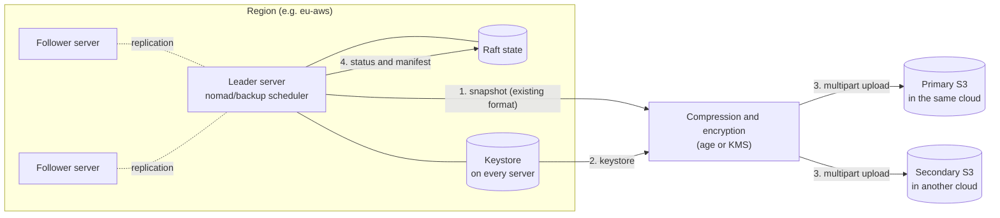
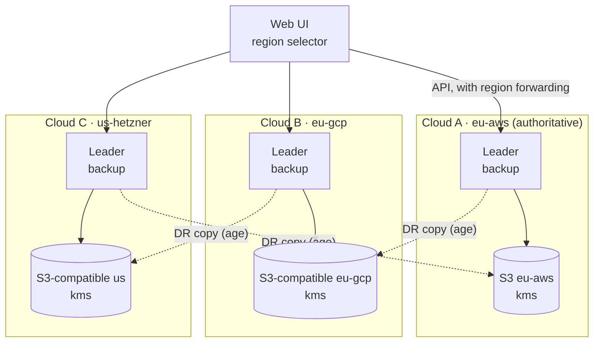

# S3-based scheduled backup and restore – plan

**Status:** In progress · 2026-10-25 (phases 1, 2 and 4 implemented; phase 3, the web UI, planned with the new UI) · Starting point: Nomad v1.6.5 (MPL 2.0) · Related document: [nomad-fork-development-plan.md](nomad-fork-development-plan.md)

In every region, Norca automatically backs up the cluster state on a schedule to one or more S3-compatible stores. Backups can be browsed, compared and restored in the web UI. A restore can be selective (a single job, a single Variables path), full (an entire region returned to an earlier state), or the building of a new cluster from a backup. The schedule and the stores live in the server configuration; manual backup, versioning and restore live in the UI.

## Table of contents

- [Starting point in Nomad 1.6.5](#starting-point-in-nomad-165)
- [What to back up](#what-to-back-up)
- [Architecture](#architecture)
- [Server configuration](#server-configuration)
- [Storage format](#storage-format)
- [Encryption](#encryption)
- [Retention and pinning](#retention-and-pinning)
- [Multi-region operation](#multi-region-operation)
- [Restore](#restore)
- [Web UI](#web-ui)
- [API and CLI](#api-and-cli)
- [Permissions](#permissions)
- [Events, metrics, alerting](#events-metrics-alerting)
- [Implementation and schedule](#implementation-and-schedule)
- [Testing and acceptance](#testing-and-acceptance)
- [Risks](#risks)
- [License](#license)
- [Open questions](#open-questions)

## Starting point in Nomad 1.6.5

| Item | Status | Location |
| --- | --- | --- |
| Manual snapshot save, restore, inspect | Open source: `nomad operator snapshot save / restore / inspect / state`, HTTP: `/v1/operator/snapshot` | `command/operator_snapshot_*.go`, `nomad/operator_endpoint.go` (`snapshotSave`, `snapshotRestore`) |
| Snapshot archive format | Open source: Raft snapshot, metadata and checksum in a single archive | `helper/snapshot/` |
| Loading a backup into a separate state store | Open source: `RestoreFromArchive`, with filtering support | `helper/raftutil/snapshot.go` |
| Scheduled backup (snapshot agent) | **Enterprise-only**, as the OSS help text also indicates | `command/operator_snapshot.go` |
| Keys of Variables and workload identity | The key metadata is in Raft (`root_key_meta` table), the key material is **on the disk of every server**, in the `keystore` directory; it is replicated from server to server within a region | `nomad/encrypter.go` (`saveKeyToStore`, `KeyringReplicator`) |
| Job version retention | By default the last 6 versions (`job_tracked_versions`) | `nomad/structs/structs.go`, `command/agent/config.go` |
| S3 client among the dependencies | `aws-sdk-go` v1 (transitive, because of go-getter) | `go.mod` |
| Web UI | Ember.js 3.28 application, with a region selector | `ui/` |

Two consequences:

- **The snapshot alone is not enough.** `saveKeyToStore` wraps the key material with a key-encrypting key (KEK), but the KEK sits right next to it in the same file, unencrypted. The keystore is therefore effectively plaintext key material. The Raft snapshot contains only the metadata of the keys. If a backup is restored into a new cluster without the keys, Variables are unreadable and the verification of workload identity tokens fails as well. The backup must therefore also contain the keystore, strongly encrypted.
- **The Enterprise equivalent of scheduled backup is not public**, so the implementation is an original design.

## What to back up

| Content | Backed up? | Note |
| --- | --- | --- |
| Raft state (jobs and their versions, allocations, deployments, namespaces, node pools, ACL policies and tokens, Variables (encrypted), quotas, admission policies, network rules, scaling policies) | Yes | In the existing snapshot format |
| Keystore (the keys of Variables and workload identity) | Yes | In a separate object, with mandatory client-side encryption |
| Server configuration | No | The job of configuration management (Terraform, Ansible); the manifest records the running version and the region |
| Local client state, allocation data directories | No | This is the data of running workloads; the applications need their own backup |
| Contents of CSI volumes | No | The job of the storage system or of CSI snapshots (`nomad volume snapshot`) |
| State of Consul and Vault | No | They have their own backup mechanisms |

## Architecture

Backup is performed per region by a new subsystem running on the leader server (`nomad/backup/`). It starts and stops with leadership in the same way as the deployment watcher or the planned built-in autoscaler, so exactly one instance backs up per region at any time, without separate high-availability handling.



**Flow of a backup:**

1. The scheduler reads the time of the last successful backup from Raft (a new `backup_status` table), so after a leader change it neither backs up twice nor skips a scheduled time.
2. The leader creates a snapshot with the existing `snapshot.New` call (the path also used by `snapshotSave`) and also reads its own keystore. Because the keystore is replicated to every server in the region, the leader's keystore is complete.
3. The snapshot and the keystore are streamed, compressed and encrypted into S3 with multipart upload, so memory use does not depend on the snapshot size.
4. After uploading to each destination, the server verifies the size and checksum of the object, then uploads the manifest.
5. The details of the successful backup (ID, Raft index, size, destinations) are written to the `backup_status` table with a small Raft write, so the UI and the other servers see them too.
6. Expired backups are deleted according to the retention rule.

## Server configuration

```hcl
server {
  backup {
    enabled  = true
    interval = "1h"            # or: schedule = "0 */1 * * *" (cron)
    jitter   = "5m"            # per-region offset so they do not load the store at the same time
    timeout  = "30m"

    # Primary destination: in the same cloud
    destination "primary" {
      type     = "s3"
      bucket   = "company-nomad-backup-eu"
      prefix   = "nomad/${region}"
      region   = "eu-central-1"
      sse      = "aws:kms"
      kms_key  = "arn:aws:kms:eu-central-1:111111111111:key/abcd-..."
      # authentication: by default from the server's environment
      # (IAM instance profile, environment variables)
    }

    # Secondary destination: in another cloud, with an S3-compatible endpoint
    destination "secondary" {
      type          = "s3"
      endpoint      = "https://s3.other-cloud.example.com"
      bucket        = "nomad-backup-dr"
      prefix        = "nomad/${region}"
      force_path_style = true
      credentials_file = "/etc/nomad.d/backup-dr.creds"
    }

    encryption {
      mode       = "age"                       # or "kms"
      recipients = ["age1qyqszqgpqyqszqgp..."] # public keys; the private key is not on the server
    }

    retention {
      keep_hourly  = 24
      keep_daily   = 14
      keep_weekly  = 8
      keep_monthly = 12
      min_keep     = 3      # this many are never deleted, even if expired
    }

    include_keyring = true
  }
}
```

**Notes:**

- The S3 credentials exist only in the server configuration or in the server's environment; they never appear in the API or the UI.
- `${region}` in the prefix ensures that the backups of different regions do not get mixed, even if they share a store.
- The configuration takes effect on reload (SIGHUP), without restarting the server.
- Azure Blob Storage is not S3-compatible, so this section does not cover it directly; it can be handled with an S3-compatible gateway (for example MinIO) or a later `type = "azure"` destination type.

## Storage format

**Object layout per destination:**

```
<prefix>/                          e.g. nomad/eu-aws/
  2026/10/24/
    20261024T140000Z-1834567/
      manifest.json                unencrypted metadata (contains no content)
      state.snap.age               the Raft snapshot, compressed and encrypted
      keyring.age                  the keystore, compressed and encrypted
      secret-store-key.age         the key of the built-in secret store core, encrypted (Norca, with the keyring; see secrets-plan.md)
  latest.json                      pointer to the most recent successful backup
```

**manifest.json example:**

```json
{
  "id": "20261024T140000Z-1834567",
  "region": "eu-aws",
  "authoritative_region": "eu-aws",
  "created_at": "2026-10-24T14:00:03Z",
  "trigger": "schedule",
  "nomad_version": "1.6.5+fork.3",
  "raft_index": 1834567,
  "raft_term": 42,
  "leader_id": "srv-eu-1",
  "objects": {
    "state":   { "key": "state.snap.age",  "size": 48211234, "sha256": "…" },
    "keyring": { "key": "keyring.age",     "size": 4120,     "sha256": "…", "key_ids": ["8c1f…", "e02a…"] }
  },
  "encryption": { "mode": "age", "recipients_fingerprint": "…" },
  "summary": { "namespaces": 6, "jobs": 214, "variables": 87, "acl_policies": 19 },
  "labels": { "note": "manual backup before upgrade" },
  "pinned": false
}
```

The manifest is unencrypted so that the UI can list backups without decrypting their content; it therefore contains only summary counts, no names and no content.

## Encryption

Backups are protected in two layers: storage-side encryption (for example S3 SSE-KMS) and mandatory client-side encryption, because the keystore contains key material and the access control of the store alone must not be relied on.

| Mode | How it works | Restore from the UI | When recommended |
| --- | --- | --- | --- |
| `kms` | Envelope encryption: a new data key per backup, wrapped by the cloud's KMS. The server is granted only the `GenerateDataKey` and `Decrypt` permissions. | Yes, the server can decrypt through the KMS | Default, for day-to-day operation |
| `age` | The `age` format, public-key encryption. The server knows only the public key; the private key is offline, for example in a vault. | Only if the private key is supplied temporarily for the restore (from the CLI, or in the configuration of a server designated for this) | For a disaster recovery copy that not even a compromised cluster can decrypt |

**Recommended combination:** the primary destination in `kms` mode (for browsing and restoring from the UI), the secondary destination, in another cloud, in `age` mode. A compromised region can then reach its own KMS backups but not the disaster recovery copy. For this, the `encryption` block can also be specified per destination.

**Integrity:** every object has a SHA-256 checksum in the manifest, and the encryption is authenticated (AEAD), so a modified or corrupted backup is detected before a restore. Where the store supports it, objects can be kept under S3 Object Lock (WORM), which also protects against ransomware.

## Retention and pinning

- Retention follows the usual "grandfather-father-son" scheme: hourly, daily, weekly and monthly backups with separate counts (`keep_hourly`, `keep_daily`, `keep_weekly`, `keep_monthly`).
- Fewer than `min_keep` backups never remain, even if the schedule has not run for weeks.
- **Pinning:** any backup can be pinned in the UI, in which case retention never deletes it (for example the state before a major upgrade). The pin is stored both in the manifest and in the `backup_status` table.
- **Labels:** a text note can be added at manual backup time or afterwards; it is shown in the list.
- Deletion is always performed by the region's leader, within its own prefix, so a region can never delete the backups of another region.

## Multi-region operation

Each region backs up independently, with its own leader, into its own prefix. Backups capture the state of one region, not of the whole federation, because every region has its own Raft.



**Rules:**

- **Per-region independence.** The outage of one region does not prevent the others from backing up. The disaster recovery copy always goes to the store of a different cloud (in a round-robin assignment, as the diagram shows), so a backup exists even if a whole cloud is lost.
- **The UI can manage any region.** Thanks to Nomad's existing region forwarding, the backups of any region can be listed and restored with the UI's region selector; the request reaches the leader of that region.
- **Keys per region.** In 1.6.5 the keystore is replicated within a region (`KeyringReplicator`, which requests the keys from its own region's leader), so each region's backup contains its own keys.
- **Global ACL objects.** Global ACL policies and tokens are replicated from the authoritative region to the others. Two rules follow from this:
  - After restoring a **non-authoritative region**, replication automatically brings the global ACL objects to the current state of the authoritative region. This is the expected behavior.
  - A full restore of the **authoritative region** rolls the global ACL objects back in all regions. The UI flags this in a separate warning and requires two-person approval for this operation.
- **There is no consistent point across regions.** The backups of the regions are independent of each other, so restoring several regions does not produce a single federation-wide point in time. In Norca's own multiregion deployment (development plan, multi-cloud chapter), the UI warns if a restore would make the versions of a multiregion job differ between regions.

## Restore

There are three kinds of restore, from the gentlest to the most drastic. Before any of them, the server loads the backup into a separate in-memory state store using the existing `helper/raftutil.RestoreFromArchive`, so the content can be browsed and compared with the current state without touching the cluster.

| Mode | What it restores | Effect on the running cluster | Permission |
| --- | --- | --- | --- |
| **Selective** | Chosen jobs (any of their versions), Variables paths, namespaces, ACL policies | Normal write operations: the job enters as a new version and goes through the admission chain and the quota | The relevant namespace permission and backup read permission |
| **Full region** | The entire Raft state of the region as of the time of the backup | Every change made since the backup is lost; allocations started after the backup are stopped | Management token, two-person approval |
| **New cluster** | Populating empty, freshly deployed servers from a backup (disaster recovery, migration to another cloud) | There is no running cluster to affect | Bootstrap process, from the CLI |

### Selective restore

This is the most common in day-to-day use, and it provides the "versioning":

- **Job versions from backups.** By default Nomad keeps only the last 6 versions of a job (`job_tracked_versions`). Much older versions can be brought back from the backups. The UI extends the existing version history of the job with the versions found in the backups, and they can be compared with the existing diff view.
- **Restore as a new version.** The selected version is re-registered through the normal `Job.Register` path, like `nomad job revert`, except that the source is the backup. It therefore goes through the admission chain, the quota and all checks, and the restore itself becomes a new, traceable version.
- **Variables.** The server decrypts the backed-up Variables entries with the backup's own keystore and re-encrypts them with the current keys, using the existing check-and-set write, so an entry modified in the meantime is not silently overwritten.
- **Secrets** of the built-in store: the value of one version of the secret in the backup is written as a new version of the secret with the normal secret write (`write-secret`, check-and-set, audit), never replacing its history; see "Backup and restore" in `secrets-plan.md`.
- **Namespaces and ACL policies** can be restored the same way, one by one, as normal writes.

### Full region restore

1. **Preview (mandatory).** The UI summarizes what would change: which jobs would disappear or get an older version, how many running allocations would stop, which Variables entries and ACL objects would change. This is computed by comparing the backup with the current state, without touching the cluster.
2. **Confirmation.** The user must type the name of the region and, if enabled, a second authorized user must also approve the request.
3. **Safety backup.** Before the restore, an automatic backup of the current state is taken and pinned, so the restore can be undone.
4. **Keys.** The new `Keyring.Restore` RPC writes the keys in the backup into the keystore of every server in the region, alongside the existing ones (old keys are not deleted).
5. **State.** The existing `snapshotRestore` path restores the Raft state; the server downloads the backup directly from S3, not through the browser.
6. **Afterwards.** On their next sync, the clients reconcile: allocations not present in the backup are stopped, and missing ones are placed again by the scheduler.

### Building a new cluster from a backup

This is done from the CLI, because there is no running cluster whose UI would be available:

```
nomad operator backup restore-bootstrap \
  -from s3://nomad-backup-dr/nomad/eu-aws/2026/10/24/20261024T140000Z-1834567/ \
  -age-identity ./dr-secret-key.txt
```

On the new servers (which have not yet formed a cluster), the command first writes the keystore to disk, then restores the snapshot. The region name in the configuration must match that of the backup; otherwise the command runs only with the `-allow-region-change` flag, because it does not rewrite the region references of the jobs.

## Web UI

The UI gains a new **Backups** menu item in the existing Ember application (`ui/app/routes/`, `ui/app/components/`), consistent with the region selector.

**Backup list.** Per region, the backups in chronological order: time, trigger (scheduled or manual), Raft index, size, destinations and their state (uploaded, verified), labels, pin indicator. Above it, the state of the schedule: last successful backup, next due, and a warning if the last successful backup is older than two intervals.

**Manual backup.** A "Back up now" button, with an optional note and pinning. Typical use: before a major change.

**Backup details.** The manifest data, and browsing of the content by type (namespaces, jobs, Variables paths, ACL policies), with filtering and search. For Variables, only the paths and key names are visible, not the values.

**Comparison.** Comparing two backups, or a backup and the current state: new, deleted and modified jobs, version differences, and per job the existing diff view.

**Job version history.** On the job's existing "Versions" page, the older versions retrievable from backups also appear, with a separate marker and a "Restore from this version" action.

**Restore wizard.** Its steps: choose the mode (selective or full), choose the items (in selective mode), preview with the effects, confirmation (typed region name, two-person approval in full mode), execution with status tracking.

**Intentionally not in the UI:** configuring stores and credentials, and changing the schedule (these are in the server configuration), and downloading backups through the browser (instead, a short-lived pre-signed download link can be generated, only with the appropriate permission).

## API and CLI

| Operation | HTTP | CLI |
| --- | --- | --- |
| List backups | `GET /v1/operator/backups` | `nomad operator backup list` |
| Backup details | `GET /v1/operator/backup/:id` | `nomad operator backup inspect <id>` |
| Browse content | `GET /v1/operator/backup/:id/contents?type=jobs&namespace=prod` | `nomad operator backup contents <id>` |
| Compare | `GET /v1/operator/backup/:id/diff?against=current\|<id>` | `nomad operator backup diff <id> [<id>]` |
| Manual backup | `POST /v1/operator/backups` | `nomad operator backup save [-label ...] [-pin]` |
| Pin, label | `PUT /v1/operator/backup/:id` | `nomad operator backup pin <id>` |
| Delete | `DELETE /v1/operator/backup/:id` | `nomad operator backup delete <id>` |
| Restore (selective or full, with preview) | `POST /v1/operator/backup/:id/restore` (`mode`, `items`, `dry_run`, `confirm`) | `nomad operator backup restore <id> [-job ...] [-dry-run]` |
| Approval (two-person) | `POST /v1/operator/backup/restore/:request_id/approve` | `nomad operator backup approve <request_id>` |
| Download link | `GET /v1/operator/backup/:id/download-url` | `nomad operator backup download <id>` |
| Build a new cluster | – | `nomad operator backup restore-bootstrap` |

Every endpoint accepts the usual `region` parameter and forwards the request to the leader of that region.

## Permissions

A new ACL policy block: `backup`, modeled on the `quota` and `operator` blocks.

| Permission | What it allows |
| --- | --- |
| `backup { policy = "read" }` | Listing, details, comparison, browsing content (without Variables values) |
| `backup { policy = "write" }` | The above, plus manual backup, pinning, labeling, deletion (honoring `min_keep` and pinning), download link |
| Selective restore | `backup read` **and** the normal write permission in the affected namespace (for example `submit-job`, Variables `write`) |
| Full restore | Management token only and, if enabled, approval by a second management token |

The `backup` block of the server configuration can make two-person approval mandatory with a `require_approval = true` switch, and it can specify how long a request awaiting approval remains valid.

## Events, metrics, alerting

- **New event topic: `Backup`.** Events: backup completed, backup failed, backup deleted, restore requested, approved, started, finished. These also go into the history and audit service (multi-cloud chapter, NATS bridge).
- **Metrics** in the existing telemetry: `nomad.backup.last_success_age_seconds`, `nomad.backup.duration_seconds`, `nomad.backup.size_bytes`, `nomad.backup.failures_total`, labeled per destination.
- **Suggested alert:** when `last_success_age_seconds` exceeds twice the interval, or three consecutive uploads to a destination fail.

## Implementation and schedule

| Phase | Content | Files affected and new |
| --- | --- | --- |
| 1. Scheduled backup | Leader subsystem, `backup` configuration block, S3 upload (multipart), `kms` and `age` encryption, manifest, retention, `backup_status` table, `Backup` event topic, metrics | new `nomad/backup/` (scheduler, destinations, encryption, retention); `nomad/leader.go`; `nomad/config.go`, `command/agent/config.go`; `nomad/state/schema.go`; `nomad/structs/` |
| 2. API, CLI, selective restore | Listing, browsing, comparison based on `RestoreFromArchive`; selective restore with normal writes; `backup` ACL block | new `nomad/backup_endpoint.go`; `command/agent/backup_endpoint.go`; new `command/operator_backup_*.go`; `acl/policy.go`; `api/backup.go` |
| 3. Web UI | Backup list, details, comparison, extension of the job version history, selective restore wizard | `ui/app/routes/backups*`, `ui/app/components/backup-*`, `ui/app/adapters/backup.js`, `ui/app/models/backup.js` |
| 4. Full restore and bootstrap | `Keyring.Restore` RPC, full restore with preview and two-person approval, automatic pre-restore backup, `restore-bootstrap` CLI | `nomad/encrypter.go`, `nomad/keyring_endpoint.go`; `nomad/operator_endpoint.go`; the full mode of the UI wizard |

The phases build on each other, but after phase 1 there is already an automatic, encrypted backup copied to several clouds, and a restore can already be done at that point with the existing `nomad operator snapshot restore` command (and by manually copying the keystore back).

## Testing and acceptance

- **Automated recovery drill.** A periodic Nomad job downloads the latest backup daily, restores it into a temporary single-server cluster, and verifies that the number of jobs matches the manifest and that a test Variables entry can be decrypted. The result appears as a metric and an event. A backup counts as proven good only if it passes this.
- **Leader change during a backup:** the interrupted upload does not appear in the list (there is no manifest), the new leader backs up at the next scheduled time, and it aborts the interrupted multipart upload.
- **Destination outage:** the unavailability of one destination does not prevent backing up to the other; the backup gets a "partially successful" state and raises an alert.
- **Selective restore:** a job version from 30 days earlier can be restored as a new version, and the quota and admission rules apply to it.
- **Full restore:** in a test cluster, after the restore the Variables are readable, the workload identity tokens are valid, and the restore can be undone from the automatic pre-restore backup.
- **Multi-region:** after restoring a non-authoritative region, the global ACL objects return through replication to the authoritative state.
- **Performance:** while backing up a 1 GB snapshot, the leader's memory use does not grow in proportion to the snapshot size, and the scheduling latency does not measurably degrade.

## Risks

| Risk | Mitigation |
| --- | --- |
| The keystore contains key material; a leaked backup would mean the compromise of Variables | Mandatory client-side encryption, `age` with an offline private key for the DR copy; storage-side encryption and narrow access |
| A full restore stops allocations started after the backup | Mandatory preview, typed confirmation, two-person approval, automatic pre-restore backup |
| Restoring the authoritative region rolls back the global ACL in every region | Separate warning and approval; prefer selective ACL restore |
| A large snapshot loads the leader | Streamed processing, multipart upload, `jitter`, timeout |
| A compromised server could delete the backups | S3 Object Lock or a versioned store; on the DR destination the server gets write permission only, not delete, and retention there is handled by the store's lifecycle rules |
| Version mismatch: restoring a backup from a newer fork version onto an older server | The manifest records the version; an older server does not restore a backup of a newer version |

## License

- The snapshot, raftutil and keyring code is part of Nomad v1.6.5, MPL 2.0.
- For the S3 client, `aws-sdk-go-v2` (Apache 2.0) or `minio-go` (Apache 2.0) is recommended. Support for the existing `aws-sdk-go` v1 ended in 2025, so it is not worth building new code on it.
- Encryption: `filippo.io/age` (BSD-3); for the KMS mode, the cloud providers' Go SDKs (Apache 2.0).
- The code of the Enterprise snapshot agent is not public, so the implementation is an original design.

## Open questions

- [x] What is the largest expected snapshot size per region? Decided 2026-10-24: about 2 GB; defaults (timeout, multipart part size) are tuned for that and stay configurable.
- [x] Which S3-compatible store is available in which cloud, and is a native Azure Blob destination needed? Decided 2026-10-24: MinIO or AWS S3-compatible stores through the S3 API only; no native Azure Blob destination.
- [x] Where should the `age` private key be stored, and who can access it in a disaster? Decided 2026-10-24: the administrators keep it outside the cluster; the cluster only knows the public recipient, and an administrator provides the private key at restore time.
- [x] Should two-person approval be mandatory for every full restore, or only for the authoritative region? Decided 2026-10-24: for every full restore.
- [x] Besides jobs, is browsing the history of deployments and allocations also needed in the UI, or are jobs, Variables, namespaces and ACL enough? Decided 2026-10-24: deployments and allocations are needed too.
