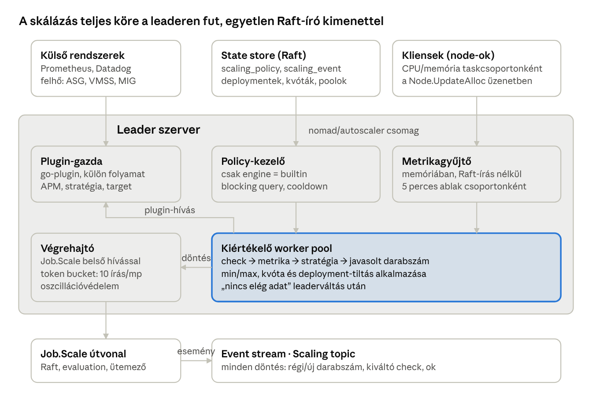
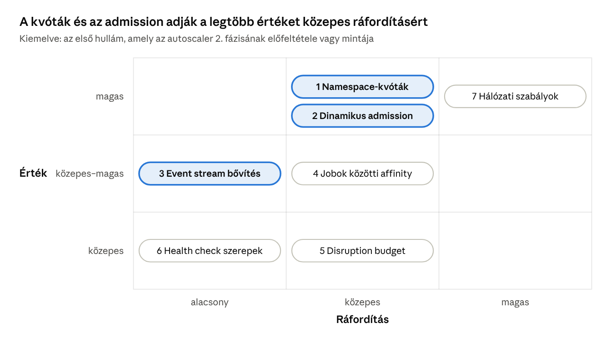
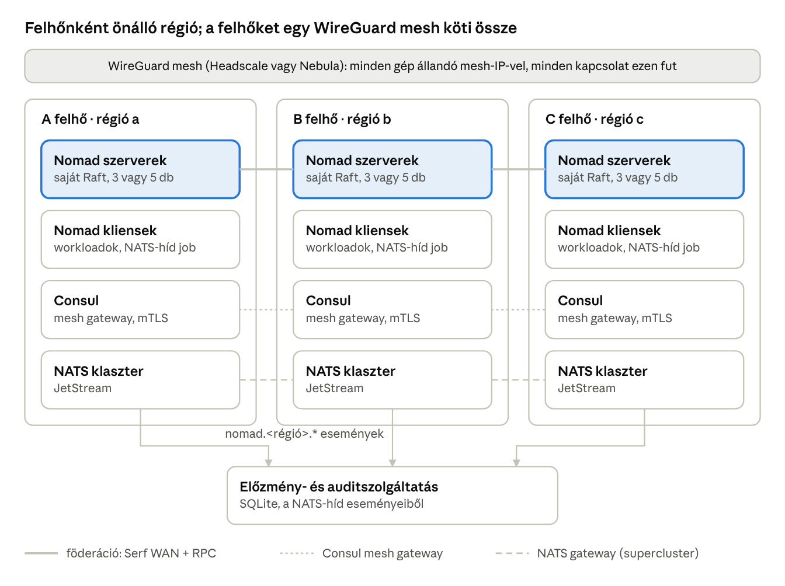
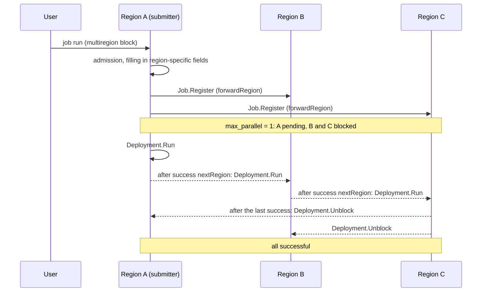
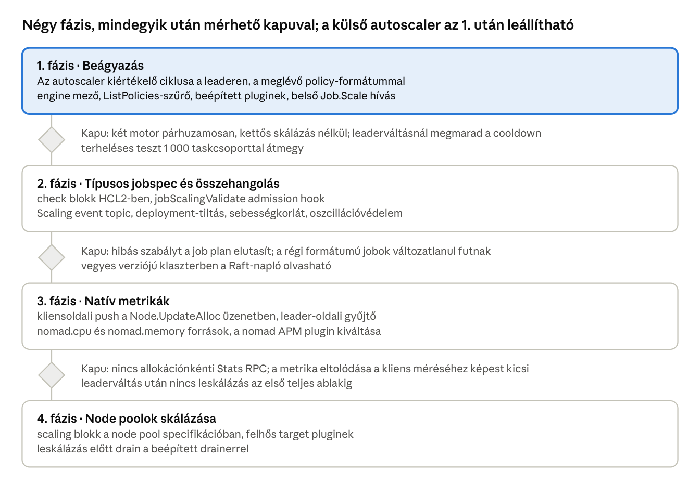

# Nomad fork development plan: built-in autoscaler and Kubernetes features

**Status:** In progress · 2026-10-24

Progress: autoscaler phase 1 implemented, phases 2–3 in progress, phase 4 planned; dependency updates done.

## Summary and goals

The evaluation logic of the Nomad Autoscaler will become an internal subsystem running on the Nomad leader server, delivered in four phases. After the first phase the separate autoscaler deployment can be retired; after the fourth, the scaling of jobs and node pools becomes a validated part of the jobspec and of the node pool specification.

The plan starts from Nomad v1.6.5 (the last release under MPL 2.0) and Nomad Autoscaler v0.6.0 (MPL 2.0). Both codebases can be freely modified and merged.

The plan also schedules seven features that can be adopted from Kubernetes (quotas, dynamic admission, event notification, cross-job affinity, disruption budget, health check roles, network rules). Two of them, quotas and dynamic admission, are prerequisites for phase 2 of the autoscaler. An operator framework (custom object types and controllers, following the Kubernetes operator pattern) is built on top of these seven items.

For multi-cloud operation the plan proposes one federated region per cloud with a WireGuard mesh, native mTLS gateways (the official Consul if a full mesh is needed) and a NATS supercluster, plus two fork developments: an own implementation of multiregion deployment and an event stream → NATS bridge. Multiregion deployment is controlled over Nomad's own cross-region RPC; NATS only carries events, notifications and application messages and is not in the control path.

The plan also includes S3-based, per-region scheduled backup and restore (encrypted backups copied to multiple clouds, with selective and full restore managed from the UI); its detailed plan is in a separate document: [backup-restore-plan.md](backup-restore-plan.md).

The plan also aims at Consul independence: a native catalog driven by health, built-in DNS, a Consul-compatible read layer for tools built on the Consul API (for example Traefik, Prometheus), external service registration and native mTLS. Discovery is topology-aware (same zone, datacenter and region preferred, with regional failover), and a DNS alias can also be given for external services. Consul remains optional only for the full service mesh, installed by Nomad. Details: [consul-independence-plan.md](consul-independence-plan.md).

Package management builds on Nomad Pack: the package format and the command-line tool stay, while Helm-level capabilities (a release object with revisions, rollback, non-job resources, atomic installation, hooks, tests, OCI registry, signing) are provided by the server side of the fork. Details: [package-management-plan.md](package-management-plan.md).

The web UI gets a new information architecture, a federation dashboard and pages for the planned features, on a Tabler base (MIT) with its own Ember component layer. Details: [ui-plan.md](ui-plan.md), clickable mockup: [mockups/ui-mockup.html](mockups/ui-mockup.html).

Licensing: wherever possible everything is MPL 2.0 (the fork, Nomad Pack, the standalone components and the documentation as well); there is no separate control plane. Details, starting commits, dependency rules and the base files of the repository: [licensing.md](../licensing.md).

**Goals:**

- A single component to install and operate, without separate HA, ACL tokens and monitoring.
- A faulty scaling policy is rejected already at the moment of `nomad job run` / `nomad job plan`.
- Built-in CPU and memory metrics, without per-allocation RPC calls.
- Scaling coordinated with deployments, quotas, the drainer and the event stream.

**Goals for the Kubernetes features:** multi-tenant operation with namespace quotas, enforcement of company rules at submission, the ability to write external controllers, and the placement and availability guarantees familiar from Kubernetes, without giving up the simplicity of Nomad.

**Out of scope:** vertical scaling (automatic adjustment of resource requests). It is an Enterprise feature in both codebases and will only be considered after phase 4.

## Starting point

Today scaling is split between two systems: Nomad stores and executes, the external autoscaler interprets and decides.

| Layer                | Where it is today                    | Code location                                                                |
|----------------------|--------------------------------------|------------------------------------------------------------------------------|
| Policy storage       | Nomad core, `scaling_policy` table   | `nomad/structs/structs.go` (`ScalingPolicy`), `nomad/state/schema.go`        |
| Policy interpretation| Autoscaler                           | `policy/nomad/parser.go`, `validate*.go`                                     |
| Metric collection    | Autoscaler APM plugins               | `plugins/builtin/apm/{nomad,prometheus,datadog,influxdb,instana}`            |
| Decision             | Autoscaler strategy plugins          | `plugins/builtin/strategy/{target-value,threshold,fixed-value,pass-through}` |
| Execution            | Nomad core, `Job.Scale` RPC          | `nomad/job_endpoint.go` (`Scale`, `ScaleStatus`)                             |
| Node scaling         | Autoscaler target plugins            | `plugins/builtin/target/{aws-asg,azure-vmss,gce-mig,ibmcloud-ig}`            |
| History              | Nomad core, `scaling_event` table    | `nomad/state/schema.go`                                                      |

Of the fields of `ScalingPolicy`, Nomad only understands `Min`, `Max`, `Enabled`, `Type` and `Target`. The scaling logic (`Policy`) is an untyped `map[string]interface{}`, and the only defined type is `horizontal`.

**Weaknesses:**

- A faulty policy (mistyped strategy, bad query) is accepted without error and only shows up in the autoscaler's log.
- The built-in `nomad` APM plugin issues one `Allocations().Stats` call per allocation per evaluation (`plugins/builtin/apm/nomad/plugin/job.go`), which reaches the clients through the server.
- The autoscaler needs its own HA, ACL token, deployment and monitoring.
- The event stream has no `Scaling` topic, so its decisions cannot be subscribed to.
- Coordination with deployments relies on polling `ScaleStatus`, not on internal state.

The autoscaler codebase is about 21,600 lines (without tests). It also has its own Enterprise separation: vertical scaling is an empty stub in the OSS version (`policy/handler_oss.go`).

## Target architecture

The scaler is a new `nomad/autoscaler` package running on the leader server, which starts and stops with leadership in the same way as the deployment watcher or the drainer (`establishLeadership` / `revokeLeadership`, `nomad/leader.go`).



target architecture · leader subsystem, 6 components

The evaluator receives the policies from the policy manager and the metrics from the collector and the plugins, and sends its decision through the executor to the existing `Job.Scale` path. This is the only point where the scaler writes to Raft.

**Components and new files:**

| Component              | Task                                                                     | New file                        | Source from the autoscaler                                    |
|------------------------|--------------------------------------------------------------------------|---------------------------------|---------------------------------------------------------------|
| Policy manager         | Watching `builtin` policies with blocking queries, tracking cooldowns    | `nomad/autoscaler/policies.go`  | `policy/manager.go`, `policy/nomad/source.go`                 |
| Evaluator worker pool  | Scheduled evaluation, check → strategy → proposed count                  | `nomad/autoscaler/evaluator.go` | `policy/handler.go`, `policy/check.go`                        |
| Metric collector       | Usage received from clients, in memory, with a time window               | `nomad/autoscaler/metrics.go`   | new                                                           |
| Plugin host            | Loading built-in and external plugins, lifecycle                         | `nomad/autoscaler/plugins.go`   | `plugins/` and `sdk/`                                         |
| Executor               | Internal `Job.Scale` call, rate limit, oscillation protection            | `nomad/autoscaler/executor.go`  | logic of `plugins/builtin/target/nomad`, rewritten as an internal call |
| Leader hook-up         | Start and stop on leader change, restoring cooldowns                     | `nomad/leader.go` (modification)| new                                                           |

## Jobspec and data model

The `scaling` block becomes a typed policy, interpreted by Nomad and validated at submission. The old, untyped `policy` form temporarily remains valid.

```hcl
group "api" {
  scaling {
    min    = 2
    max    = 20
    engine = "builtin"   # or "external" (external autoscaler)

    policy {
      evaluation_interval = "30s"
      cooldown            = "2m"
      on_check_error      = "ignore"

      check "cpu" {
        metric   = "nomad.cpu"
        strategy = "target-value"
        target   = 70
      }
      check "latency" {
        source   = "prometheus"
        query    = "histogram_quantile(0.95, sum(rate(http_req_seconds_bucket{job=\"api\"}[1m])) by (le))"
        strategy = "threshold"
        upper    = 0.3
      }
    }
  }
}
```

**Data model changes** (`nomad/structs/structs.go`):

- New fields of `ScalingPolicy`: `Engine` (`builtin` \| `external`), `EvaluationInterval`, `Cooldown`, `CooldownOnScaleUp`, `OnCheckError`, `Checks []*ScalingCheck`.
- New `ScalingCheck` type: `Name`, `Source`, `Metric`, `Query`, `QueryWindow`, `Strategy`, `StrategyConfig map[string]string`, `OnError`.
- The old `Policy map[string]interface{}` field remains. If the new fields are empty, the parser fills them from it, so existing jobs keep working unchanged.
- Raft compatibility: the new fields are optional in the msgpack encoding, so old servers can also read the log (mixed-version cluster during an upgrade).

**Jobspec parser:** extension of `jobspec2/` (HCL2) with the `check` block and the new attributes; the old `jobspec/` (HCLv1) only handles the existing form.

**Validation at submission:** a new `jobScalingValidate` hook in the existing admission chain (`admissionValidators`, `nomad/job_endpoint_hooks.go`). It checks:

- `min ≤ count ≤ max`, and `min ≥ 0`;
- known strategy and source (built-in or loaded plugin);
- the required parameters of the strategy (e.g. `target-value` → `target`, `threshold` → `upper` or `lower`);
- lower bounds for `evaluation_interval` and `cooldown` (from the server configuration, default 10 s);
- for the `builtin` engine, whether the built-in autoscaler is enabled on the server.

## Metrics

The source of the built-in CPU and memory metrics will be aggregated usage data sent periodically by the clients, which the leader keeps in memory only. Application-level metrics come from the existing APM plugins.

| Source                                          | Operation                                                                                       | Cost                             | Phase                |
|-------------------------------------------------|-------------------------------------------------------------------------------------------------|----------------------------------|----------------------|
| `nomad` APM (current)                           | `ClientAllocations.Stats` RPC per allocation at evaluation time                                 | RPC proportional to allocation count | Phase 1 (temporary) |
| Client-side push (`nomad.cpu`, `nomad.memory`)  | The client aggregates per task group and sends it attached to the existing `Node.UpdateAlloc` messages | No extra RPC, no Raft write | Phase 3              |
| Prometheus                                      | Built-in APM plugin (Datadog, InfluxDB and Instana are not ported, by decision; they can only be loaded as external plugins) | Load on the external system      | From phase 1         |

**Details of the client-side push:**

- From the existing resource statistics of `client/allocrunner` (`AllocResourceUsage`), the client computes an average and a maximum per task group, with a 10-second window by default.
- The data travels in a new, optional field of the `Node.UpdateAlloc` call. The server does not write it to Raft but forwards it to the leader's in-memory collector (`nomad/autoscaler/metrics.go`).
- The collector keeps a short time window per job and task group (default 5 minutes) and discards older data.
- After a leader change the collector starts empty. At least one full window of data must arrive before the first evaluation; until then the check returns an "insufficient data" state and does not scale.
- Follower servers forward the received data to the leader over RPC, like their other write requests.

**Metric names:** `nomad.cpu` (percentage of allocated CPU), `nomad.memory` (percentage of allocated memory), `nomad.cpu_mhz`, `nomad.memory_mb` (absolute values). These can be used in the `check` block by name, without a query.

**Collector memory (measured):** the leader keeps each task group's window as a fixed ring of 30 time buckets (10 s each with the default 5-minute window), each holding a weighted sum and a maximum per metric, so the memory used does not depend on the number of nodes or allocations reporting. `BenchmarkUsageCollector_Memory` (`nomad/autoscaler/metrics_test.go`) fills a full window for 1,000 task groups, with reports from 10 nodes every 10 s. It measured about 2.8 MB of heap per 1,000 task groups (about 2.8 KB per group). The collector keeps at most 100,000 groups and drops groups that sent no report within the window.

## Coordination with other subsystems

The built-in scaler sees deployments, quotas and node state directly from the state store, so it makes its decisions knowing them rather than learning of them from a failure afterwards.

| Subsystem    | Rule                                                                                                                                       | Code location                                               |
|--------------|--------------------------------------------------------------------------------------------------------------------------------------------|-------------------------------------------------------------|
| Deployments  | No scaling during an active deployment or with an unpromoted canary; can be overridden per job with `scale_during_deployment = "up_only"`  | State of `nomad/deploymentwatcher/` from the state store    |
| Quotas       | Checks the namespace quota before scaling up; on overrun it scales up to the quota-based ceiling instead of `max`, and writes an event     | `evaluatePlanQuota` and `NewQuotaIterator` (OSS stubs today)|
| Node pools   | A new `scaling` block in the node pool specification describes the cloud group and the min/max node count                                 | `nomad/structs/node_pool.go`, `nomad/node_pool_endpoint.go` |
| Drainer      | When scaling nodes down, drain first with the built-in drainer, and only then call the cloud target                                        | `nomad/drainer/`                                            |
| Event stream | New `Scaling` topic: every decision (job, group, old and new count, triggering check, reason)                                              | `nomad/structs/event.go`, `nomad/state/events.go`           |
| History      | Every decision goes into the existing `scaling_event` table; after a leader change the cooldown is restored from there                     | `nomad/state/schema.go`                                     |

**Rate limit:** a cluster-wide token bucket on scaling Raft writes (default: 10 writes/s, burst of 50), and per-job oscillation protection: if a task group changes direction three times within 10 minutes, the scaler suspends it for 15 minutes and writes a warning event.

**Execution:** the decision goes through the existing `Job.Scale` path, as an internal call (not over HTTP). This leaves the existing ACL check, the recording of the `scaling_event` and the creation of the evaluation unchanged. The internal call runs with a system identity that only receives the `scale-job` permission.

## Compatibility and migration

The built-in and the external autoscaler can run side by side throughout the transition, because each policy belongs to exactly one of them according to the `engine` field.

**Server configuration:**

```hcl
server {
  autoscaler {
    enabled              = true
    default_engine       = "external"   # after the switch: "builtin"
    min_eval_interval    = "10s"
    plugin_dir           = "/opt/nomad/autoscaler-plugins"
  }
}
```

**Distribution of policies:**

- A policy without `engine` gets the value of `default_engine`. Initially this is `external`, so the behavior of existing jobs does not change.
- The `Scaling.ListPolicies` RPC gets a new `Engine` filter. The external autoscaler requests only its own policies with the `?engine=external` parameter (this needs a small change in the autoscaler's `policy/nomad/source.go`). Old autoscaler versions see everything without a filter, so coexistence with them is safe only as long as no job is `builtin`.
- The built-in scaler evaluates only `builtin` policies.

**Migration steps in a cluster:**

1.  Upgrade the servers to the new version, `enabled = true`, `default_engine = "external"`.
2.  Upgrade the external autoscaler to the engine-filtering version.
3.  Set `engine = "builtin"` job by job and run `nomad job plan`; the validator reports faulty or unsupported policies.
4.  After all jobs are switched, set `default_engine = "builtin"`, then stop the external autoscaler.

**Rollback:** setting the `engine` field of a job back to `external` immediately returns that job to the external autoscaler, without a server restart.

**External plugins:** loaded plugins use the same autoscaler plugin SDK (`sdk/`, `plugins/*/proto`), so existing third-party APM, strategy and target plugins run unchanged. The difference is that the server loads them from the `plugin_dir` directory.

## Features adopted from Kubernetes

Adopting seven Kubernetes features is justified. The first wave (quotas, event stream extension, dynamic admission) proceeds in parallel with phase 1 of the autoscaler, because phase 2 builds on them. The classification is an estimate based on a review of the Nomad v1.6.5 code.



K8s features · value × effort, 7 items

| \#  | Feature (Kubernetes equivalent)                                  | Starting point in Nomad 1.6.5                                                                                                                                                        | Implementation                                                                                                                                                            | Relation to the autoscaler                                                                           |
|-----|------------------------------------------------------------------|--------------------------------------------------------------------------------------------------------------------------------------------------------------------------------------|---------------------------------------------------------------------------------------------------------------------------------------------------------------------------|------------------------------------------------------------------------------------------------------|
| 1   | Namespace quotas (ResourceQuota, LimitRange)                     | Empty OSS stubs: `NewQuotaIterator` (`scheduler/stack_oss.go`), `evaluatePlanQuota` (`nomad/plan_apply_oss.go`), `allocQuota` (`nomad/fsm_oss.go`); the `/v1/quota*` API returns 501 today | Quota object per namespace (CPU, memory, allocation count), task-level default and maximum, rejection already at submission; the structure of the existing quota API is kept | Prerequisite for phase 2: scaling up to the quota ceiling                                            |
| 2   | Dynamic admission (webhooks, ValidatingAdmissionPolicy / CEL)    | Hard-coded chain: `admissionMutators`, `admissionValidators` (`nomad/job_endpoint_hooks.go`); the place of Sentinel: `enforceSubmitJob` (`nomad/job_endpoint_oss.go`)                 | Configurable webhook hook and CEL validator (`cel-go`, Apache 2.0) in the chain                                                                                           | `jobScalingValidate` goes into the same chain; webhooks can also check scaling policies              |
| 3   | Event stream extension (watch)                                   | Fixed topics (`nomad/structs/event.go`), no Variables topic                                                                                                                          | Variables topic, index-based resumable subscription; Variables and events together give a lightweight CRD substitute                                                      | The `Scaling` topic is built with the same pattern                                                   |
| 4   | Cross-job affinity and anti-affinity (podAffinity)               | Only node-level and within-job iterators (`scheduler/feasible.go`, `rank.go`, `spread.go`)                                                                                           | New feasibility and rank iterator based on the labels of other jobs' allocations                                                                                          | Independent                                                                                          |
| 5   | Disruption budget (PodDisruptionBudget)                          | `migrate.max_parallel`: job-level, applies together to all nodes drained at the same time, but only for drains, and only in the form "at most N at a time"                            | Job-level `disruption` rule that both the drainer and the deployment watcher respect                                                                                      | Drains from node scale-down (phase 4) respect it; needed before phase 4                              |
| 6   | Health check roles (startup, readiness, liveness)                | One check in several roles: `SuccessBeforePassing`, `FailuresBeforeCritical`, `OnUpdate` (`nomad/structs/services.go`), `check_restart`                                               | Explicit `role` field on the checks                                                                                                                                       | Based on readiness, allocations that are not yet ready can be excluded from the metric average      |
| 7   | Network rules (NetworkPolicy)                                    | Not available without Consul; CNI bridge mode                                                                                                                                        | nftables or eBPF rules enforced through CNI, based on namespace and job labels                                                                                            | Independent; only if the decision to drop Consul is made                                             |

**8. Operator framework (builds on items 1–7):** custom object types (with a native `CustomObject` type registry, schema, defaults, CEL rules that also see `oldSelf`, spec/status separation, optimistic concurrency, finalizers, owner references and garbage collection) and the controllers that maintain them, which run as Nomad jobs with workload identity and job-bound ACLs, using an MPL-licensed Go controller SDK. The autoscaler can also scale the objects through the `scale` subresource. Four phases: Variables-based prototype, native objects, lifecycle, ecosystem (UI, operator package, developer tools).

The detailed specification of the eight items (semantics, jobspec, API, data model, affected files, acceptance criteria) is in a separate document: [kubernetes-features-spec.md](kubernetes-features-spec.md).

**Order:** items 1 and 3 start at the same time as phase 1 of the autoscaler, item 2 is completed before phase 2 of the autoscaler. Item 5 is a prerequisite for phase 4 of the autoscaler. Items 4 and 6 can be slotted in at any time, item 7 only after the decision about Consul. The prototype of the operator framework can start after items 2 and 3; its native objects and lifecycle management are prerequisites for the first production operator.

**What we do not adopt:** etcd and the general object model, the kube-proxy-style virtual-IP Service model and the YAML-based manifest ecosystem, because these would sacrifice the simplicity and performance of Nomad.

## Multi-cloud connectivity

Proposed setup: one federated Nomad region per cloud, a WireGuard mesh underneath, service-to-service traffic over native mTLS and mTLS gateways (over the official Consul mesh gateways if a full mesh is needed), and application messages over a NATS supercluster. NATS does not replace Nomad's internal communication (Raft, Serf, RPC), because that is tightly interwoven with consensus and failure detection.

**The role of NATS:** events (per-region forwarding of the event stream), notifications and application-to-application messages. The control of Nomad's own operations, including multiregion deployment, does not run over NATS but over Nomad's TLS-protected cross-region RPC, so a NATS outage affects only observation, not deployments.



*In the figure the Consul layer is optional: by default service-to-service traffic is handled by native mTLS; Consul is needed only for a full mesh, with the current official version (see phase 6 of the Consul independence plan).*

multi-cloud topology · 3 regions, 4 layers

The outage of one cloud affects only its own region, because every region has its own Raft. The connection between regions does not need to be low-latency.

| Layer                           | Solution                                                                                              | License                 |
|---------------------------------|-------------------------------------------------------------------------------------------------------|-------------------------|
| Control plane                   | One Nomad region per cloud, federated (Serf WAN 4648, RPC 4647); ACL replication from a designated region | MPL 2.0 (fork)     |
| Machine-to-machine network      | WireGuard mesh with Headscale or Nebula                                                               | BSD / MIT               |
| Service-to-service traffic      | Native mTLS and a native mTLS gateway between regions (Consul independence plan, phase 5); for a full mesh, the current official Consul version, installed by the user and not distributed by the project (Consul v1.16.4 is not recommended for a production mesh) | MPL 2.0 (fork); Consul: BSL 1.1, installed separately |
| Application messages            | NATS supercluster with gateways, leaf nodes for edge, JetStream for durable streams                   | Apache 2.0              |
| Events, audit                   | Event stream → NATS bridge → history and audit service                                                | own                     |

**Cross-region failover:** service discovery prefers the local zone and region, and if there is no healthy instance in the local region, it switches to the regions in the `failover` list of the `discovery` block (Consul independence plan, phase 2). Cloud load balancers are managed by the first sample operator of the operator framework, the LoadBalancer operator (Kubernetes item 8).

**The role of Consul:** in this setup Consul is optional. Service discovery, DNS and serving the tools built on the Consul API are provided by the native catalog and the compatibility layer, and in the longer term the encrypted traffic between regions by native mTLS. Consul is needed only for a full service mesh, installed by Nomad ([consul-independence-plan.md](consul-independence-plan.md)).

**Alternative (one region, clients in several clouds):** simpler, and with the `spread` block jobs can be distributed across clouds, but the control plane is tied to one cloud. If it fails, running allocations keep running, but no new scheduling takes place.

**Security minimum:** TLS on the Nomad RPC and HTTP API (4647, 4646), an encryption key on the Serf gossip (4648), ACL enabled in every region, ports reachable only on the mesh interface.

**Fork developments:**

| Development              | Starting point in Nomad 1.6.5                                                                                                                                                                                   | Implementation                                                                                                                                                                                       | Relation                                                                                                               |
|-------------------------|-----------------------------------------------------------------------------------------------------------------------------------------------------------------------------------------------------------------|------------------------------------------------------------------------------------------------------------------------------------------------------------------------------------------------------|------------------------------------------------------------------------------------------------------------------------|
| Multiregion deployment | The skeleton is largely ready: `multiregion` jobspec structures, `pending` / `blocked` / `unblocking` deployment states, the scheduler already creates multiregion deployments with them today (`scheduler/reconcile.go`), `Deployment.Run / Unblock / Cancel / Fail` RPCs, region forwarding (`forwardRegion`). Empty stubs: `multiregionRegister`, `multiregionStart`, `multiregionDrop`, `multiregionStop`, `interpolateMultiregionFields` (`nomad/job_endpoint_oss.go`) and the watcher steps: `nextRegion`, `RunDeployment`, `UnblockDeployment`, `CancelDeployment` (`nomad/deploymentwatcher/multiregion_oss.go`); in 1.6.5 a `multiregion` block without regions is silently ignored (with regions the job is rejected as unlicensed); the fork rejects every `multiregion` block with "multiregion deployments are not supported yet" | Implementing the stubs according to the protocol below, over Nomad's cross-region RPC; with independent design, because the Enterprise code is not public | As part of the Enterprise cleanup, the silent ignoring has become a validation error until the implementation exists (done); deployment events reach the central UI and the audit through the NATS bridge |
| Event stream → NATS bridge | `/v1/event/stream` HTTP endpoint (`command/agent/event_endpoint.go`)                                                                                                                                         | First as a separate Nomad job per region (Go, `nats.go` client, Apache 2.0), onto `nomad.<region>.<topic>` subjects; later an optional built-in output                                               | The `Scaling` topic and the events of the Kubernetes features (quota, admission) also reach the history service through it |


### Multiregion deployment: communication and protocol

Control between regions runs over Nomad's own RPC (`forwardRegion`, port 4647, TLS, region-specific server certificates, inside the WireGuard mesh). The protocol builds on RPCs and deployment states that already exist in Nomad 1.6.5; only the stubs need to be implemented.



1. **Submission:** to any region. Admission runs there, then `multiregionRegister` fills in the region-specific fields per region (count, datacenters, node pool, meta) and issues a `Job.Register` call in every affected region, with the same job version.
2. **Deployments:** the scheduler of each region creates its own; the first `max_parallel` regions are `pending`, the others `blocked` (this already works this way today).
3. **Start:** the submitting region starts the `pending` deployments with a `Deployment.Run` call.
4. **Progression:** after a successful deployment, the region's watcher issues a `Deployment.Run` call in the next region in the `nextRegion` step; after the last success every `blocked` deployment receives a `Deployment.Unblock` call and becomes `successful`.
5. **Failure:** with `on_failure = "fail_all"`, the failing region issues a `Deployment.Fail` call in every region; with `fail_local`, only its own deployment fails.

**Durability:** the state of every step is in the Raft of the respective region; after a leader change the watcher of the new leader continues from there, and the cross-region calls are retried with backoff. In case of a network partition the waiting regions stay `blocked` until the connection is restored or an operator decides manually (`Deployment.Run`, `Unblock` or `Fail`, through the API and the UI).

**Authorization:** the forwarded request carries the ACL token of the original caller, so a multiregion deployment requires a global token (replicated from the authoritative region).

**Why not NATS for control:** the state of the deployments is in the Raft of the regions, and the RPC uses the same authentication, ACL checks and error handling as every other Nomad operation; the skeleton of the protocol already exists; and this way NATS does not end up on the critical path of deployments.

**Acceptance criteria:** with `max_parallel = 1` in three regions, the regions deploy one after another in order; with `fail_all`, a failure in one region results in a `failed` state in all three regions; the loss of the leader of the submitting region in the middle of the process causes no duplicated or lost step; when one region is network-partitioned, the other regions stay `blocked` and continue after the connection is restored.

## Backup and restore

The leader of every region periodically (according to the `backup` block of the server configuration) backs up the Raft state and the keystore to one or more S3-compatible stores, with mandatory client-side encryption. There are three kinds of restore: selective (job versions, Variables, namespaces, ACL from the backups, as normal writes), full region restore with preview and two-person approval, and building a new cluster from a backup. Listing and comparing backups, the extended job version history and the restore wizard have their place in the web UI.

The four phases of the work (scheduled backup; API, CLI and selective restore; web UI; full restore and bootstrap) are independent of the autoscaler phases and can proceed in parallel. Details: [backup-restore-plan.md](backup-restore-plan.md).

## Package management

The official package manager of the fork is Nomad Pack (MPL 2.0; the executable uses only MPL-licensed Nomad modules, the BSL main module appears only in the test helper, which must be switched to the fork's own build). Rendering stays on the client; the server keeps track of the revisions in a `Release` object (building on the framework of Kubernetes item 8), and a `Release.Apply` RPC applies the rendered resources in a fixed order: namespace, quota, ACL, Variables, type definitions, policies, objects, jobs. This provides rollback, atomic installation, hooks and tests, and diffing, and the same format serves as an operator package.

Four phases: adoption (can start immediately), release registry, server-side apply, supply chain and multi-region. Details: [package-management-plan.md](package-management-plan.md).

## Web UI

The current UI (Ember 3.28, Bulma, flat menu, no landing page) gets a menu grouped by task, cross-region views, a federation dashboard and pages for the planned features (backups, packages, objects, quotas, admission, services with health, network, scaling, multiregion deployment). The visual base is Tabler 1.6.1 and Tabler Icons 3.49.0 (MIT), through an own Ember component layer; the old Bulma styles temporarily run in a `.legacy` scope, switched page by page. ApexCharts cannot be used because of its dual license. Four phases: foundation, existing areas, new areas, wrap-up.

Details: [ui-plan.md](ui-plan.md). Clickable mockup with the real Tabler CSS and design notes: [mockups/ui-mockup.html](mockups/ui-mockup.html).

## Roadmap

The work proceeds in four phases that build on each other, and every phase can be released separately. After phase 1 the external autoscaler can already be stopped; the later phases improve quality and efficiency. We deliberately give no durations, because they depend on the team size and on the answers to the open questions.



roadmap · 4 phases, 3 gates

| Phase               | Affected Nomad files                                                                                                                                                                                   | Adopted or modified autoscaler parts                                                                                                                   | Acceptance criteria (proposed)                                                                                                                                                  |
|---------------------|--------------------------------------------------------------------------------------------------------------------------------------------------------------------------------------------------------|--------------------------------------------------------------------------------------------------------------------------------------------------------|---------------------------------------------------------------------------------------------------------------------------------------------------------------------------------|
| 1\. Embedding       | new `nomad/autoscaler/`; `nomad/leader.go`; `nomad/scaling_endpoint.go` (Engine filter); `nomad/structs/structs.go` (`Engine` field); `nomad/config.go` and `command/agent/config.go` (`autoscaler` block) | `policy/`, `plugins/builtin/strategy/*`, `plugins/builtin/apm/{nomad,prometheus}`, `sdk/`; `policy/nomad/source.go` (Engine filter for the external version) | Extra leader CPU ≤ 10% at 3,000 task groups (the target size per region) with a 30 s interval; number of Raft writes = number of scaling decisions; scheduling p99 latency does not degrade by more than 10% |
| 2\. Typed jobspec   | `nomad/structs/structs.go` (`ScalingCheck`); `jobspec2/`; `nomad/job_endpoint_hooks.go` (`jobScalingValidate`); `nomad/structs/event.go`, `nomad/state/events.go` (`Scaling` topic); `api/scaling.go`   | logic of `policy/nomad/parser.go` and `validate*.go` into the validator                                                                                | All existing jobspec tests green; a faulty policy gives a `job plan` error; no scaling during an active deployment                                                              |
| 3\. Native metrics  | `client/allocrunner/` (aggregation); `nomad/structs/structs.go` (new field of `AllocUpdateRequest`); `nomad/node_endpoint.go` (`UpdateAlloc`); `nomad/autoscaler/metrics.go`                           | replacing the `nomad` APM plugin                                                                                                                       | No `ClientAllocations.Stats` call in evaluation; memory demand of the collector measured and documented                                                                         |
| 4\. Node pools      | `nomad/structs/node_pool.go`; `nomad/node_pool_endpoint.go`; `nomad/drainer/` integration                                                                                                             | `plugins/builtin/target/{aws-asg,azure-vmss,gce-mig}`                                                                                                  | On scale-down no node is removed with an unfinished drain; e2e test with at least one cloud provider                                                                            |

## Risks and testing

The biggest risk is that the scaler loads the leader's resources and Raft, so every phase ends with a load test, and the scaler can be switched off at runtime with a switch.

| Risk                                      | Impact                                                | Mitigation                                                                                                                                                 |
|-------------------------------------------|-------------------------------------------------------|------------------------------------------------------------------------------------------------------------------------------------------------------------|
| Leader CPU and memory load grows          | Slower scheduling, leader instability in a large cluster | Evaluations with bounded concurrency (worker pool), measurement with the existing `nomad.nomad.*` metrics; switch-off with `autoscaler.enabled = false` on reload |
| An oscillating policy overloads Raft      | Many `Job.Scale` writes, large log                    | Token bucket and oscillation protection (see Coordination)                                                                                                 |
| Double scaling during the transition      | A job moves according to two systems                  | `engine` field and `ListPolicies` filter; integration test with two engines                                                                                |
| Cooldown lost on leader change            | Immediate, unexpected scaling on the new leader       | Restoring the cooldown from the `scaling_event` table; test with a forced leader change                                                                    |
| Incomplete metrics after a leader change  | Wrong scale-down                                      | "Insufficient data" state until the first full window; scale-down only after a full window                                                                 |
| Faulty external plugin in the server process | Server crash                                       | Plugins run in a separate process (`go-plugin`), their crash only causes a check error                                                                     |
| Mixed-version cluster during an upgrade   | Old server does not understand the new fields         | Optional msgpack fields; the built-in engine starts only if all servers are on the new version (Serf tag check)                                            |

**Test levels:**

- **Unit tests:** parser and validator (valid and faulty jobspecs), strategies with deterministic input, cooldown and oscillation logic with a fake clock.
- **Integration tests:** a three-server test cluster (with `nomad/testing.go` helpers), scaling over the real `Job.Scale` path, forced leader change, prohibition during a deployment.
- **E2E tests:** in the `e2e/` framework, scale-up and scale-down of a loaded sample job based on `nomad.cpu`, and a Prometheus-based check.
- **Load test:** 1,000 scaled task groups with a 30-second interval; the extra leader CPU and the number of Raft writes are measured, the acceptance thresholds are in the Roadmap chapter.

## License and legal aspects

Every source in the plan is MPL 2.0 or under a compatible license, so the autoscaler code can be taken directly into the Nomad fork. This is not legal advice; a legal review is recommended before commercial distribution.

- **Nomad v1.6.5:** MPL 2.0, this is the last MPL release. Nothing can be taken from Nomad code after v1.6.6 (BSL 1.1).
- **Nomad Autoscaler v0.6.0:** MPL 2.0 across the whole history, there was no switch to BSL. All 253 Go files of the main branch have an `SPDX-License-Identifier: MPL-2.0` header.
- **File-level copyleft:** adopted autoscaler files keep their MPL header and copyright line. When distributing after modification, the source of the modified files must be made available.
- **Enterprise parts:** we do not implement the autoscaler's vertical scaling (the `policy/handler_oss.go` stub) and Nomad's recommendation endpoints based on HashiCorp's Enterprise code (which is not public anyway). If such a feature is built later, it is done with independent design.
- **Trademarks:** the names "Nomad" and "HashiCorp" cannot be used as a product name in the public distribution of the fork; this plan uses internal code names (the `nomad/autoscaler` package), and the product-level renaming is a separate task.

**Kubernetes features:** Kubernetes is Apache 2.0 licensed, which is compatible with MPL 2.0. Adopted Kubernetes code may enter the fork in a separate file, keeping the Apache license header and the NOTICE content. From similar features implemented later by HashiCorp under BSL (for example the dynamic host volumes of v1.10 or the `secret` block of v1.11), nothing can be adopted; for these, an independent implementation can only be made from public descriptions.

**Multi-cloud components:** NATS and the `nats.go` client are Apache 2.0, Headscale is BSD, Nebula is MIT, all compatible with MPL 2.0. The NATS license was a matter of dispute in 2025 (a planned switch to BSL); verified on 2026-10-24 from the LICENSE files of the adopted versions (nats.go v1.54.0, nats-server/v2 v2.15.0 for tests, nkeys, nuid, jwt/v2): all are unmodified Apache 2.0. The Enterprise equivalent of multiregion deployment is not public, so the implementation is done with independent design.

## Open questions

- [x] How large is the target cluster (number of servers, nodes, scaled task groups)? Decided 2026-10-24: up to 150 client nodes per region with at most 20 scaled task groups each, i.e. up to 3,000 scaled task groups per region; the load test uses this size.
- [x] Is node-level (cloud) scaling needed, and with which provider? If not, phase 4 can be dropped. Decided 2026-10-24: not for now; phase 4 is postponed.
- [x] Which plugins of the external autoscaler are in use today? Decided 2026-10-24: the built-in set is the `nomad` and Prometheus APMs and the four strategies; the Datadog, InfluxDB and Instana APMs are not ported (usable only as external plugins).
- [x] Does the namespace quota development precede this plan? If not, the quota coordination from phase 2 has to be added later. Resolved: quotas were implemented first, and phase 2 caps scale-ups at the quota ceiling.
- [x] Is it acceptable that there is no scale-down during the first metric window (default 5 minutes) after a leader change? Decided 2026-10-24: yes.
- [x] Should HCLv1 jobspec support be kept for the new fields, or should they be available only in HCL2? Decided 2026-10-24: HCL2 only.

<!-- -->

- [x] Does Consul stay part of the stack? If so, the network rules (Kubernetes item 7) are covered by the intentions, and the item can be dropped. Decided 2026-10-24: Consul stays optional, only for a full service mesh; item 7 is therefore kept.
- [x] What error handling should the dynamic admission webhooks run with (fail-open or fail-closed) when the webhook is unavailable? Decided 2026-10-25: fail-closed by default (`failure_policy = "fail"`); each webhook can opt into `"ignore"`, which admits the request with a warning.

<!-- -->

- [x] A separate region per cloud (proposed) or one region with clients in several clouds? Decided 2026-10-24: a separate region per cloud, so multiregion deployment is developed.
- [x] Which clouds and sites take part, and is there already a VPN or dedicated connection between them that can be built on instead of the WireGuard mesh? Decided 2026-10-24: AWS, GCP and Hetzner Cloud, one provider per region (providers are not mixed within a region); a VPN between them already exists and is used instead of a new WireGuard mesh.
- [x] Do we use NATS only as an event and notification bridge, or is application-to-application messaging also built on it? Decided 2026-10-24: only as an event and notification bridge. (The control of Nomad, including multiregion deployment, runs over the Nomad RPC in both cases.)
