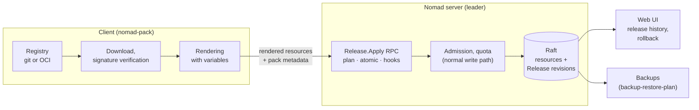

# Package management: Nomad Pack integration – plan

**Status:** Plan · 2026-10-24 · Starting point: Nomad v1.6.5 (MPL 2.0), Nomad Pack v0.4.2 (MPL 2.0) · Related documents: [nomad-fork-development-plan.md](nomad-fork-development-plan.md), [kubernetes-features-spec.md](kubernetes-features-spec.md), [backup-restore-plan.md](backup-restore-plan.md)

Norca's package manager will be Nomad Pack: the package format and the command-line tool remain, while the capabilities missing compared to Helm (a release object with revisions, rollback, non-job resources, atomic install, hooks, tests, OCI registry, signing) are provided by Norca's server side, building on the features already planned. The same format also serves as the operator package for Kubernetes item 8, so there is a single package format.

## Table of contents

- [Starting point](#starting-point)
- [Comparison with Helm](#comparison-with-helm)
- [Target architecture](#target-architecture)
- [Extended package format](#extended-package-format)
- [Release object](#release-object)
- [Install, upgrade, rollback](#install-upgrade-rollback)
- [Hooks and tests](#hooks-and-tests)
- [Multi-region](#multi-region)
- [Registries and supply chain](#registries-and-supply-chain)
- [API, CLI and UI](#api-cli-and-ui)
- [Permissions](#permissions)
- [Schedule](#schedule)
- [Testing and acceptance](#testing-and-acceptance)
- [Implementation](#implementation)
- [Risks](#risks)
- [License](#license)
- [Open questions](#open-questions)

## Starting point

### License and dependencies (verified in the source code)

- Nomad Pack has been MPL 2.0 since the beginning (2021), in every release, up to the latest v0.4.2 (2026-03). The project is active; the last commit is from 2026-10-21.
- `go.mod` also pulls in the main Nomad module (`github.com/hashicorp/nomad`, v1.11, **BSL**). However, the executable imports only two **MPL**-licensed Nomad modules: `github.com/hashicorp/nomad/api` (in 24 places) and `github.com/hashicorp/nomad/jobspec2/hclutil` (`internal/runner/job/metadata.go`). Packages of the main module (`command/agent`, `testutil`, `ci`) appear only in the test environment (`internal/cli/testhelper/testhelper.go`), where a Nomad agent is started for the tests.
- Consequence: if the test helper uses Norca's own (MPL) Nomad build, Nomad Pack is entirely BSL-free.

### Features

| Feature | Status | Location |
| --- | --- | --- |
| Package with Go templates, typed variables, varfiles | Present | `internal/pkg/renderer/`, `internal/pkg/variable/` |
| Registries from git repositories | Present | `registry add / list / update / delete` |
| Dependencies, vendoring | Present | `deps vendor`, `internal/pkg/deps/` |
| `render`, `plan`, `run`, `stop`, `destroy`, `status`, `info`, `fmt`, `generate` | Present | `internal/cli/` |
| Variable sources (Nomad Variables, Consul) | Present | `internal/pkg/variable/source/` |
| Tracking of installations | Only in the jobs' `meta` fields: `pack.name`, `pack.version`, `pack.registry`, `pack.path`, `pack.job`, `pack.deployment_name` | `internal/runner/job/` |

## Comparison with Helm

| Helm feature | Nomad Pack today | In Norca |
| --- | --- | --- |
| Release object with revision history | None | `Release` object on the server |
| Rollback of several resources together | None | `rollback` to a revision |
| Non-job resources | None | Namespace, quota, ACL, Variables, type definition, object, admission policy, network rule |
| Hooks | None | `pre-install`, `post-install`, `pre-upgrade`, `post-upgrade`, `pre-delete`, `test` |
| Atomic upgrade | None | `atomic` mode with server-side rollback |
| Package tests | None | `test` hook, `nomad-pack test` |
| OCI registry, signing | Git only | OCI, cosign/Sigstore verification, admission policy |
| Value schema | Typed variables | JSON Schema and CEL rules for variables |
| Drift detection | None | Comparison of the revision with the actual state |
| Server-side history in the UI | None | Release view in the web UI |

## Target architecture



Rendering stays on the client (as Nomad Pack works today), so the server does not need to run a template engine, and the content of the pack does not reach the server. The server receives the rendered resources, applies them and keeps track of them.

## Extended package format

The existing pack structure (`metadata.hcl`, `variables.hcl`, `templates/`, `outputs.tpl`, `README.md`, dependencies) remains. The new resource types are identified by the extension of the template file:

| Template extension | Resource | Apply order |
| --- | --- | --- |
| `*.namespace.hcl.tpl` | Namespace | 1 |
| `*.quota.hcl.tpl` | Quota (K8s item 1) | 2 |
| `*.acl.hcl.tpl` | ACL policy (can also be bound to a job) | 3 |
| `*.var.hcl.tpl` | Variables entry (without secret values, see below) | 4 |
| `*.kind.hcl.tpl` | Type definition (K8s item 8) | 5 |
| `*.admission.hcl.tpl`, `*.netpol.hcl.tpl` | Admission policy, network rule | 6 |
| `*.object.hcl.tpl` | Custom object (K8s item 8) | 7 |
| `*.nomad.tpl` | Job (the current format) | 8 |

On deletion the order is reversed. The pack states the required fork version and the features it uses in `metadata.hcl`, so that on an older server `plan` already reports an error:

```hcl
pack {
  name        = "postgres-operator"
  description = "PostgreSQL operator for the db.example.com/PostgresCluster type"
  version     = "1.4.0"

  requires {
    nomad_fork = ">= 1.6.5+fork.8"
    features   = ["custom-objects", "admission-cel"]
  }
}

variables_schema = file("values.schema.json")   # optional JSON Schema for the variables
```

**Secret values:** a pack cannot contain secret values, and the release object does not store them either. `*.var.hcl.tpl` specifies only the structure and the non-secret items of the Variables entry; the secret items are either supplied separately by the installer (`-var-secret`) and go directly into Variables, or are generated by a hook of the pack. Only a reference to them appears in the release.

## Release object

`packs.nomad/Release` is a built-in type built on the native object framework of Kubernetes item 8, bound to a namespace.

| Field | Content |
| --- | --- |
| `metadata.name` | The name of the installation (equivalent of today's `deployment_name`) |
| `spec.pack` | Registry, pack name, version, content digest, result of signature verification |
| `spec.values` | The values of the variables, without secret values (a Variables reference in their place) |
| `status.revision` | The number of the current revision |
| `status.phase` | `pending`, `applying`, `deployed`, `failed`, `rolling-back`, `superseded`, `uninstalling` |
| `status.resources` | The list of applied resources (type, namespace, name, version or `ModifyIndex`) |
| `status.conditions` | `Ready` (the deployments of all jobs succeeded), `HooksSucceeded`, `Drifted` |

**Revisions:** every install or upgrade creates a new, immutable revision with the full content of the rendered resources (compressed). By default the last 10 revisions are kept (`max_history`); older ones can be recovered from the backups.

**Ownership:** every resource created by the release gets an owner reference to the release (item 8), so deleting the release also deletes its resources, with the chosen deletion mode. For backward compatibility, the jobs' current `pack.*` meta fields remain.

## Install, upgrade, rollback

**`Release.Apply` RPC** (on the leader):

1. **Validation:** the pack's requirements (fork version, features), the schema of the variables, the signature, and whether the affected resources already belong to another release (an error on conflict; they can be taken over with the `-take-ownership` flag).
2. **Preview (`plan`):** per resource, what is created, what changes (for jobs, using the diff of the existing `Job.Plan`), what is deleted; without writing.
3. **`pre-install` or `pre-upgrade` hooks.**
4. **Apply** in the fixed order, every resource through the normal write path (admission, quota, ACL), with optimistic concurrency.
5. **Waiting (`wait`):** until the deployments of the jobs succeed, with a timeout.
6. **`post-install` or `post-upgrade` hooks.**
7. **Closing the revision:** `deployed`, the previous revision `superseded`.

**Atomic mode (`atomic = true`):** if any step fails (apply, deployment, hook), the server restores the resources of the previous revision in the same order, the jobs as a new version (as `nomad job revert` does), and the release becomes `failed`, while the previous revision becomes `deployed` again.

**Rollback:** `nomad-pack rollback <release> [revision]` or in the UI. The content of the selected revision is applied as a new revision, over the same path, so a rollback is also traceable.

**Drift detection:** the leader periodically (and on request) compares the release's current revision with the actual state of the resources. In case of a difference, the `Drifted` condition becomes true and an event is generated. There is no automatic correction; the operator decides.

**Concurrency:** only one operation can run on a release at a time; a second request gets a `409 Conflict` response.

## Hooks and tests

- Hooks are batch jobs in the pack, marked with the `pack.hook` meta field: `pre-install`, `post-install`, `pre-upgrade`, `post-upgrade`, `pre-delete`, `post-delete`, `test`.
- Within a phase, hooks run in sequence by weight (`pack.hook_weight`); the phase succeeds if all of them finished successfully.
- Deletion policy (`pack.hook_delete`): `on-success` (default), `always`, `never` (for debugging).
- **Tests:** hooks with the `test` role are run by `nomad-pack test <release>`; the result goes into the release's event log and the UI. Typical use: a post-install smoke test, connecting to the database.
- Hooks run with the permissions and quota of the release, and the admission rules of item 2 apply to them as well.

## Multi-region

- A release lives per region (like every other object). Installing a pack into several regions is done either one by one with the `-region` flag, or in one step with a `regions = ["eu-aws", "eu-gcp"]` setting.
- **Jobs:** if the pack's jobs contain a `multiregion` block, the install uses Norca's multiregion deployment (cross-region RPC, ordered rollout, see the multi-cloud chapter of the development plan).
- **Other resources:** applied per region, on the region's leader, with cross-region RPC forwarding. Global ACL objects can be applied only in the authoritative region, from where they are replicated.
- **Partial success:** if the install fails in one region, the releases in the other regions are kept; `atomic` mode applies per region. The UI shows the state of the release per region.

## Registries and supply chain

- **Git registry:** today's behavior remains, extended with commit- or tag-based pinning (`-ref`).
- **OCI registry:** a pack can be stored and downloaded as an OCI artifact (for example Harbor, GitHub Container Registry, an internal registry), versioned and with a content digest. This also solves internal mirroring and air-gapped environments.
- **Signing:** packs can be signed with cosign/Sigstore; `nomad-pack` verifies on download and puts the result (signer, digest) into the release's `spec.pack` field.
- **Enforcement on the server:** a built-in admission policy (K8s item 2) allows, in the given namespaces, only releases whose signature belongs to a trusted key or identity.
- **Dependencies:** the digests of vendored dependencies go into a lock file (`pack.lock`), so the install is reproducible.

## API, CLI and UI

| Operation | HTTP | CLI |
| --- | --- | --- |
| Preview | `POST /v1/release/:name/plan` | `nomad-pack plan` |
| Install, upgrade | `PUT /v1/release/:name` (`atomic`, `wait`, `timeout`) | `nomad-pack run` / `upgrade` |
| List, details | `GET /v1/releases`, `GET /v1/release/:name` | `nomad-pack list`, `status` |
| Revisions | `GET /v1/release/:name/history`, `/revision/:n` | `nomad-pack history` |
| Rollback | `POST /v1/release/:name/rollback` | `nomad-pack rollback` |
| Tests | `POST /v1/release/:name/test` | `nomad-pack test` |
| Drift | `GET /v1/release/:name/drift` | `nomad-pack diff --live` |
| Delete | `DELETE /v1/release/:name` (`propagation`) | `nomad-pack destroy` |

**UI:** a new "Packs" menu item. A release list by namespace and region (pack, version, revision, state, drift indicator); release details with the resources (with links to the jobs), the revision history, comparison of two revisions, and the results of hooks and tests; rollback with confirmation. On the jobs' pages it is shown which release they belong to.

## Permissions

- Reading, writing and deleting a release uses the per-type ACL model of item 8: `object "packs.nomad/Release" { capabilities = [...] }` at namespace level.
- Applying a release **grants no extra permissions**: every resource in it is applied with the caller's own permissions and the normal checks. Someone who cannot write an ACL policy cannot install a pack that contains one either.
- Hooks run with the ACL policies bound to the pack's jobs (`JobACL`).

## Schedule

| Phase | Content | Prerequisite |
| --- | --- | --- |
| 1. Adoption | Nomad Pack becomes Norca's official tool; the test helper switched to Norca's build; compatibility tests against Norca's server; own registry for internal packs; documentation | – |
| 2. Release tracking | `Release` object, revisions, `status`, `history`, `rollback` with client-side apply | Phase 2 of K8s item 8 (native objects) |
| 3. Server-side apply | Extended package format, fixed order, `Release.Apply`, `plan`, `atomic`, hooks, tests, drift detection, UI | Phase 2; K8s item 2 (admission); phase 3 of item 8 (ownership) |
| 4. Supply chain and multi-region | OCI registry, signing, admission check, `pack.lock`, multiple regions | Phase 3; multiregion deployment |

Phase 1 can start immediately and on its own provides unified package management. Helm-level capabilities are available from phase 3.

**Relationship to upstream Nomad Pack:** the client-side extensions (OCI registry, signature verification, `pack.lock`, value schema) are best written as changes that can be submitted upstream. The parts that build on Norca's own server-side features (release object, `Release.Apply`, extended resource types) live in Norca's Nomad Pack branch, with regular upstream synchronization.

## Testing and acceptance

- A pack containing a namespace, a quota, an ACL policy, a Variables entry and two jobs can be installed in one step, and on deletion all its elements are removed in reverse order.
- In `atomic` mode, after a deliberately faulty job upgrade, every resource returns to the state of the previous revision, and the release becomes `failed`.
- A release upgraded three times can be rolled back to any earlier revision, and the rollback appears as a new revision.
- A job modified by hand results in a `Drifted` state at the next check.
- A pack without a signature is rejected in a protected namespace.
- Today's Nomad Pack packs (the samples of the community registry) can be installed without modification.

## Implementation

Phases 2 and 3 (release objects, server-side apply, hooks, drift) and the supply chain part of phase 4 are documented for users in [`nomad/pack/docs/releases.md`](../../nomad/pack/docs/releases.md) and [`supply-chain.md`](../../nomad/pack/docs/supply-chain.md). This section records the remaining items of phase 4.

### Variables schema

- **Format:** `variables_schema` is a top-level attribute of `metadata.hcl` (as in the example above). `metadata.hcl` is now decoded with an evaluation context whose only function is `file(path)`, which reads a file of the loaded pack (cleaned path, never outside the pack directory; `pack.DecodeMetadata` in `pack/sdk/pack`, also used by `deps vendor`). The schema is compiled when the pack is loaded, so a broken schema fails early.
- **One validator:** the JSON Schema library of the object kinds (`santhosh-tekuri/jsonschema/v6`, wrapped by `nomad/objectschema`) is reused: `objectschema.CompileDocument` compiles a self-contained document that is not an object kind schema, `Schema.ValidateValue` validates any Go value through its JSON encoding. Errors keep the `at /<path>: <message>` form of object validation, so they name the variable path (`at /resources/cpu: maximum: got 9000, want 4000`).
- **Client:** the pack manager validates, after variable parsing and before rendering (`render`, `plan`, `run`, `upgrade`), the effective values of every pack of the dependency tree that has a schema against its own schema; null (unset) variables are left out so that `required` reports them.
- **Server:** the release request carries `VariablesSchemas` (pack path and schema) and `VariableValues` (effective values by pack path). `Release.Apply` (also dry runs) validates them again and stores the schemas in `spec.variablesSchemas` of the revision; rollbacks copy them. The effective values are never stored (they can contain secrets); the revision keeps the redacted overrides as before. The schemas of a release are limited to 64 KiB, which is subtracted from the content limit of the revision.
- CEL rules for variables (mentioned in the comparison table) are not implemented; JSON Schema covers the plan's acceptance needs.

### Multi-region

- **Coordination:** `ReleaseApplyRequest.Regions` (CLI `--regions`, or `regions = [...]` at the top level of `metadata.hcl`) makes the receiving region's leader the coordinator. It validates the regions (known, all servers at the Norca minimum version), requires a global token when ACLs are on and other regions are involved, orders the regions (global region first) and sends every region a copy of the request with a `ReleaseMultiregion` description (`Regions`, `GlobalRegion`) over the normal region forwarding (`Release.Apply` to each region's leader). The reply has one `ReleaseRegionResult` per region. No new Raft message types: each region writes its own release objects.
- **Global resources:** namespaces, quotas and ACL policies are written in the authoritative region and replicated by the servers. Only the release of the global region (the authoritative region if listed, otherwise the first region given) applies and owns them; the others report them as `remote` changes, wait (bounded, 1 minute, warning on timeout) until the replicated copies match, and never delete them (a resource that moves to the global region's ownership is dropped from the local release, not deleted).
- **Multiregion jobs:** the submitting region of a job with a `multiregion` block is the first region of the install that the job lists (`ReleaseMultiregion.JobSubmitter`); its release registers the job, Norca's multiregion registration fans it out with the same version and the deployment watchers run the staged rollout. Other listed regions adopt the job (owned, waited for, not registered); regions the job doesn't list skip it.
- **Partial success and atomic mode:** the regions are applied in turn; a failure is recorded in that region's result and the remaining regions are still applied. Atomic mode runs inside each region's operation, so it restores only that region. The RPC fails only if every region failed.
- **Persistence of the division of work:** `spec.multiregion` of the release and of every revision records the install; later single-region operations (upgrade, rollback, record-only) of such a release keep it.
- **CLI:** `run`, `upgrade`, `plan` print a per-region table; `status` and `history` show every region of the install (found in `spec.multiregion`, or `--regions`); `uninstall --all-regions`/`--regions` uninstalls in reverse install order (global region last). The client-side job conflict check runs in every region of the install.

**Provisional decisions (reversible):**

1. `regions` and `variables_schema` are top-level attributes of `metadata.hcl` (not inside `pack {}`), next to each other as in the design example; `--regions` overrides `regions`.
2. When the authoritative region is not among the regions, the first region given owns the global resources (its writes are forwarded to the authoritative region), instead of failing or creating a release in the authoritative region.
3. Regions are applied sequentially; after a failure the remaining regions are still applied (no `stop-on-failure` option).
4. A replication wait that times out is a warning, not a failure (resources that need the namespace then fail on their own); without ACLs the servers don't replicate, which is reported as a warning.
5. `rollback` and `test` stay per region (revision numbers can differ between regions).

## Risks

| Risk | Mitigation |
| --- | --- |
| Diverging from upstream Nomad Pack | Client-side extensions submitted upstream; the fork-specific part kept well separated; regular synchronization |
| A secret value ends up in the release or in the backups | The format does not allow secret values; secret items appear only as Variables references; admission check |
| A release takes over resources belonging to another release | Owner reference and conflict check; only with the `-take-ownership` flag |
| A faulty hook blocks the install | Per-hook timeout; `atomic` mode; hook jobs are kept for debugging (`never` deletion policy) |
| The size of revisions loads Raft | Compression, `max_history`, per-revision size limit; older revisions from the backups |

## License

- Nomad Pack: MPL 2.0. The executable imports only MPL-licensed Nomad modules (`api`, `jobspec2/hclutil`); the BSL main Nomad module appears only in the test helper, which must be switched to Norca's own build.
- OCI client and signing: for example the `oras-go` and `sigstore/cosign` libraries (Apache 2.0).
- JSON Schema validation: the library to be selected as an open question of K8s item 8, the same one for the pack variables.
- The name "Helm" appears only for comparison; no code is taken from Helm.

## Open questions

- [x] Which OCI registry do we use internally, and is an air-gapped installation needed? Decided 2026-10-24: an internal, configurable OCI registry; air-gapped installation is needed.
- [x] Who signs the internal packs, and with what key (key pair or Sigstore identity)? Decided 2026-10-24: a cosign-compatible key pair first (Sigstore identity later); the needed command-line tooling is built into `norca pack`.
- [x] Should `atomic` mode be the default in production namespaces? Decided 2026-10-24: yes.
- [x] How many revisions do we keep by default (`max_history`)? Decided 2026-10-24: 10.
- [x] Which existing packs (community registry, internal jobs) must be migrated first? Decided 2026-10-24: none yet (internal packs are not set up); tests use the community registry, in particular its `redis` pack.
