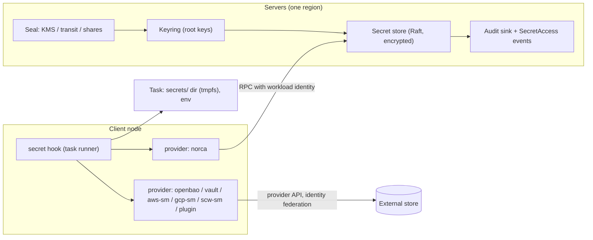

# Embedded secret storage with external providers – plan

**Status:** Planned · 2026-10-25 (decisions recorded, development not started) · Starting point: Nomad v1.6.5 (MPL 2.0) and the Norca features built on it (Variables, keyring, workload identities, backup) · Related documents: [nomad-fork-development-plan.md](nomad-fork-development-plan.md), [backup-restore-plan.md](backup-restore-plan.md), [consul-independence-plan.md](consul-independence-plan.md), [package-management-plan.md](package-management-plan.md)

Norca gets a built-in secret store, so that a cluster can keep and hand out passwords, API keys and certificates without running a separate secret server. The **existing external Vault integration stays exactly as it is**, and further external modules (OpenBao, cloud secret managers, plugins) can be added. The rule that ties the two together: **a secret lookup goes to the external store when one is defined for it, and falls back to the built-in store when none is defined.** This also holds for jobs written for Vault: on a cluster without Vault, their `vault` blocks and `secret` template calls are served by the built-in store, unchanged.

## Table of contents

- [Starting point](#starting-point)
- [Goals and non-goals](#goals-and-non-goals)
- [Architecture](#architecture)
- [Implementation basis: uBixVault](#implementation-basis-ubixvault)
- [Key protection (seal)](#key-protection-seal)
- [The built-in store](#the-built-in-store)
- [Provider resolution and fallback](#provider-resolution-and-fallback)
- [Vault compatibility](#vault-compatibility)
- [Delivery to tasks](#delivery-to-tasks)
- [External providers](#external-providers)
- [Permissions](#permissions)
- [Audit](#audit)
- [Rotation and dynamic secrets](#rotation-and-dynamic-secrets)
- [Multi-region operation](#multi-region-operation)
- [Backup and restore](#backup-and-restore)
- [API, CLI and UI](#api-cli-and-ui)
- [Migration](#migration)
- [Implementation and schedule](#implementation-and-schedule)
- [Testing and acceptance](#testing-and-acceptance)
- [Risks](#risks)
- [License](#license)
- [Open questions](#open-questions)

## Starting point

| Item | Today | Location |
| --- | --- | --- |
| Variables | Encrypted key/value entries in Raft (AES-256-GCM with the active root key), at most 64 KiB per entry, ACL by path, admission policies on writes, `Variables` event topic | `nomad/variables_endpoint.go`, `nomad/structs/variables.go` |
| Access from tasks | A task's workload identity can read `nomad/jobs`, `nomad/jobs/<job>`, `.../<group>` and `.../<task>` in its namespace without extra policies; templates read them with `nomadVar` | `nomad/variables_endpoint.go`, `client/allocrunner/taskrunner/template/` |
| Keyring | Root keys in the `root_key_meta` table; the key material is on every server's disk in `keystore/`, wrapped with a key-encrypting key that sits **in the same file** (the code itself calls this "security theatre … a shim for external KMS providers in the future") | `nomad/encrypter.go` (`saveKeyToStore`, `newKMSWrapper`) |
| Vault integration | Server-derived Vault tokens (`vault` block of the agent and the task), `secret` template function; Vault itself is BSL 1.1 since 1.15 and is not shipped by Norca | `nomad/vault.go`, `client/vaultclient/` |
| Secrets in packs | `secret_items` of Variables resources are applied but never stored in the release | `nomad/pack/docs/releases.md` |
| Other key material in Raft | The native mTLS CA key, encrypted with the root key | `nomad/mtls*.go` |
| Backups | Raft snapshot plus the keystore, encrypted with `kms` or `age` | `nomad/backup/` |
| Libraries already in the module | `go-kms-wrapping/v2` (MPL 2.0), `vault/api` (MPL 2.0) | `go.mod` |

Variables are therefore already an encrypted, replicated, access-controlled store. What is missing for real secret management:

1. **The keys are not protected.** Whoever reads a server's disk can decrypt every Variable, every backup made with the cluster's own keys, and the mTLS CA key.
2. **No secret lifecycle:** no versions, no expiry or rotation, no audit of who read a value.
3. **Delivery is template-only:** there is no declarative way to say "put this secret into this file or environment variable", and nothing that works the same way for an external store.
4. **External stores are Vault-only**, with the old token-derivation flow, and Vault itself is no longer open source.

## Goals and non-goals

**Goals**

- Secrets at rest are protected by a key that is **not** on the servers' disks in usable form (cloud KMS, an OpenBao/Vault transit key, or operator-held unseal shares).
- A first-class secret object with versions, metadata, expiry and rotation reminders, separate from configuration Variables, with value redaction everywhere (API listings, events, logs, UI, backups browsing).
- One declarative `secret` block in the jobspec that delivers values as files or environment variables, re-delivers them on change, and works identically for the built-in store and for external providers.
- **The existing Vault integration is unchanged:** the agent's `vault` block, server-derived Vault tokens, the task `vault` block and the `secret` template function keep working against a configured Vault exactly as in Nomad 1.6.5.
- **Fallback:** every secret lookup is resolved to an external store if one is defined for it, otherwise to the built-in store. Jobs written for Vault run without Vault: the built-in store answers their KV reads.
- A **provider interface** with built-in providers (the embedded store, OpenBao/Vault, the cloud secret managers of the supported clouds) and external plugins over the same gRPC plugin mechanism as the autoscaler's external plugins.
- Workload identity as the only credential a task needs; no long-lived tokens in jobspecs or on clients where the provider supports identity federation.
- An audit trail of every value read and write.

**Non-goals (for this plan)**

- Replacing a full Vault/OpenBao: no generic secret-engine marketplace, no SSH CA, no general PKI engine beyond the existing mTLS CA, no transit encryption-as-a-service API in the first phases.
- Secrets larger than the Raft entry budget (the built-in store keeps the 64 KiB limit per secret).
- Storing secrets of external providers in Raft: external values are fetched by the client and never written to the servers.

## Architecture



- **Servers** own the seal, the keyring and the built-in store. Values are encrypted with the active root key (as Variables are); the root keys are wrapped by the seal.
- **Clients** run a `secret` task-runner hook. For each `secret` block it picks the provider, authenticates with the task's workload identity, fetches the value, writes it into the task's `secrets/` directory or environment, and watches for changes.
- **Providers** are one interface; `norca` is the built-in one. External providers are either compiled in (OpenBao/Vault and the cloud secret managers) or loaded as plugins. The existing Vault integration is wrapped as the `vault` provider without changing its behaviour.
- **Resolution:** the client decides per lookup which provider answers it (see the next section); `norca` is always the last fallback, so a lookup never fails just because no external store is configured.

## Implementation basis: uBixVault

**Decided 2026-10-25:** the built-in store is not written from scratch; its core comes from [uBixVault](https://github.com/cwolsen7905/ubixvault) (BSD-3-Clause, an independent from-scratch Go secrets manager, not derived from Vault; reference clone in the workspace at `C:\orchestrate\ubixvault`).

| uBixVault part | Used for | How |
| --- | --- | --- |
| `barrier` (AES-256-GCM, path bound into the ciphertext), `shamir`, `seal`, the init/unseal part of `core` | Key protection, the `shares` seal, sealed state | Imported; the root of trust for secrets |
| `kv` (KV v2: versions, soft delete, undelete, destroy, max versions) | The `Secret` object's storage and versioning | Imported; addressed through the Norca secret API |
| `transit` | Later: encryption as a service (not in the first phases) | Imported, not exposed until decided |
| `database` (dynamic credentials with leases) | Phase 7, built-in dynamic engine | Imported; MariaDB/MySQL today, PostgreSQL to be added |
| `audit` | The audit file sink | Imported; records also feed the `SecretAccess` topic |
| HTTP API layer (Vault-compatible shapes) | The Vault-compatible endpoint on the client agent (phase 4) | Reused for the KV read subset, behind Norca's own authorization |
| `storage/raft`, `file`, `mysql` backends, HA lock over MySQL | – | **Not used** (see below) |
| `token`, `policy`, `userpass`, `ldapauth`, `jwtauth`, `kubeauth`, `approle`, `certauth`, `identity` | – | **Not used**: access is decided by Norca ACL policies and workload identities |

- **Storage on Norca's Raft.** uBixVault's core only sees a small storage interface (`Get`, `Put`, `Delete`, `List`) and an HA lock interface. Norca implements both on its own Raft: a new message type and memdb table hold the barrier's ciphertext blobs (keys are storage paths, values stay encrypted), and the HA lock is Nomad leadership. uBixVault's own Raft backend (a second Raft cluster with its own peers and ports) is not used, so there is one consensus system per region, and secrets are automatically replicated, included in the backup snapshots and carried over leader changes.
- **One active instance per region:** the barrier core runs on the Nomad leader (unsealed state per server, as planned); followers forward secret requests over the normal Nomad RPC forwarding.
- **Authorization:** Norca ACL capabilities (`list-secret`, `read-secret`, …) and workload identities are checked before the engines are called; uBixVault tokens and policies are not exposed.
- **Code import:** the needed packages are brought into the Norca repository with `git subtree` (history kept, like Nomad Pack), under `nomad/secretstore/ubix/`, because they are Go `internal` packages and cannot be imported as a module. Upstream is asked whether it would export them as public packages; if it does, the subtree is replaced by a normal module dependency. Local changes are kept small and offered upstream.
- **Version:** v1.6.0 (2026-10-14) is the latest release; per the two-week rule it can be adopted from 2026-10-28, until then v1.5.0 (2026-09-30).
- **Risks taken on:** the project is young (first commit 2026-07-18), maintained essentially by one person, and not independently audited; Norca takes on review and maintenance of the imported code (own security review of the barrier, Shamir and seal paths before release, fuzz and property tests kept and run in Norca's CI).

## Key protection (seal)

A new `keyring` block in the server configuration replaces the key-encrypting key stored next to the key:

```hcl
server {
  keyring {
    seal "awskms" {            # or gcpckms, scwkms, transit, shares, aead (legacy)
      region     = "eu-central-1"
      kms_key_id = "alias/norca-keyring"
    }
    # optional second seal: keys are wrapped by both, either can unwrap
    seal "shares" {
      threshold = 3
      shares    = 5
    }
  }
}
```

| Seal | Wraps the root keys with | Unseal at server start | Fits |
| --- | --- | --- | --- |
| `awskms` | AWS KMS key (server role needs `Encrypt`/`Decrypt` only) | Automatic | AWS regions |
| `gcpckms` | Google Cloud KMS key | Automatic | GCP regions |
| `scwkms` | Scaleway Key Manager key | Automatic | Scaleway regions |
| `transit` | An OpenBao/Vault transit key | Automatic while the transit server is reachable | Any cloud with an existing OpenBao/Vault |
| `shares` | A random unseal key split into Shamir shares held by operators | Manual: `norca operator unseal` with `threshold` shares | Hetzner (no managed KMS), bare metal, highest protection |
| `aead` | Today's behaviour (key next to the key) | Automatic | Development and migration only; the agent warns |

- **Decided 2026-10-25:** the first version implements `shares` (and `aead` for development and migration). The KMS and `transit` seals above are the designed extension points and are integrated later, when someone needs them.
- Hetzner Cloud has no managed KMS; Hetzner regions use `transit` (an OpenBao in another region or on dedicated hosts) or `shares`.
- **Sealed state:** a server whose keys cannot be unwrapped joins Raft and serves everything that needs no decryption, but rejects secret and Variable reads, workload-identity signing and mTLS issuance with a clear `sealed` error until unsealed. `norca operator seal-status` shows it per server.
- **Seal migration** (`norca operator keyring rewrap -to <seal>`) re-wraps all root keys online; both seals stay valid until the rewrap finishes on every server.
- The existing `Keyring.Restore` and full restore of the backup plan work on wrapped keys: restoring into a cluster requires access to the seal that wrapped them (or the `age` backup copy, see below).

## The built-in store

**Object:** `Secret`, namespace-scoped, stored in a new Raft table `secrets` (not in the `variables` table), encrypted with the keyring exactly like Variables.

| Field | Meaning |
| --- | --- |
| `path` | Hierarchical name, e.g. `prod/db/postgres` |
| `items` | Key/value pairs (the value), at most 64 KiB in total |
| `version` | Monotonic; the last `max_versions` (default 10) are kept, older ones destroyed |
| `metadata` | Free labels, `owner`, `description` – never secret, always visible to readers of metadata |
| `expires_at`, `rotate_every` | Optional; drive warnings, events and the rotation hook |
| `deleted` | Soft delete with `undelete` until the version is destroyed |

- **Why not just Variables:** Variables are widely used for non-secret configuration, are readable by default by every task of a job, and have no versions or audit. Keeping both lets Variables stay simple and compatible while secrets get stricter defaults (no implicit task access, value redaction, audit). A Variable item can still be marked secret by moving it.
- **Values never leave the servers except** through an explicit value read (API/CLI with `read-value`, or the client `secret` hook). Listings, events, the event stream, backup browsing, release drift and the UI only ever show metadata and a value hash.
- **Size and load:** secret writes are rare; reads by clients use blocking queries on metadata and fetch the value only when the version changes.

## Provider resolution and fallback

Every secret lookup – a `secret` block, a `secret`/`nomadSecret` template call, a task `vault` block, or a read through the Vault-compatible endpoint – is resolved by the client in this order; the first step that defines a provider wins:

| Step | Where it is defined | Example |
| --- | --- | --- |
| 1. Explicit | `provider` in the `secret` block, or the `provider:` prefix in a template call | `provider = "aws"`, `{{ secret "bao:kv/data/db" }}` |
| 2. Path mapping | `secrets { route }` rules in the client configuration, matched on the path prefix | `route { prefix = "kv/" provider = "vault" }` |
| 3. Job or namespace default | `secrets { default_provider }` in the namespace metadata, or in the job's group | `default_provider = "bao"` for the `prod` namespace |
| 4. Vault integration | The agent's existing `vault { enabled = true }` block: Vault-style lookups (task `vault` block, `secret` template calls) go to that Vault, exactly as today | unchanged Nomad 1.6.5 behaviour |
| 5. **Fallback** | Nothing above defines a provider | the built-in `norca` store |

- **Fallback means "not defined", never "failed".** If a provider is defined but unreachable, or denies the request, or the secret does not exist there, the lookup fails with that provider's error; it does **not** silently fall through to the built-in store. A silent fallback could hand a task a stale or different value without anyone noticing.
- The resolved provider of each secret of a task is shown in the task events and the allocation status (`secret db: provider norca (fallback)`), never the value.
- Admission policies can require a provider for a namespace (for example: `prod` must use `bao`), so that a missing configuration fails at job submission instead of falling back.
- Servers use the same order for server-side lookups (for example the pack release `secret_items`).

## Vault compatibility

The existing Vault integration is kept as it is: the agent's `vault` block, the server-derived Vault tokens, the task `vault` block (`policies`, `change_mode`, `env`), `VAULT_TOKEN`/`VAULT_ADDR` injection and the `secret` template function. With a configured Vault (step 4 above) nothing changes.

When **no Vault is configured** (and no other provider is defined for the lookup), Vault-style lookups fall back to the built-in store:

- **Template calls:** `{{ with secret "kv/data/app/db" }}{{ .Data.data.password }}{{ end }}` reads the built-in secret `app/db` and returns it in the KV v2 response shape (`.Data.data`, `.Data.metadata.version`), so existing templates render unchanged. KV v1 paths (`secret/app/db` → `.Data.password`) are supported as well. The mount prefix is mapped by configurable rules (default: `kv/data/<p>`, `secret/data/<p>` and `secret/<p>` → `<p>`).
- **Task `vault` block:** without Vault, the task gets a short-lived, task-scoped token for a **Vault-compatible read endpoint on the local client agent** (`VAULT_ADDR` points to it), so applications that use a Vault SDK directly can read their KV secrets from the built-in store. The endpoint implements only KV v1/v2 reads, `token/lookup-self`, `token/renew-self` and `sys/health`; everything else returns a clear "not supported by the built-in store" error. Access is checked with the task's workload identity and the `read-secret` policy, not with Vault policies; the `policies` list of the `vault` block is used only for a warning if no matching Norca policy exists.
- This mirrors the Consul-compatible read layer of the Consul independence plan: same idea, same "subset plus explicit errors" rule.
- Dynamic Vault engine paths (for example `database/creds/<role>`) fall back to the built-in dynamic engine (see [Rotation and dynamic secrets](#rotation-and-dynamic-secrets)) for the engines it implements; other engines (for example PKI or SSH) fail with a message that a Vault/OpenBao provider is required.

## Delivery to tasks

```hcl
task "api" {
  secret "db" {
    provider = "aws"              # optional; omitted = resolution order, fallback to the built-in store
    path     = "prod/db/postgres" # provider-specific path
    version  = 0                  # 0 = latest

    file {
      destination = "secrets/db.env"   # always below secrets/ (tmpfs, 0400)
      format      = "env"              # env | json | raw:<item> | template
    }
    env {                              # optional, items to environment variables
      DB_USER     = "username"
      DB_PASSWORD = "password"
    }

    change_mode   = "restart"          # restart | signal | script | noop
    change_signal = "SIGHUP"
  }
}
```

- The hook runs before the task starts (`prestart`) and blocks the start until every required secret is delivered (`optional = true` makes a secret non-blocking).
- Files are written atomically into `secrets/` (tmpfs on Linux where available) with mode 0400 and the task's user as owner; `env` values go only into the task's environment, never into the allocation API or logs.
- A **template function** `{{ nomadSecret "prod/db/postgres" }}` (optionally with a `provider:` prefix) gives the same data to templates and follows the same resolution order; the existing Vault `secret` function keeps working, against Vault when one is configured and against the built-in store otherwise.
- Values are never written into the job spec, the allocation, client state on disk, or task events. Restarted clients fetch them again.
- Jobs reference secrets by path; admission policies (CEL) can restrict which paths a namespace may reference.

## External providers

**Configuration** on clients (and servers, for providers used by server-side features):

```hcl
secrets {
  provider "bao" {
    type    = "openbao"            # Vault-compatible API: openbao | vault
    address = "https://bao.internal:8200"
    auth "jwt" { role = "norca-workloads" }   # login with the task's workload identity
  }
  provider "aws" {
    type   = "aws-secretsmanager"
    region = "eu-central-1"
    auth "web-identity" { role_arn = "arn:aws:iam::123:role/norca-tasks" }
  }
  provider "gcp"  { type = "gcp-secretmanager"      project = "acme-prod" }
  provider "scw"  { type = "scaleway-secretmanager" region  = "fr-par" }
  provider "corp" { type = "plugin" plugin = "corp-secrets" }   # external plugin binary
}
```

| Provider type | Backend | Authentication of the task | Notes |
| --- | --- | --- | --- |
| `norca` | Built-in store | Workload identity, server RPC | Always available; the fallback |
| `vault` (existing integration) | The Vault configured in the agent's `vault` block | Server-derived Vault tokens, as in Nomad 1.6.5 | Unchanged; defined implicitly when `vault { enabled = true }` |
| `openbao`, `vault` (new provider block) | OpenBao or Vault KV v2 (also dynamic secrets engines, read as leases) | JWT auth with the workload identity (no Vault token in the job) | Optional newer path; can run next to the existing integration |
| `aws-secretsmanager` | AWS Secrets Manager | STS `AssumeRoleWithWebIdentity` with the workload identity, or the node's instance role | |
| `gcp-secretmanager` | Google Secret Manager | Workload Identity Federation with the workload identity, or the node's service account | |
| `scaleway-secretmanager` | Scaleway Secret Manager | API key from the client configuration (no identity federation) | |
| `plugin` | Anything | The plugin receives the workload identity token | go-plugin over gRPC, same packaging as the autoscaler's external plugins |

- **Plugin interface** (gRPC): `Configure`, `Fetch(path, version, identity) → items, version, lease`, `Renew(lease)`, `Revoke(lease)`, `Capabilities()`. A plugin can be written without importing Norca's server code (a small SDK in the api module, like the controller SDK).
- **Identity federation** needs the cluster's public OIDC discovery document and JWKS so that cloud IAM and OpenBao can verify workload identity tokens; Nomad 1.6.5 has neither endpoint, so the plan adds `/.well-known/openid-configuration` and `/.well-known/jwks.json` with a configurable issuer and audiences per provider.
- **Cloud SDKs** (Hetzner, Scaleway, AWS, GCP are the supported clouds) are the same official SDKs used by the LoadBalancer providers and the autoscaler's cloud targets, so they are shared dependencies, not one copy per feature. Hetzner has no secret manager; its regions use `norca` or `openbao`.
- **Fallback and caching:** a client caches values only in memory for running tasks; if a provider is unreachable, running tasks keep their delivered files, new tasks wait (with an event) until `timeout`, then fail.

## Permissions

New namespace capabilities for the built-in store, none of them included in the `read`/`write` shorthands:

| Capability | Allows |
| --- | --- |
| `list-secrets` | Paths and metadata |
| `read-secret` | Values (also needed for the `secret` hook through workload identities) |
| `write-secret` | Create, update, soft delete, undelete |
| `destroy-secret` | Destroy versions permanently |

- Path restrictions use the same glob rules as Variables (`secret "prod/db/*" { capabilities = [...] }` inside a namespace rule).
- **No implicit task access:** unlike Variables, a task can read a secret only if a policy bound to the job (`job_acl`) or a workload-identity binding grants `read-secret` on the path. A shorthand binding `secret_access { path = "jobs/${job}/*" }` keeps the common case short.
- Seal operations (`unseal`, `rewrap`, seal status) need `operator:write`.

## Audit

- Every value read and every write produces an audit record: time, region, namespace, path, version, operation, accessor (token accessor or workload identity: job, group, task, allocation), client node, result. Never the value.
- Records go to a new event stream topic `SecretAccess` (subscribers need `operator:read`) and, optionally, to an append-only audit file sink on each server (`secrets { audit_file = "/var/log/norca/secrets-audit.log" }`) with rotation. The NATS bridge can forward the topic like any other.
- External providers keep their own audit; the client additionally emits a `SecretAccess` record with `provider = <name>` for every fetch it performs.

## Rotation and dynamic secrets

- **Rotation reminders:** `rotate_every` and `expires_at` produce `SecretExpiring`/`SecretExpired` events and metrics; nothing is rotated automatically for static secrets.
- **Rotation hooks:** a secret can name a rotation job (`rotate { job = "rotate-db-password" }`), dispatched as a parameterized job with the secret path; the job writes the new version and the `secret` hooks of consuming tasks re-deliver it (`change_mode`).
- **Dynamic secrets** (database users, cloud credentials created on demand with a lease and revoked when the lease ends) get a **built-in engine** (decided 2026-10-25). The same resolution rule applies as for static secrets: if an external provider is defined for the lookup (for example an OpenBao/Vault with its database engine), it provides the dynamic secret; otherwise the built-in engine does.
- **Built-in engine design:**
  - A `SecretEngine` object per namespace describes a backend connection (`type = "postgresql" | "mysql" | …`, address, the engine's own admin credential stored as a built-in secret) and `role`s (creation and revocation statements or cloud policy, `ttl`, `max_ttl`).
  - A task asks for it with `secret "db" { engine = "pg-prod" role = "readonly" }` (or the Vault-style path `database/creds/readonly` through the fallback); the client's `secret` hook requests a lease from the servers, the leader creates the credential on the backend, stores the lease (not the password) in Raft, and returns the credential to the client only.
  - Leases are renewed by the client while the task runs and revoked by the leader when the allocation stops, when `max_ttl` is reached, or after a lease expires without renewal (also after leader changes: the lease table is in Raft, a lease watcher on the leader revokes overdue leases).
  - Every create, renew and revoke goes to the audit trail; the backend admin credential can be rotated by the engine itself (`rotate-root`).
  - Which backends come first is an open question below.

## Multi-region operation

- Secrets are **region-local** by default; each region has its own keyring and seal (one cloud per region, so each region uses its own cloud's KMS).
- **Replicated paths:** paths marked `replicate = true` in the authoritative region are copied to the other regions. A replicated secret is read-only outside the authoritative region.
- **Transport: the Nomad region RPC** (decided 2026-10-25), the same server-to-server connection over the existing VPN that already carries request forwarding, ACL replication, multiregion deployments and the mTLS CA federation. NATS stays an event and notification bridge only.
  - Each non-authoritative region's leader pulls the replicated paths from the authoritative region with a blocking query on their metadata (like the ACL policy replication), fetches changed versions with a dedicated `Secret.Replicate` RPC that is allowed only for server identities, and writes them through its own Raft, re-encrypted with its own keyring.
  - The RPC runs over the servers' mutual TLS; in addition, the value is encrypted for the target region (each region publishes an X25519 replication public key whose private key is part of that region's keyring, therefore protected by its seal), so a value is never in plaintext outside the two leaders' memory.
  - Replication is idempotent (path plus version); an older version never overwrites a newer one, and deletes are replicated as tombstones. A leader change or an offline period is caught up by the next blocking query, plus a periodic full reconciliation that compares version hashes.
- A task in region B never fetches secrets from region A directly.

## Backup and restore

- Secrets are part of the Raft snapshot (encrypted); the backup subsystem needs no new content type.
- With a KMS or transit seal, the keystore in the backup holds **wrapped** keys; restoring into a new cluster requires access to the same KMS key or transit key. The `age` copy of the backup plan remains the disaster-recovery path that needs nothing from the cloud.
- With the `shares` seal, a restore requires the unseal shares; the backup manifest records which seal wrapped the keys.
- Backup browsing and the selective restore show secret paths and metadata, never values; restoring a secret restores its versions.

## API, CLI and UI

| Operation | HTTP | CLI |
| --- | --- | --- |
| List | `GET /v1/secrets?prefix=` | `norca secret list [prefix]` |
| Metadata | `GET /v1/secret/:path?metadata` | `norca secret info <path>` |
| Read value | `GET /v1/secret/:path?version=` | `norca secret get <path> [-version n] [-item k]` |
| Write | `PUT /v1/secret/:path` (check-and-set index) | `norca secret put <path> k=v k=@file` |
| Delete, undelete, destroy | `DELETE /v1/secret/:path`, `POST …/undelete`, `POST …/destroy?versions=` | `norca secret delete/undelete/destroy` |
| Seal status, unseal, rewrap | `GET /v1/operator/seal`, `POST /v1/operator/unseal`, `POST /v1/operator/keyring/rewrap` | `norca operator seal-status/unseal`, `norca operator keyring rewrap` |
| Providers on a client | `GET /v1/client/secrets/providers` | `norca node secrets-providers` |

- `norca secret put` never takes values as plain arguments in shell history when `-` or `@file` is used, and refuses to print values unless `-item`/`-format` is given explicitly.
- **UI:** a "Secrets" page per namespace (paths, versions, metadata, expiry, last access from the audit, which jobs reference a path); values are revealed only on explicit click with `read-secret`, and the reveal is audited. Seal status on the cluster overview.
- **Packs:** `secret_items` of the package plan become `Secret` resources (with `replicate`, `rotate_every`), still never stored in the release.

## Migration

- **Variables → secrets:** `norca secret import -from-variable <path>` moves (or copies) a Variable into the store; a deprecation warning can be enabled for Variables items that look secret (same heuristics as the pack release redaction).
- **Vault jobs:** jobs using `vault {}` and `{{ with secret "kv/data/..." }}` keep working against a configured Vault with no change. To move a cluster off Vault, copy the KV secrets into the built-in store (`norca secret import -from-vault <mount>/<prefix>`, reading through the existing Vault configuration), then remove the agent's `vault` block: the same jobs now resolve to the built-in store through the fallback. Switching to an `openbao`/`vault` provider block with JWT auth is optional and removes the need for server-derived Vault tokens.
- **Keyring:** clusters start with `aead` (today's behaviour) until a `keyring { seal … }` block is added; `norca operator keyring rewrap` then moves to the new seal online.

## Implementation and schedule

| Phase | Content | Main code locations |
| --- | --- | --- |
| 0. Import | uBixVault packages via `git subtree` into `nomad/secretstore/ubix/`, Norca-Raft storage and HA-lock backend (new message type and table), REUSE and notices, Norca CI running its tests | `nomad/secretstore/`, `nomad/fsm.go`, `nomad/state/` |
| 1. Seal | `keyring { seal }` with `shares` (on uBixVault's barrier, Shamir and seal) (and `aead`, today's behaviour, for development and migration); a seal interface that later seals plug into; sealed state; unseal, seal status, rewrap; backup manifest records the seal | `nomad/encrypter.go`, new `nomad/seal/`, `command/operator_unseal.go`, `nomad/backup/` |
| 2. Built-in store | `Secret` object, Raft table, versions, soft delete, ACL capabilities, redaction, `SecretAccess` events, audit file sink, API, CLI | new `nomad/secrets_endpoint.go`, `nomad/structs/secrets.go`, `nomad/state/state_store_secrets.go`, `acl/policy.go`, `api/secrets.go`, `command/secret_*.go` |
| 3. Delivery and fallback | `secret` jobspec block, task-runner hook, `nomadSecret` template function, change modes, provider interface with the `norca` provider and the existing Vault integration wrapped as the `vault` provider, the resolution order with fallback, admission on referenced paths and required providers | `jobspec2`, `nomad/structs`, `client/allocrunner/taskrunner/secret_hook.go`, `client/secrets/` |
| 4. Vault compatibility | Vault-style template calls and the task `vault` block served by the built-in store when no Vault is configured; Vault-compatible KV read endpoint on the client agent; `secret import -from-vault` | `client/allocrunner/taskrunner/vault_hook.go`, `client/allocrunner/taskrunner/template/`, new `client/vaultcompat/` |
| 5. Further external providers (on demand) | `openbao`/`vault` provider blocks (JWT), `aws-secretsmanager`, `gcp-secretmanager`, `scaleway-secretmanager`, plugin mechanism and SDK, OIDC discovery/JWKS; built only when a user needs them | `client/secrets/providers/`, `api/secretsplugin/`, `command/agent/` |
| – Further seals (on demand) | `awskms`, `gcpckms`, `scwkms`, `transit`, behind the phase 1 seal interface; built only when a user needs them | `nomad/seal/` |
| 6. Lifecycle | Expiry and rotation events, rotation jobs, replicated paths over the region RPC (pull by the non-authoritative leaders, encrypted for the target region), UI page | `nomad/secrets_watcher.go`, new `nomad/secretsrepl/`, `nomad/leader.go`, `ui/` |
| 7. Built-in dynamic secrets | `SecretEngine` objects and roles, lease table and lease watcher on the leader, credential creation and revocation, renewal by clients, `rotate-root`, fallback of Vault-style dynamic paths, first backends (see open questions) | new `nomad/secretengine/`, `nomad/structs/secret_engine.go`, `client/secrets/` |

Phase 0 comes first; phases 1 and 2 build on it and are independent of each other, so they can run in parallel; phase 3 needs 2; phase 4 needs 3; phase 7 needs 2 and 3 (and 4 for the Vault-style dynamic paths). Phase 5 and the further seals are built on demand (decided 2026-10-25); the interfaces of phases 1 and 3 are designed so that they can be added without changing jobs or stored data. The existing Vault integration keeps working throughout; no phase changes its behaviour when a Vault is configured.

## Testing and acceptance

- With `awskms`/`gcpckms`/`scwkms`/`transit`, the keystore files contain no usable key material: copying a server's data directory to another machine does not allow decrypting any Variable, secret or backup.
- With `shares`, a restarted server stays sealed (serving Raft but rejecting decryption) until `threshold` shares are entered; fewer shares do not unseal.
- `rewrap` from `aead` to a KMS seal runs online under write load without failed reads.
- A secret's value never appears in: list responses, the event stream, server or client logs, task events, the allocation API, the job spec, release revisions, backup browsing (tests grep all of these for a canary value).
- A task without a policy granting `read-secret` cannot start if it requires the secret, and the denial is in the audit trail.
- Updating a secret re-delivers it to running tasks according to `change_mode` within 10 seconds.
- The same job with `provider = "norca"` and with `provider = "bao"` (OpenBao test server, JWT auth with the workload identity) yields the same files and environment.
- **Fallback:** a job without any `provider` setting, on a client with no route, no namespace default and no `vault` block, gets its secrets from the built-in store; adding a namespace default makes the same job read from that provider; making that provider unreachable makes the task fail with the provider's error instead of falling back.
- **Vault compatibility:** an unmodified job that uses `vault {}` and `{{ with secret "kv/data/app/db" }}` renders the same file with a real Vault (existing integration, OpenBao/Vault test server) and, after removing the agent's `vault` block, from the built-in store; an application using the Vault Go client with `VAULT_ADDR`/`VAULT_TOKEN` reads the same KV value through the client's compatible endpoint.
- The existing Vault integration tests of Nomad 1.6.5 pass unchanged.
- Each cloud secret-manager provider is tested against the provider's API (integration tests gated on credentials; contract tests with recorded responses in CI).
- A replicated path written in the authoritative region appears in the other regions, re-encrypted, within the replication interval.

## Risks

| Risk | Mitigation |
| --- | --- |
| A KMS outage blocks server restarts (sealed servers) | Running servers keep their unwrapped keys in memory; a second seal (`shares` or another KMS) can be configured; seal status in metrics and alerts |
| Lost unseal shares or a deleted KMS key make all data unrecoverable | Two seals recommended; the `age` backup copy; documented key-deletion protection (KMS deletion windows) |
| Secrets leak through a side channel (logs, events, crash dumps, `env` inspection) | Canary-value tests across all outputs; `file` delivery recommended over `env`; values only in memory on clients |
| Too many secret reads load Raft | Clients watch metadata and fetch values only on version change; reads are served by followers with stale-OK for metadata |
| External provider differences (versions, leases, naming) | Provider capability flags; contract tests per provider; clear errors for unsupported features |
| Confusion between Variables and secrets | Documentation, `secret import`, warnings for secret-looking Variables |
| A job silently reads from the built-in store although an external store was intended (missing configuration) | The resolved provider is shown in task events and the allocation status; admission policies can require a provider per namespace; fallback only when nothing is defined, never on errors |
| The Vault-compatible endpoint is mistaken for a full Vault | Only KV reads and token self-operations; explicit errors for everything else; documented subset |

## License

- The core of the built-in store comes from uBixVault (BSD-3-Clause, on the allowed list): its copyright and license notice are kept in the imported files and in `THIRD_PARTY_NOTICES.md`, and `REUSE.toml` annotates the subtree. Its dependencies used by the imported packages are MPL/MIT/BSD/Apache (for example `go-sql-driver/mysql`, MPL 2.0).

- Everything is built on the Nomad v1.6.5 code (MPL 2.0) with an independent design; no code is taken from Vault or from Nomad/Vault versions under BSL 1.1.
- `hashicorp/go-kms-wrapping/v2` and its `awskms`, `gcpckms` and `transit` wrapper modules are MPL 2.0 (checked 2026-10-25 for awskms v2.0.11, gcpckms v2.0.13, transit v2.0.13; to be re-checked for the versions adopted); the Scaleway Key Manager wrapper is written in Norca on the Scaleway SDK.
- `vault/api` (MPL 2.0) is already a dependency and talks to OpenBao (MPL 2.0) and Vault. Norca never ships Vault; OpenBao is the recommended external server.
- Cloud SDKs: `hcloud-go` (MIT), `scaleway-sdk-go`, `aws-sdk-go-v2`, `google-cloud-go` (Apache 2.0).
- Database drivers for the dynamic engine: for example `jackc/pgx` (MIT) and `go-sql-driver/mysql` (MPL 2.0); the engine's design is independent, no code is taken from Vault's database plugins (BSL).
- Shamir secret sharing: an own implementation or a library under an allowed license (MPL/Apache/MIT/BSD/ISC); not the BSL-licensed Vault code.

## Open questions

- [x] What happens to the existing Vault integration, and how do built-in and external stores relate? Decided 2026-10-25: the existing Vault integration stays as it is; external modules remain possible; secret lookups go to the external store when one is defined and fall back to the built-in store when none is defined.
- [x] Should a defined but failing external provider ever fall back to the built-in store? Decided 2026-10-25: never; fallback only when no provider is defined.
- [x] Should the Vault-compatible read endpoint on the client agent be part of the first version, or only the template fallback? Decided 2026-10-25: part of the first version, KV reads only (as proposed).
- [x] Separate `Secret` object next to Variables, or extend Variables with secret features? Decided 2026-10-25: a separate `Secret` object.
- [x] Which seals are needed first? Decided 2026-10-25: `shares` for now (plus `aead` for development and migration); KMS and `transit` seals are integrated later, when someone needs a more complex setup.
- [x] Which external providers come first? Decided 2026-10-25: none beyond the existing Vault integration for now; further providers (OpenBao/Vault provider blocks, cloud secret managers, plugins) are integrated later, on demand.
- [x] Is a built-in dynamic secrets engine needed at all, or are OpenBao's engines enough? Decided 2026-10-25: a built-in engine is needed; if an external provider is defined for the lookup, the external provider supplies the dynamic secret instead.
- [x] Is the built-in store written from scratch or based on an existing project? Decided 2026-10-25: based on uBixVault (barrier, Shamir, seal, KV, transit, database, audit) imported with `git subtree`, storage on Norca's Raft, access through Norca ACL, its Vault-compatible HTTP layer reused for the client endpoint; see [Implementation basis](#implementation-basis-ubixvault).
- [ ] Which backends does the built-in dynamic engine support first? Proposed: PostgreSQL and MySQL/MariaDB; then credentials of the supported clouds (Hetzner, Scaleway, AWS, GCP) where their APIs allow short-lived keys.
- [x] Should secrets be replicable across regions, and over which connection? Decided 2026-10-25: yes, opt-in per path from the authoritative region, over the Nomad region RPC (the server-to-server connection over the existing VPN); NATS was considered and rejected, it stays an event bridge only.
- [x] Is `env` delivery allowed by default, or only `file` delivery unless an admission policy allows `env`? Decided 2026-10-25: `env` is enabled by default; the documentation recommends `file`, and an admission policy can forbid `env` per namespace.
- [x] Where do audit records go besides the event stream? Decided 2026-10-25: an append-only file sink on each server (as proposed); no remote sink for now (the NATS bridge can still forward the `SecretAccess` topic).
