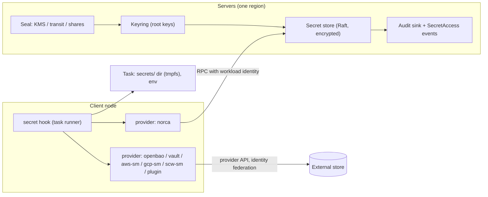

# Embedded secret storage with external providers – plan

**Status:** Planned · 2026-10-25 · Starting point: Nomad v1.6.5 (MPL 2.0) and the Norca features built on it (Variables, keyring, workload identities, backup) · Related documents: [nomad-fork-development-plan.md](nomad-fork-development-plan.md), [backup-restore-plan.md](backup-restore-plan.md), [consul-independence-plan.md](consul-independence-plan.md), [package-management-plan.md](package-management-plan.md)

Norca gets a built-in secret store, so that a cluster can keep and hand out passwords, API keys and certificates without running a separate secret server. The same delivery path to tasks also works with an **external provider**: OpenBao or Vault, a cloud secret manager, or a third-party plugin. A job says *which* secret it needs and *where* it should appear in the task; whether the value comes from the built-in store or from an external one is a configuration choice that can differ per secret.

## Table of contents

- [Starting point](#starting-point)
- [Goals and non-goals](#goals-and-non-goals)
- [Architecture](#architecture)
- [Key protection (seal)](#key-protection-seal)
- [The built-in store](#the-built-in-store)
- [Delivery to tasks](#delivery-to-tasks)
- [External providers](#external-providers)
- [Permissions](#permissions)
- [Audit](#audit)
- [Rotation and dynamic secrets](#rotation-and-dynamic-secrets)
- [Multi-region operation](#multi-region-operation)
- [Backup and restore](#backup-and-restore)
- [API, CLI and UI](#api-cli-and-ui)
- [Migration](#migration)
- [Implementation and schedule](#implementation-and-schedule)
- [Testing and acceptance](#testing-and-acceptance)
- [Risks](#risks)
- [License](#license)
- [Open questions](#open-questions)

## Starting point

| Item | Today | Location |
| --- | --- | --- |
| Variables | Encrypted key/value entries in Raft (AES-256-GCM with the active root key), at most 64 KiB per entry, ACL by path, admission policies on writes, `Variables` event topic | `nomad/variables_endpoint.go`, `nomad/structs/variables.go` |
| Access from tasks | A task's workload identity can read `nomad/jobs`, `nomad/jobs/<job>`, `.../<group>` and `.../<task>` in its namespace without extra policies; templates read them with `nomadVar` | `nomad/variables_endpoint.go`, `client/allocrunner/taskrunner/template/` |
| Keyring | Root keys in the `root_key_meta` table; the key material is on every server's disk in `keystore/`, wrapped with a key-encrypting key that sits **in the same file** (the code itself calls this "security theatre … a shim for external KMS providers in the future") | `nomad/encrypter.go` (`saveKeyToStore`, `newKMSWrapper`) |
| Vault integration | Server-derived Vault tokens (`vault` block of the agent and the task), `secret` template function; Vault itself is BSL 1.1 since 1.15 and is not shipped by Norca | `nomad/vault.go`, `client/vaultclient/` |
| Secrets in packs | `secret_items` of Variables resources are applied but never stored in the release | `nomad/pack/docs/releases.md` |
| Other key material in Raft | The native mTLS CA key, encrypted with the root key | `nomad/mtls*.go` |
| Backups | Raft snapshot plus the keystore, encrypted with `kms` or `age` | `nomad/backup/` |
| Libraries already in the module | `go-kms-wrapping/v2` (MPL 2.0), `vault/api` (MPL 2.0) | `go.mod` |

Variables are therefore already an encrypted, replicated, access-controlled store. What is missing for real secret management:

1. **The keys are not protected.** Whoever reads a server's disk can decrypt every Variable, every backup made with the cluster's own keys, and the mTLS CA key.
2. **No secret lifecycle:** no versions, no expiry or rotation, no audit of who read a value.
3. **Delivery is template-only:** there is no declarative way to say "put this secret into this file or environment variable", and nothing that works the same way for an external store.
4. **External stores are Vault-only**, with the old token-derivation flow, and Vault itself is no longer open source.

## Goals and non-goals

**Goals**

- Secrets at rest are protected by a key that is **not** on the servers' disks in usable form (cloud KMS, an OpenBao/Vault transit key, or operator-held unseal shares).
- A first-class secret object with versions, metadata, expiry and rotation reminders, separate from configuration Variables, with value redaction everywhere (API listings, events, logs, UI, backups browsing).
- One declarative `secret` block in the jobspec that delivers values as files or environment variables, re-delivers them on change, and works identically for the built-in store and for external providers.
- A **provider interface** with built-in providers (the embedded store, OpenBao/Vault, the cloud secret managers of the supported clouds) and external plugins over the same gRPC plugin mechanism as the autoscaler's external plugins.
- Workload identity as the only credential a task needs; no long-lived tokens in jobspecs or on clients where the provider supports identity federation.
- An audit trail of every value read and write.

**Non-goals (for this plan)**

- Replacing a full Vault/OpenBao: no generic secret-engine marketplace, no SSH CA, no general PKI engine beyond the existing mTLS CA, no transit encryption-as-a-service API in the first phases.
- Secrets larger than the Raft entry budget (the built-in store keeps the 64 KiB limit per secret).
- Storing secrets of external providers in Raft: external values are fetched by the client and never written to the servers.

## Architecture



- **Servers** own the seal, the keyring and the built-in store. Values are encrypted with the active root key (as Variables are); the root keys are wrapped by the seal.
- **Clients** run a `secret` task-runner hook. For each `secret` block it picks the provider, authenticates with the task's workload identity, fetches the value, writes it into the task's `secrets/` directory or environment, and watches for changes.
- **Providers** are one interface; `norca` is the built-in one. External providers are either compiled in (OpenBao/Vault and the cloud secret managers) or loaded as plugins.

## Key protection (seal)

A new `keyring` block in the server configuration replaces the key-encrypting key stored next to the key:

```hcl
server {
  keyring {
    seal "awskms" {            # or gcpckms, scwkms, transit, shares, aead (legacy)
      region     = "eu-central-1"
      kms_key_id = "alias/norca-keyring"
    }
    # optional second seal: keys are wrapped by both, either can unwrap
    seal "shares" {
      threshold = 3
      shares    = 5
    }
  }
}
```

| Seal | Wraps the root keys with | Unseal at server start | Fits |
| --- | --- | --- | --- |
| `awskms` | AWS KMS key (server role needs `Encrypt`/`Decrypt` only) | Automatic | AWS regions |
| `gcpckms` | Google Cloud KMS key | Automatic | GCP regions |
| `scwkms` | Scaleway Key Manager key | Automatic | Scaleway regions |
| `transit` | An OpenBao/Vault transit key | Automatic while the transit server is reachable | Any cloud with an existing OpenBao/Vault |
| `shares` | A random unseal key split into Shamir shares held by operators | Manual: `norca operator unseal` with `threshold` shares | Hetzner (no managed KMS), bare metal, highest protection |
| `aead` | Today's behaviour (key next to the key) | Automatic | Development and migration only; the agent warns |

- Hetzner Cloud has no managed KMS; Hetzner regions use `transit` (an OpenBao in another region or on dedicated hosts) or `shares`.
- **Sealed state:** a server whose keys cannot be unwrapped joins Raft and serves everything that needs no decryption, but rejects secret and Variable reads, workload-identity signing and mTLS issuance with a clear `sealed` error until unsealed. `norca operator seal-status` shows it per server.
- **Seal migration** (`norca operator keyring rewrap -to <seal>`) re-wraps all root keys online; both seals stay valid until the rewrap finishes on every server.
- The existing `Keyring.Restore` and full restore of the backup plan work on wrapped keys: restoring into a cluster requires access to the seal that wrapped them (or the `age` backup copy, see below).

## The built-in store

**Object:** `Secret`, namespace-scoped, stored in a new Raft table `secrets` (not in the `variables` table), encrypted with the keyring exactly like Variables.

| Field | Meaning |
| --- | --- |
| `path` | Hierarchical name, e.g. `prod/db/postgres` |
| `items` | Key/value pairs (the value), at most 64 KiB in total |
| `version` | Monotonic; the last `max_versions` (default 10) are kept, older ones destroyed |
| `metadata` | Free labels, `owner`, `description` – never secret, always visible to readers of metadata |
| `expires_at`, `rotate_every` | Optional; drive warnings, events and the rotation hook |
| `deleted` | Soft delete with `undelete` until the version is destroyed |

- **Why not just Variables:** Variables are widely used for non-secret configuration, are readable by default by every task of a job, and have no versions or audit. Keeping both lets Variables stay simple and compatible while secrets get stricter defaults (no implicit task access, value redaction, audit). A Variable item can still be marked secret by moving it.
- **Values never leave the servers except** through an explicit value read (API/CLI with `read-value`, or the client `secret` hook). Listings, events, the event stream, backup browsing, release drift and the UI only ever show metadata and a value hash.
- **Size and load:** secret writes are rare; reads by clients use blocking queries on metadata and fetch the value only when the version changes.

## Delivery to tasks

```hcl
task "api" {
  secret "db" {
    provider = "norca"            # default; or a configured external provider name
    path     = "prod/db/postgres" # provider-specific path
    version  = 0                  # 0 = latest

    file {
      destination = "secrets/db.env"   # always below secrets/ (tmpfs, 0400)
      format      = "env"              # env | json | raw:<item> | template
    }
    env {                              # optional, items to environment variables
      DB_USER     = "username"
      DB_PASSWORD = "password"
    }

    change_mode   = "restart"          # restart | signal | script | noop
    change_signal = "SIGHUP"
  }
}
```

- The hook runs before the task starts (`prestart`) and blocks the start until every required secret is delivered (`optional = true` makes a secret non-blocking).
- Files are written atomically into `secrets/` (tmpfs on Linux where available) with mode 0400 and the task's user as owner; `env` values go only into the task's environment, never into the allocation API or logs.
- A **template function** `{{ secret "norca:prod/db/postgres" }}` gives the same data to templates; the existing Vault `secret` function keeps working for `vault` providers.
- Values are never written into the job spec, the allocation, client state on disk, or task events. Restarted clients fetch them again.
- Jobs reference secrets by path; admission policies (CEL) can restrict which paths a namespace may reference.

## External providers

**Configuration** on clients (and servers, for providers used by server-side features):

```hcl
secrets {
  provider "bao" {
    type    = "openbao"            # Vault-compatible API: openbao | vault
    address = "https://bao.internal:8200"
    auth "jwt" { role = "norca-workloads" }   # login with the task's workload identity
  }
  provider "aws" {
    type   = "aws-secretsmanager"
    region = "eu-central-1"
    auth "web-identity" { role_arn = "arn:aws:iam::123:role/norca-tasks" }
  }
  provider "gcp"  { type = "gcp-secretmanager"      project = "acme-prod" }
  provider "scw"  { type = "scaleway-secretmanager" region  = "fr-par" }
  provider "corp" { type = "plugin" plugin = "corp-secrets" }   # external plugin binary
}
```

| Provider type | Backend | Authentication of the task | Notes |
| --- | --- | --- | --- |
| `norca` | Built-in store | Workload identity, server RPC | Always available |
| `openbao`, `vault` | OpenBao or Vault KV v2 (also dynamic secrets engines, read as leases) | JWT auth with the workload identity (no Vault token in the job) | The legacy `vault` block keeps working unchanged |
| `aws-secretsmanager` | AWS Secrets Manager | STS `AssumeRoleWithWebIdentity` with the workload identity, or the node's instance role | |
| `gcp-secretmanager` | Google Secret Manager | Workload Identity Federation with the workload identity, or the node's service account | |
| `scaleway-secretmanager` | Scaleway Secret Manager | API key from the client configuration (no identity federation) | |
| `plugin` | Anything | The plugin receives the workload identity token | go-plugin over gRPC, same packaging as the autoscaler's external plugins |

- **Plugin interface** (gRPC): `Configure`, `Fetch(path, version, identity) → items, version, lease`, `Renew(lease)`, `Revoke(lease)`, `Capabilities()`. A plugin can be written without importing Norca's server code (a small SDK in the api module, like the controller SDK).
- **Identity federation** needs the cluster's public OIDC discovery document and JWKS so that cloud IAM and OpenBao can verify workload identity tokens; Nomad 1.6.5 has neither endpoint, so the plan adds `/.well-known/openid-configuration` and `/.well-known/jwks.json` with a configurable issuer and audiences per provider.
- **Cloud SDKs** (Hetzner, Scaleway, AWS, GCP are the supported clouds) are the same official SDKs used by the LoadBalancer providers and the autoscaler's cloud targets, so they are shared dependencies, not one copy per feature. Hetzner has no secret manager; its regions use `norca` or `openbao`.
- **Fallback and caching:** a client caches values only in memory for running tasks; if a provider is unreachable, running tasks keep their delivered files, new tasks wait (with an event) until `timeout`, then fail.

## Permissions

New namespace capabilities for the built-in store, none of them included in the `read`/`write` shorthands:

| Capability | Allows |
| --- | --- |
| `list-secrets` | Paths and metadata |
| `read-secret` | Values (also needed for the `secret` hook through workload identities) |
| `write-secret` | Create, update, soft delete, undelete |
| `destroy-secret` | Destroy versions permanently |

- Path restrictions use the same glob rules as Variables (`secret "prod/db/*" { capabilities = [...] }` inside a namespace rule).
- **No implicit task access:** unlike Variables, a task can read a secret only if a policy bound to the job (`job_acl`) or a workload-identity binding grants `read-secret` on the path. A shorthand binding `secret_access { path = "jobs/${job}/*" }` keeps the common case short.
- Seal operations (`unseal`, `rewrap`, seal status) need `operator:write`.

## Audit

- Every value read and every write produces an audit record: time, region, namespace, path, version, operation, accessor (token accessor or workload identity: job, group, task, allocation), client node, result. Never the value.
- Records go to a new event stream topic `SecretAccess` (subscribers need `operator:read`) and, optionally, to an append-only audit file sink on each server (`secrets { audit_file = "/var/log/norca/secrets-audit.log" }`) with rotation. The NATS bridge can forward the topic like any other.
- External providers keep their own audit; the client additionally emits a `SecretAccess` record with `provider = <name>` for every fetch it performs.

## Rotation and dynamic secrets

- **Rotation reminders:** `rotate_every` and `expires_at` produce `SecretExpiring`/`SecretExpired` events and metrics; nothing is rotated automatically for static secrets.
- **Rotation hooks:** a secret can name a rotation job (`rotate { job = "rotate-db-password" }`), dispatched as a parameterized job with the secret path; the job writes the new version and the `secret` hooks of consuming tasks re-deliver it (`change_mode`).
- **Dynamic secrets** (database users, cloud credentials created on demand with a lease) come only from external providers in the first phases (OpenBao/Vault database and cloud engines). A built-in dynamic engine is a later, optional phase.

## Multi-region operation

- Secrets are **region-local** by default; each region has its own keyring and seal (one cloud per region, so each region uses its own cloud's KMS).
- **Replicated paths:** paths marked `replicate = true` in the authoritative region are copied to the other regions by their leaders (like ACL policies), decrypted and re-encrypted with each region's own keyring over the existing mTLS region RPC. A replicated secret is read-only outside the authoritative region.
- A task in region B never fetches secrets from region A directly.

## Backup and restore

- Secrets are part of the Raft snapshot (encrypted); the backup subsystem needs no new content type.
- With a KMS or transit seal, the keystore in the backup holds **wrapped** keys; restoring into a new cluster requires access to the same KMS key or transit key. The `age` copy of the backup plan remains the disaster-recovery path that needs nothing from the cloud.
- With the `shares` seal, a restore requires the unseal shares; the backup manifest records which seal wrapped the keys.
- Backup browsing and the selective restore show secret paths and metadata, never values; restoring a secret restores its versions.

## API, CLI and UI

| Operation | HTTP | CLI |
| --- | --- | --- |
| List | `GET /v1/secrets?prefix=` | `norca secret list [prefix]` |
| Metadata | `GET /v1/secret/:path?metadata` | `norca secret info <path>` |
| Read value | `GET /v1/secret/:path?version=` | `norca secret get <path> [-version n] [-item k]` |
| Write | `PUT /v1/secret/:path` (check-and-set index) | `norca secret put <path> k=v k=@file` |
| Delete, undelete, destroy | `DELETE /v1/secret/:path`, `POST …/undelete`, `POST …/destroy?versions=` | `norca secret delete/undelete/destroy` |
| Seal status, unseal, rewrap | `GET /v1/operator/seal`, `POST /v1/operator/unseal`, `POST /v1/operator/keyring/rewrap` | `norca operator seal-status/unseal`, `norca operator keyring rewrap` |
| Providers on a client | `GET /v1/client/secrets/providers` | `norca node secrets-providers` |

- `norca secret put` never takes values as plain arguments in shell history when `-` or `@file` is used, and refuses to print values unless `-item`/`-format` is given explicitly.
- **UI:** a "Secrets" page per namespace (paths, versions, metadata, expiry, last access from the audit, which jobs reference a path); values are revealed only on explicit click with `read-secret`, and the reveal is audited. Seal status on the cluster overview.
- **Packs:** `secret_items` of the package plan become `Secret` resources (with `replicate`, `rotate_every`), still never stored in the release.

## Migration

- **Variables → secrets:** `norca secret import -from-variable <path>` moves (or copies) a Variable into the store; a deprecation warning can be enabled for Variables items that look secret (same heuristics as the pack release redaction).
- **Vault templates:** jobs using `vault {}` and `{{ with secret "kv/data/..." }}` keep working; switching a job to an `openbao`/`vault` provider with JWT auth removes the need for server-derived Vault tokens. The old token flow is kept for compatibility and documented as legacy.
- **Keyring:** clusters start with `aead` (today's behaviour) until a `keyring { seal … }` block is added; `norca operator keyring rewrap` then moves to the new seal online.

## Implementation and schedule

| Phase | Content | Main code locations |
| --- | --- | --- |
| 1. Seal | `keyring { seal }` with `awskms`, `gcpckms`, `scwkms`, `transit`, `shares`, `aead`; sealed state; unseal, seal status, rewrap; backup manifest records the seal | `nomad/encrypter.go`, new `nomad/seal/`, `command/operator_unseal.go`, `nomad/backup/` |
| 2. Built-in store | `Secret` object, Raft table, versions, soft delete, ACL capabilities, redaction, `SecretAccess` events, audit file sink, API, CLI | new `nomad/secrets_endpoint.go`, `nomad/structs/secrets.go`, `nomad/state/state_store_secrets.go`, `acl/policy.go`, `api/secrets.go`, `command/secret_*.go` |
| 3. Delivery | `secret` jobspec block, task-runner hook, `secret` template function, change modes, admission on referenced paths | `jobspec2`, `nomad/structs`, `client/allocrunner/taskrunner/secret_hook.go`, `client/secrets/` |
| 4. External providers | Provider interface, `openbao`/`vault` (JWT), `aws-secretsmanager`, `gcp-secretmanager`, `scaleway-secretmanager`, plugin mechanism and SDK, OIDC discovery/JWKS | `client/secrets/providers/`, `api/secretsplugin/`, `command/agent/` |
| 5. Lifecycle | Expiry and rotation events, rotation jobs, replicated paths, UI page | `nomad/secrets_watcher.go`, `nomad/leader.go`, `ui/` |
| 6. (optional) Built-in dynamic secrets | Lease-based database and cloud credentials | later decision |

Phases 1 and 2 are independent of each other and can run in parallel; phase 3 needs 2; phase 4 needs 3 (except the OIDC discovery part, which can start at any time).

## Testing and acceptance

- With `awskms`/`gcpckms`/`scwkms`/`transit`, the keystore files contain no usable key material: copying a server's data directory to another machine does not allow decrypting any Variable, secret or backup.
- With `shares`, a restarted server stays sealed (serving Raft but rejecting decryption) until `threshold` shares are entered; fewer shares do not unseal.
- `rewrap` from `aead` to a KMS seal runs online under write load without failed reads.
- A secret's value never appears in: list responses, the event stream, server or client logs, task events, the allocation API, the job spec, release revisions, backup browsing (tests grep all of these for a canary value).
- A task without a policy granting `read-secret` cannot start if it requires the secret, and the denial is in the audit trail.
- Updating a secret re-delivers it to running tasks according to `change_mode` within 10 seconds.
- The same job with `provider = "norca"` and with `provider = "bao"` (OpenBao test server, JWT auth with the workload identity) yields the same files and environment.
- Each cloud secret-manager provider is tested against the provider's API (integration tests gated on credentials; contract tests with recorded responses in CI).
- A replicated path written in the authoritative region appears in the other regions, re-encrypted, within the replication interval.

## Risks

| Risk | Mitigation |
| --- | --- |
| A KMS outage blocks server restarts (sealed servers) | Running servers keep their unwrapped keys in memory; a second seal (`shares` or another KMS) can be configured; seal status in metrics and alerts |
| Lost unseal shares or a deleted KMS key make all data unrecoverable | Two seals recommended; the `age` backup copy; documented key-deletion protection (KMS deletion windows) |
| Secrets leak through a side channel (logs, events, crash dumps, `env` inspection) | Canary-value tests across all outputs; `file` delivery recommended over `env`; values only in memory on clients |
| Too many secret reads load Raft | Clients watch metadata and fetch values only on version change; reads are served by followers with stale-OK for metadata |
| External provider differences (versions, leases, naming) | Provider capability flags; contract tests per provider; clear errors for unsupported features |
| Confusion between Variables and secrets | Documentation, `secret import`, warnings for secret-looking Variables |

## License

- Everything is built on the Nomad v1.6.5 code (MPL 2.0) with an independent design; no code is taken from Vault or from Nomad/Vault versions under BSL 1.1.
- `hashicorp/go-kms-wrapping/v2` and its `awskms`, `gcpckms` and `transit` wrapper modules are MPL 2.0 (checked 2026-10-25 for awskms v2.0.11, gcpckms v2.0.13, transit v2.0.13; to be re-checked for the versions adopted); the Scaleway Key Manager wrapper is written in Norca on the Scaleway SDK.
- `vault/api` (MPL 2.0) is already a dependency and talks to OpenBao (MPL 2.0) and Vault. Norca never ships Vault; OpenBao is the recommended external server.
- Cloud SDKs: `hcloud-go` (MIT), `scaleway-sdk-go`, `aws-sdk-go-v2`, `google-cloud-go` (Apache 2.0).
- Shamir secret sharing: an own implementation or a library under an allowed license (MPL/Apache/MIT/BSD/ISC); not the BSL-licensed Vault code.

## Open questions

- [ ] Separate `Secret` object next to Variables (proposed), or extend Variables with secret features?
- [ ] Which seals are needed first? Proposed: `awskms`, `gcpckms`, `scwkms` and `shares` (for Hetzner); `transit` with OpenBao next.
- [ ] Which external providers come first? Proposed: OpenBao/Vault with JWT auth, then the AWS, GCP and Scaleway secret managers; the plugin mechanism together with the first provider.
- [ ] Is a built-in dynamic secrets engine needed at all, or are OpenBao's engines enough (proposed: OpenBao's engines)?
- [ ] Should secrets be replicable across regions (proposed: opt-in per path from the authoritative region), or strictly region-local?
- [ ] Is `env` delivery allowed by default, or only `file` delivery unless an admission policy allows `env` (proposed: both allowed, `file` recommended)?
- [ ] Where do audit records go besides the event stream: file sink on servers (proposed), and/or a remote sink (S3, syslog)?
